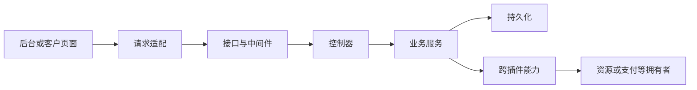

# 项目源码与业务定位地图

记录日期：2026-10-10。源码基线：`c561b8d9`及当时工作区。用途：支持用户后续逐项描述业务和页面问题后的快速定位。

## 阅读范围与证据边界

本轮扫描了`apps/`及`hack/`的可检索文件结构、全部插件清单的身份与类型、服务目录和页面入口，重点阅读了宿主启动、后台路由、客户交易路由，以及下单、支付提交、结清事件分流和资源任务执行的关键代码段。不是逐行读完所有源码，也不是全项目正确性审计。

以下流程描述是当前实现的定位摘要，不替代业务确认、权限规则或正式规范。目录清单表示已定位，不表示该目录全部逻辑已经审查。未运行服务、浏览器、数据库或业务测试，未验证线上状态。

用户本轮要求先建立结构记录，再由用户逐项提出逻辑和页面问题。尚未确认新的收费、状态、权限或产品流程，不根据“很多地方不合理”自行重写业务。

## 工作区与活跃变更

活跃变更有`add-idc-server-operations-platform`、`streamline-agent-context`、`add-plugin-market-docs`、`harden-idc-runtime-delivery`。归档目录不属于活跃变更。

开始时已有`idc-portal`的双语说明、后端测试、品牌页面、双语资源、插件清单、未跟踪页面测试，以及`add-idc-server-operations-platform/tasks.md`修改。本轮保留，未将其纳入审查或修改。

根目录存在`.contributing`。`go.work`直接列出`apps/lina-core`与`hack/tools/linactl`；其他模块的实际构建装配需继续看构建入口，不能据此认定插件没有被引用。

## 顶层职责

| 目录 | 当前定位 |
| --- | --- |
| `apps/lina-core` | 基于`GoFrame v2`的通用宿主，提供用户、角色、菜单、认证、存储、插件运行等能力 |
| `apps/lina-plugins` | 业务插件、通用扩展与外部适配器，当前发现25份插件清单 |
| `apps/lina-vben/apps/web-antd` | 运营管理后台，含宿主页面及插件页面加载入口 |
| `apps/lina-vben/apps/web-customer` | 客户中心，含购买、账户、财务、服务及售后页面 |
| `apps/lina-vben/packages` | 前端共享组件、布局、状态、工具和基础能力 |
| `apps/lina-websites` | 独立官网工作区，含默认站点、模板、契约、打包工具及开发文档 |
| `hack/tools/linactl` | 仓库开发和交付工具入口 |
| `hack/tests` | 跨模块测试、运行脚本和测试支持 |
| `openspec` | 正式能力规范、活跃变更与历史归档 |
| `.agents` | 规则、业务偏好、技能和定位导航 |
| `localdocs` | 本地参考资料，不能自动当作当前实现或业务授权 |

## 启动与请求路径

已核对的启动路径：`apps/lina-core/main.go`加载配置和日志，进入命令树；`internal/cmd/cmd_http.go`委托`internal/cmd/internal/httpstartup/httpstartup.go`启动服务。该入口按顺序创建运行时、执行插件路由前准备、绑定宿主接口、注册源码插件路由、完成后续运行时准备、绑定前端资源和接口文档，最后运行服务器。

宿主插件基础设施在`apps/lina-core/pkg/plugin`。业务源码插件装配重点看对应`backend/plugin.go`及`backend/internal/composition`；动态插件同时看根目录`main.go`、`plugin.yaml`和能力契约，不能假设与源码插件同一装配方式。

`idc-core/backend/plugin.go`存在不同路由组：公开请求、账号激活与入驻、普通客户、管理端。客户链路包含身份、租户、客户访问、初始密码和页面桥接中间件；管理链路包含身份、租户、权限、员工资格和页面桥接。具体接口仍须追踪服务层的数据范围检查，不能只看菜单权限。

## 页面定位规则

运营后台首先检查`apps/lina-vben/apps/web-antd/src/router/access.ts`。当前实现加载后端菜单，过滤租户不可用路由和停用插件，再组织后台菜单；宿主页面由`views`映射，插件沙箱页面由对应布局加载。因此“菜单不见了”和“页面组件出错”需要分别排查。

插件管理页面通常位于`apps/lina-plugins/<插件>/frontend/pages`，菜单和权限入口在其`plugin.yaml`。`idc-portal`当前品牌页的菜单路径为`/idc/portal-brand`，组件声明为`system/plugin/dynamic-page`。插件类型与前端页面加载方式不是同一个分类。

客户中心重点入口：

- 路由：`apps/lina-vben/apps/web-customer/src/router/routes/modules/account.ts`、`customer-service.ts`及`src/router/product-directory-routes.ts`。
- 页面：`apps/lina-vben/apps/web-customer/src/views/account`。
- 请求：`apps/lina-vben/apps/web-customer/src/api/idc`。
- 购买路径包括`/account/products/catalog`、`/account/products/:publicSlug/configure`、`/account/cart`、`/account/orders`。
- 财务路径包括`/account/billing`、`/account/billing/invoices`、`/account/billing/credit`、`/account/refunds`。
- 服务路径包括`/account/servers`和`/account/product-directories`；目录派生路由仍需结合实际菜单检查。
- 同一个`commerce/index.vue`承接购物车和订单，同一个`finance/index.vue`承接多个财务入口，同一个`servers/index.vue`承接列表与详情。改组件时需要检查路由对应的其他模式。

官网与客户中心是两个工作区。`apps/lina-websites/README.zh-CN.md`明确说明`sites/default`是迁移基线，不能仅凭该目录存在认定官网包契约及页面拆分全部完成。

## 核心业务链路与源码证据

| 链路 | 核心位置 | 已核对或待深入的边界 |
| --- | --- | --- |
| 商品与报价 | `idc-core/backend/internal/service/catalog`、`commerce`、`configurationcontract` | 已定位商品、配置、购物车、报价、订单服务；具体价格与库存规则待反馈后深入 |
| 客户下单 | `idc-core/backend/internal/service/commerce/commerce_checkout.go` | 已读账号下单入口：派生当前客户身份，规范化请求，在事务中结账；零金额结果继续调用结清服务 |
| 支付提交 | `idc-payment/backend/internal/service/paymentflow/service.go` | 已读创建及提交入口：先准备支付尝试，在调用渠道前持久化已提交状态；订单、充值、授信还款有不同入口 |
| 支付事实与账本 | `idc-payment/backend/internal/service/paymentattempt`、`idc-core/backend/internal/service/billing` | 已定位渠道尝试、回调处理与账单能力依赖；回调验签、幂等及完整账本事务未逐项审计 |
| 结清后交付 | `idc-core/backend/internal/service/fulfillment/fulfillment_routed_consumer.go` | 已读完整分流：校验事件，优先由附加操作消费者处理，其错误不回退为普通购买；其余交给通用商品履约 |
| 通用商品履约 | `idc-core/backend/internal/service/productfulfillment` | 已定位结清、门禁、取消、资源结果等处理文件，不能将所有商品理解为服务器 |
| 上游资源执行 | `idc-resource/backend/internal/service/resourcetask/resourcetask_executor.go` | 已读执行器接口、构造及批量执行入口；资源任务、写操作、查询观察分开，注入资源解析、供应商构造与健康检查 |
| 退款与续费 | `idc-core/backend/internal/service/billing`、`renewal`，以及支付和资源插件 | 已定位多拥有者边界，退款金额、终止权益、续费结果与失败恢复待具体问题追踪 |
| 实名、合同和发票 | `idc-compliance/backend/internal/service`及`idc-core`的相关能力 | 已建立服务目录索引；未推断实名门禁、合同政策或发票业务结论 |

结清、履约成功、资源创建完成是不同处理环节。后续排查“付了款但没开通”“页面状态不一致”等反馈时，需要核对各环节事实、任务及前端投影，不能先认定只需改显示文字。

## 插件职责索引

以下职责按清单描述与源码目录归纳；适配器可用范围仍以其当前实现和配置为准。

| 插件 | 类型 | 定位职责 |
| --- | --- | --- |
| `content-notice` | `source` | 通知公告与站内投递 |
| `idc-ai` | `source` | 只读运营洞察与辅助草稿 |
| `idc-baota` | `dynamic` | 宝塔面板适配 |
| `idc-channel` | `source` | 下游渠道令牌、商品发布、请求与回调投递 |
| `idc-compliance` | `source` | 实名、电子合同、税务发票及合规网关 |
| `idc-core` | `source` | 客户、通用商品、交易、账本、履约、工单与商家治理 |
| `idc-dcim` | `dynamic` | 服务器管理系统适配 |
| `idc-notify` | `source` | 通知模板、渠道、投递及重试 |
| `idc-payment` | `source` | 支付渠道、支付退款尝试、回调与对账 |
| `idc-payment-alipay` | `dynamic` | 支付宝渠道适配 |
| `idc-payment-epay` | `dynamic` | 易支付渠道适配 |
| `idc-payment-unionpay` | `dynamic` | 银联渠道适配 |
| `idc-payment-wechatpay` | `dynamic` | 微信支付渠道适配 |
| `idc-portal` | `source` | 官网包、品牌与客户中心外部菜单 |
| `idc-resource` | `source` | 资源接口、容量、服务器、资源归属与异步操作 |
| `idc-v10` | `dynamic` | 业务系统V10供应商适配 |
| `idc-zjmf-finance` | `dynamic` | 魔方财务原生供应商适配 |
| `idc-zjmfcloud` | `dynamic` | 魔方公有云供应商适配 |
| `idc-zjmfmigrate` | `dynamic` | 魔方迁移检查适配 |
| `org-core` | `source` | 部门和岗位 |
| `shared-services` | `source` | 人机验证证明和幂等站内消息 |
| `staff-access`（已移除） | 历史记录 | 2026-10-10改为角色授权和组织部门队列，见偏好75 |
| `tenant-core` | `source` | 租户、成员、解析与生命周期 |
| `vben-adapter` | `source` | 插件页面使用通用前端组件的适配契约 |
| `yunsu-ssl` | `dynamic` | 云宿证书签发适配 |

## 数据与验证入口

宿主接口与实现分别在`apps/lina-core/api`、`apps/lina-core/internal/controller`和`apps/lina-core/internal/service`。业务插件通常采用`backend/api`、`backend/internal/controller`、`backend/internal/service`、`backend/internal/dao`和`backend/internal/model`。数据库资源查对应`manifest/sql`，不可仅根据生成模型推断完整数据库约束。

已有验证分布于后端`*_test.go`、前端`*.test.ts`、插件本地`hack/tests`及宿主`hack/tests`。测试文件存在不代表本轮已通过测试。后续只运行匹配改动的验证；页面行为需要真实浏览器检查，数据库生成文件按项目规则生成。

## 后续反馈定位顺序

1. 从用户描述的页面、操作、现象和期望确定入口，先复现并核对当前源码。
2. 顺着页面、请求、接口、服务、数据与异步任务查找实际根因；跨插件时追踪拥有者和能力接口。
3. 使用`.agents/CONTEXT.md`检索对应偏好及完整规范条款，不以本地图替代权威正文。
4. 先报告根因或有证据的假设，再修复。影响收费、权限、状态含义或主要流程且没有现成确认的真实歧义，向用户明确提问。
5. 记录本次修改和验证，完成范围内审查；不自动提交、推送、创建合并请求或归档。

## 服务与页面目录快查

本节为文件系统生成的定位索引，列出各插件的服务子目录及顶层页面，不宣称已阅读每个文件。路径均相对于`apps/lina-plugins/<插件>/`。动态插件没有这些目录时，回到其清单和根入口定位。

### `content-notice`

服务目录：`notice`。

顶层页面：`notice-management.vue`、`notice-modal.vue`、`notice-preview-modal.vue`。

### `idc-ai`

服务目录：`copilot`。

顶层页面：`ai-copilot.vue`。

### `idc-channel`

服务目录：`channel`。

顶层页面：`channel-operations.vue`。

### `idc-compliance`

服务目录：`closureprecheck`、`contractarchive`、`contractautosign`、`contractfailure`、`contractfulfillmentgate`、`contractlifecycle`、`contractsigner`、`cron`、`customer360summary`、`electroniccontractonboarding`、`electroniccontractpreparation`、`electroniccontracttemplate`、`enterpriseverification`、`numberedpage`、`personalverification`、`privacygovernance`、`providerconfig`、`supplierconfig`、`taxinvoicemanagement`、`taxinvoiceredletter`、`taxinvoicerequest`。

顶层页面：`electronic-contract.vue`、`enterprise-verifications.vue`、`privacy-governance.vue`、`provider-configuration.vue`、`red-letter.vue`、`supplier-configurations.vue`、`tax-invoice.vue`。

### `idc-core`

服务目录：`asynctask`、`audit`、`billing`、`catalog`、`catalogdraft`、`closureprecheck`、`commerce`、`commission`、`configurationcontract`、`contenthub`、`contractcompensation`、`contractpolicy`、`contractsnapshot`、`customer`、`customer360summary`、`customeractivation`、`customeraddress`、`customerassistance`、`customerclosure`、`customercontact`、`customerexport`、`customermanagement`、`customerprojection`、`financeops`、`fulfillment`、`identityprojection`、`identityworkflow`、`invoiceprofile`、`lifecycle`、`managementruntime`、`marketing`、`merchantcontext`、`notificationpolicy`、`onboarding`、`operations`、`outbox`、`principal`、`productautomation`、`productautomationtoken`、`productdeliverydirectory`、`productdirectory`、`productfulfillment`、`purchaseconfigurationfile`、`reauth`、`renewal`、`resourceinterfaceprojection`、`saleschannel`、`secret`、`serveroperation`、`serviceaction`、`serviceguard`、`sshkey`、`supportdesk`、`supportupstream`、`taxinvoicesource`、`versioncache`。

顶层页面：`assisted-quotes.vue`、`catalog-automation-interfaces.vue`、`catalog-categories.vue`、`catalog-management.vue`、`commerce-orders.vue`、`content-management.vue`、`customer-management.vue`、`financial-management.vue`、`ip-change-policy.vue`、`marketing-management.vue`、`operations-workbench.vue`、`product-directories.vue`、`product-fulfillment-tasks.vue`、`sales-channel.vue`、`server-operation-security.vue`、`support-desk.vue`、`support-settings.vue`、`system-configuration.vue`。

### `idc-notify`

服务目录：`customer360summary`、`notification`。

顶层页面：`notification-channels.vue`、`notification-deliveries.vue`、`notification-templates.vue`、`wechat-work-binding.vue`。

### `idc-payment`

服务目录：`channelconfig`、`exceptionfund`、`paymentattempt`、`paymentflow`、`reconciliation`。

顶层页面：`payment-channels.vue`、`payment-exception-funds.vue`、`payment-reconciliation.vue`。

### `idc-portal`

服务目录：`brand`、`externalmenu`。

顶层页面：`customer-external-menus.vue`、`portal-brand.vue`。

### `idc-resource`

服务目录：`accessorydirectory`、`batchrenewal`、`channelconfig`、`channelinvocation`、`channelsecret`、`customer360summary`、`interfacecandidate`、`interfaceprojection`、`interfacerevision`、`lifecyclesource`、`managedparameters`、`poolcandidate`、`principalprovision`、`providerauthsession`、`providercapacity`、`providerconfiguration`、`providerhealth`、`providerverification`、`provisionsource`、`renewalsource`、`resourceoverview`、`resourceprojection`、`resourcetask`、`serverdirectory`、`serveroperationsource`、`serverownership`、`serverprojection`。

顶层页面：`provider-capacity-observations.vue`、`provider-configuration.vue`、`provider-health.vue`、`provider-tasks.vue`、`resource-overview.vue`、`server-accessories.vue`、`server-batch-renewal.vue`。

### `idc-zjmfmigrate`

服务目录：`migrate`。

### `org-core`

服务目录：`dept`、`post`。

顶层页面：`dept-drawer.vue`、`dept-management.vue`、`dept-tree-panel.vue`、`post-drawer.vue`、`post-management.vue`。

### `shared-services`

服务目录：`challenge`、`inbox`、`sharedcode`、`sharedsource`、`sharedutil`。

### `staff-access`

已于2026-10-10按用户确认移除。工单权限统一使用角色授权与直属组织部门，不再保留独立员工权限页面、资格服务或成员配置。

### `tenant-core`

服务目录：`impersonate`、`lifecycleprecondition`、`membership`、`provider`、`resolver`、`resolverconfig`、`shared`、`tenant`、`tenantplugin`。

顶层页面：`tenant-management.vue`、`tenant-plugin-management.vue`。
