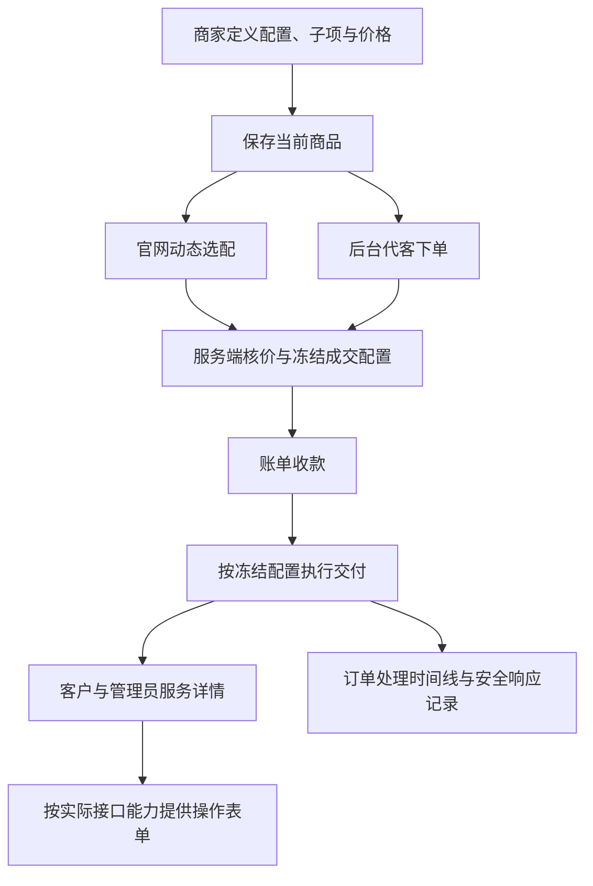

# 魔方财务功能研究与云平台实施设计

## 研究范围与结论

二〇二六年十月二十一日读取[魔方财务使用文档](https://docs.idcsmart.com/docs/财务系统使用文档)及该目录内可达的全部子页面：共一百三十三页，十五个一级专题，正文约十一万二千字符，抓取失败零页。页面清单见[文档覆盖索引](idcsmart-finance-document-map.md)。读取范围包含目录页、操作说明、故障排查、安装与迁移；不是一百三十三个独立功能。六百张左右的图片没有全部逐张审阅，商品配置、阶段价格等关键示例另行检查。外链开发文档与第三方服务最新签约规则不属于此次全量范围。

结论：学习其经营流程和可配置能力，把商品定义、购买、收款、交付及服务操作衔接起来。我们采用自己的插件契约和页面实现，不照搬其数据库、固定商品类型、名称分隔符协议及历史运维方式。当前是设计与源码对照，不能把文档能力、仓库存在对应代码或隔离测试通过，称为全部真实业务验收完成。

## 全功能取舍

| 领域 | 文档提供的有效经验 | 本项目采用方式与顺序 |
| --- | --- | --- |
| 商品组织 | 分组、商品、描述、独立购买链接 | 第一版保留二级分类与商品同页；编辑抽屉直接使用页签；描述无需手写代码 |
| 配置选项 | 参数、控件、子项、顺序、分组、展示名 | 第一版核心重做；一份可售配置供官网、后台代购、订单及服务管理消费 |
| 配置价格 | 按周期报价、安装费、数量及阶段收费 | 与所属配置一起维护；每档能直接看到售价与计价示例，避免反复选择配置维度 |
| 自动化接口 | 连接状态、首次导入、权限及开通时机 | 第一版可见具体连接错误；导入后允许独立编辑，不在每次打开页面等待上游 |
| 供应商代理 | 选择上游商品、同步规格和周期、加价方案 | 与直接管理魔方云明确区分；通过相应连接器提供导入，预览差异后决定本地展示和价格 |
| 手动资源 | 外采设备录入、成本、资源分配与结果交付 | 保留人工交付入口；实际关联资源后才提供受支持的管理操作 |
| 官网与购物车 | 选配、周期、优惠、数量、统一汇总 | 第一版按商品配置渲染；关联选项即时联动，显示周期费用和一次性费用；服务端核价 |
| 订单与开通 | 代客下单、付款后自动处理、手动激活 | 第一版展示付款、交付、服务三个独立结果；异常在订单内直接查看、修正及处理 |
| 账单与流水 | 待付账单、交易明细、余额付款与退款 | 复用资金拥有方；不能靠改状态、删账单或删除付款记录假装完成资金操作 |
| 服务管理 | 详情、配置、上游标识、生命周期与模块命令 | 第一版集中到服务详情；实际动作按连接器能力展示，执行状态与接口错误可追踪 |
| 客户管理 | 客户摘要关联产品、财务、工单、通知和跟进 | 客服查看客户即能进入关联业务；避免同一信息在多处分别维护 |
| 认证与账户 | 实名、手机号邮箱、第三方登录、安全设置 | 沿用现有认证插件；商品可声明已有准入要求，不把某家实名服务写死到商品 |
| 客户折扣 | 客户组、等级及配置项折扣范围 | 沿用已确认代理价和专属价优先级；结算显示实际使用规则，不引入第二套折扣算法 |
| 工单 | 部门、状态、备注、上游传递、评分 | 保留独立工单域，与客户和服务直接关联；上游传递需真实接口，不把本地回复记作上游受理 |
| 续费与升级 | 计费周期、续费、配置变化与费用 | 商品第一版的持续管理范围；沿用已确认的剩余周期补差及不可缩盘规则 |
| 发票与合同 | 申请、模板、产品关联与处理进度 | 保留现有域；在账单和服务中展示入口，外部开票及签章需相应真实渠道 |
| 优惠码 | 适用商品、客户、周期、次数和有效期 | 保留已有能力；价格明细解释优惠来源，具体叠加规则继续按已确认业务处理 |
| 销售与推介 | 客户归属、成交与续费佣金、延迟确认 | 后续运营增强；佣金基于已确认款项与退款事实，不重新解释历史成交 |
| 通知 | 事件、模板、渠道、发送设置与失败日志 | 开通成功、失败、续费和到期通知与事件对应；发送失败不抹掉业务成功结果 |
| 站务与模板 | 官网、会员中心、购买页可替换 | 官网与客户中心保持独立插件；品牌统一，购买入口和登录返回地址由配置连接 |
| 开放接口 | 向下游销售、下游查询与管理服务 | 复用公开交易契约；同系统、魔方财务、业务系统接口分别验收，不声称自动兼容 |
| 权限与日志 | 岗位权限、客户范围、操作与接口记录 | 继续复用现有权限边界；订单和服务页面直接显示相关安全日志 |
| 定时任务 | 自动订单处理、状态同步、通知的健康状态 | 后台展示最近执行及失败；任务可查询、可恢复，不让业务长时间无原因地挂起 |
| 安装升级迁移 | 数据备份、版本匹配、迁移后校验 | 保留现有客户、订单、资金与服务；界面重写不重置数据库，不复制旧系统的文件覆盖流程 |

上述顺序是实施建议，不等于把所有营销、佣金、合同等功能纳入本轮重写。当前首先完成商品至云服务器交付及管理这一连续流程。

## 通用底座与插件能力边界

用户再次确认平台需要销售各类云产品。魔方云用于先验收完整流程，不作为核心数据模型。底座不增加服务器、证书或其他固定商品类型枚举，也不假设所有交付必然生成一台服务器。

| 通用底座负责 | 插件负责 |
| --- | --- |
| 商品资料、可售配置、计价与客户输入 | 字段声明、技术限制、单位转换与真实选项来源 |
| 下单、付款、退款和成交快照 | 原成交配置到上游请求的明确映射 |
| 交付任务、受理结果、进度及异常记录 | 实际创建、查询及业务结果解释 |
| 服务归属、通用详情和操作入口 | 证书验证、域名、存储桶、云资源等专有状态与操作 |
| 通用字段组件和动作提交结果 | 需要专用交互时的独立插件页面 |

例如服务器插件声明镜像、核数及电源操作；证书插件声明域名、验证方法及签发结果；存储插件声明容量、区域及其管理动作。它们复用同一经营与交易流程，不共用一份服务器规格表。续费、升级、重装或文件下载只在实际插件支持时提供，不能从商品名称或页面类型推断能力。

现有`productfulfillmentcap`已区分持续管理、到期归属、续费方式、服务操作与下载声明。后续重写首先核对并使用这些公开边界；不另造一个绕过拥有方的万能动作接口。多插件验收必须包含一种非服务器商品的新增、配置及交付投影，防止只在魔方云上成立。

## 商品编辑的最终操作方式

商品列表继续使用左侧分类、右侧商品。新增时只填名称、分类与交付来源；编辑打开抽屉，保留基本资料、配置与价格、自动开通三个页签。库存、购买条件、合同及附加商品在所属内容内展开，不另开步骤向导。

配置与价格首先展示完整配置清单：名称、展示方式、可售内容、上游对应和操作。点击某一项，直接维护该项的资料、子项与费用。新增项先选择用途：接口参数或普通客户资料；接口参数从所选连接器声明选择，普通资料不发送上游。

子项采用逐行编辑，显示值、名称和周期价格，不要求商家输入`值|中文|英文`文本。地区与镜像支持从已同步目录选入；名称可以改、顺序可以调、可售项可以删选。固定规格就是一条可售记录。数量项提供最小值、最大值、步长和计价方式；阶段价格直接显示范围及该范围费用，并给出可试算的例子。

客户预览使用当前未提交配置，即时展示单选、下拉、数量、滑块及普通资料。商家改变名称、选项或顺序后，不必先保存或打开官网才能知道效果。预览不创建报价、订单或上游请求；未经服务端核价的金额明确属于编辑预览。

保存对当前商品生效。配置与所属价格的最终统一保存应在服务端作为一个事务提交，不能先应用新规格再留下旧价格，也不能以两个依次请求冒充原子保存。已保存配置更改后，旧订单继续使用原成交快照。

## 一份配置，四个使用场景

这里的共用是共用字段语义、取值、校验和展示定义，不代表前后台有相同权限，也不代表实例重装和新购提交完全相同的参数。新购、升级、重装等动作分别声明允许输入；例如格式化数据盘只属于明确支持的重装动作。

### 最小业务模型

| 对象 | 负责的事实 |
| --- | --- |
| 商品 | 名称、说明、分类与销售状态 |
| 可售配置定义 | 分组、稳定字段标识、展示方式、单位、必填、范围、子项及关联条件 |
| 价格规则 | 币种、周期、一次性费用、选项附加费及数量算法 |
| 接口绑定 | 当前接口及已声明参数对应、单位转换、交付策略 |
| 成交快照 | 用户最终所选配置、名称、价格及金额，不随后续编辑变化 |
| 服务与执行 | 上游实例映射、已确认状态、动作任务及安全请求响应 |

这是逻辑划分，不预设必须新建六张表。现有核心已经存在配置、计价、订单快照和履约拥有方，优先保留正确事实和事务边界；确实阻碍统一编辑的数据结构才迁移。不另外建立一个所有页面都可任意读写的万能参数表。

### 关联配置

地区、线路、节点、镜像等必须保留其实际关联。选择地区后只显示适用线路及镜像；改变父项时保留仍有效的已选值，否则重选第一个有效值并更新价格。不能只把全部选项放进几个互不相干的下拉框，也不能仅依靠保存时拒绝不兼容组合。

后台编辑使用同样的关联信息。目录同步失败时显示最后成功时间及具体错误；有合法缓存时仍可编辑本地内容，无合法选项时明确告知缺什么，不长期旋转或静默置灰。商品读取不触发远程全量校验，常用本地读取目标为三秒内可操作。

### 单位与特殊参数

| 内容 | 设计处理 |
| --- | --- |
| 内存 | 客户选择的展示单位与实际接口单位明确转换，避免同一商品两处维护内存 |
| 快照、备份及转发配额 | 不开通、指定数量、不限量分别显示，接口的零值不自动等于免费 |
| 磁盘容量与存储 | 业务表单分别编辑容量、适用系统及存储对应，由连接器编码成所需请求 |
| 性能组合档位 | 每个档位作为完整子项，内部逗号保留；显示读写吞吐与操作次数的含义 |
| 流量周期 | 商家选择自然月或订购日重置，连接器转换到上游实际字段 |
| 节点选择优先级 | 作为接口声明的参数，可固定或允许客户选配，不与配置项显示顺序混淆 |
| 客户自定义资料 | 默认只记录订单及服务；只有显式绑定受支持参数时才参与自动化 |
| 重装格式化 | 只在实际支持的重装表单提供，默认关闭 |

## 通用商品定义与自动化关系

原实现让结构化配置必须依赖自动化绑定，配置表和成交快照进一步强制存在接口修订。现已让商品版本拥有独立商业定义：无接口商品维护普通资料、可售选项及所属价格，经过同一报价、成交冻结和人工交付流程，不创建假接口，不展示服务器专用字段。

`142-generic-offer-configuration.sql`只把接口身份及修订成对改为可选关系，保留存在时的准确外键、已发布事实不可变及配置并发修订约束；人工履约允许携带商业成交快照，同时保持自动履约的完整接口证据要求。没有清空表、重置订单或修改历史金额。隔离库重复迁移和官方代码生成已执行，受影响模型的生成类型没有变化。

人工商品后续选择真实接口时保留已有资料、子项与价格，在同一编辑器补齐真实接口参数，通过保存重新验证之后才用于新的自动化交易。旧订单仍保留原配置及人工交付结果。独立模拟交易已覆盖此方向；已有自动化商品更换不同接口或撤销接口时，跨声明的商业配置保留与重新对应还需独立完成，不宣称所有转换已验收。

## 用户中心与管理员处理

客户首页聚焦服务器、近期订单、待付账单、余额和需要处理的事项。购买仍在官网，已有登录会话复用。服务列表显示名称、地址、状态、到期与主要操作；进入详情能看到配置、费用、监控、操作、账单和工单，不让客户寻找接口、修订或配置维度。

管理员打开同一服务时增加上游对应、成本权限内的信息和执行记录。订单异常处直接显示发生环节、时间、具体安全报错与响应；明确失败可修正上游映射后重开或申请退款，未知结果先由管理员核对确认。不得修改历史金额，也不得因为换了页面就取消重复创建保护。

## 文档中不宜照搬的内容

- 总览提到多币种，货币及账单正文却列出并发币种或人民币限制。不能据此宣称竞品所有版本都具备完整多币种；本项目继续按已有显式币种契约处理。
- 部分页面只有图片或目录，退款说明也有待完善内容。文档不等于接口能力证明，尤其不能据此虚构外部退款成功。
- 配置项名称中混入接口键、`|`和`^`便于旧系统解析，但不应成为新后台操作门槛；稳定标识、展示名称与分组分别存储。
- 魔方云表中`IP_MACBond`标题与参数说明不一致。以真实接口和已核对语义为依据，不能把它直接当作嵌套虚拟化功能。
- 删除账单、直接调整余额、修改产品状态与真正调用上游命令是不同事实。本项目保留清楚的资金及操作记录，不复制通过删记录解决流程问题的做法。
- 文档中关闭防火墙、修改主题源码、放置临时重置脚本等历史排查办法，不转化为我们产品的正常使用步骤。

## 当前源码对照与交付门槛

源码中`idc-core`已承担目录、配置、价格、订单及业务快照；`idc-resource`承担连接与资源；`idc-zjmfcloud`、`idc-zjmf-finance`、`idc-v10`及`idc-peer`分别处理不同上游协议；官网和客户中心有独立模板插件。以上依据对应模块源码与说明，表示职责和现有实现位置，不表示每条业务都已联调完成。

本次已替换商品主编辑流程：配置清单、结构化子项、当前草稿预览及所属价格在同一区域维护，配置与价格通过一次事务保存。复用已核对的参数绑定、服务端计价、资金与成交快照。主编辑器仍承担较多表单状态职责，真实关联联动及增量阶段收费需继续核对和验收，不能因编辑器已替换便宣称全部商品能力完成。

原数量单价按所在档单价乘全部数量；整档模式直接取对应档费用。文档中的“前若干容量免费、超出部分收费”属于增量阶段收费，不能通过改名把原算法当成该能力，也不能重新解释历史价格。后续若增加该模式，应使用独立明确的算法标识、报价及冻结验证。

必须以以下结果验收，而不是以文档或页面存在验收：

1. 商家能从列表新增商品，选择魔方云接口，导入后独立编辑配置、子项和价格，并在当前页面预览。
2. 固定套餐和客户选配各完成一次隔离下单，前后台显示的规格与费用一致，付款后实际发送的接口字段符合冻结配置。
3. 后台、官网及管理员重开读取配置可在目标预算内操作；慢上游、失败与恢复均有真实提示，草稿不丢失。
4. 明确拒绝和未知响应分别显示证据，只有满足处理条件的订单才允许修正后重开或退款。
5. 服务详情展示真实已确认信息，支持的管理动作有结果与错误；第三方只读限制继续有效，不由代理操作现有真实实例验收。
6. 旧订单、资金、商品实际价格和未提交的用户输入均保持其原事实。界面重写不直接改已有商业数据。
