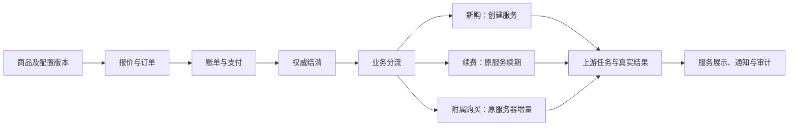

# 魔方财务官方文档：本地阅读总览与业务检查清单

更新日期：`2026-09-04`。来源：[财务系统使用文档](https://docs.idcsmart.com/docs/财务系统使用文档)。

本资料用于以后开发、排错和审查时查漏，不是竞品文档镜像，也不是“所有业务已通过测试”的证明。用户已确认的业务规则优先；文档中的安装命令、付款、删除、改密和关闭安全措施只作为研究资料，没有执行。

## 阅读范围和本地入口

本轮发现该财务目录下`133`个独立页面，包括总览与`15`个分类；链接去重后全部返回`HTTP 200`，没有未取回的正文。逐页记录保存标题、来源、原创摘要和注意点，不复制原文、模板、图片或第三方代码。

| 分类 | 页数 | 阅读笔记 |
| --- | ---: | --- |
| 总览 | 1 | 本文件下方 |
| 客户设置 | 19 | [客户与商品](idcsmart-finance-business-notes.md) |
| 商品设置 | 5 | [客户与商品](idcsmart-finance-business-notes.md) |
| 系统设置 | 4 | [客户与商品](idcsmart-finance-business-notes.md) |
| 上下游接口 | 6 | [客户与商品](idcsmart-finance-business-notes.md) |
| 财务设置 | 9 | [财务与账单](idcsmart-finance-financial-notes.md) |
| 账单系统 | 4 | [财务与账单](idcsmart-finance-financial-notes.md) |
| 工单设置 | 5 | [工单与运营](idcsmart-finance-operations-notes.md) |
| 基础使用教程 | 1 | [工单与运营](idcsmart-finance-operations-notes.md) |
| 可扩展设置 | 4 | [工单与运营](idcsmart-finance-operations-notes.md) |
| 销售管理 | 5 | [工单与运营](idcsmart-finance-operations-notes.md) |
| 运营设置 | 3 | [工单与运营](idcsmart-finance-operations-notes.md) |
| 站务设置 | 6 | [工单与运营](idcsmart-finance-operations-notes.md) |
| 第三方平台对接 | 30 | [接口对接](idcsmart-finance-integration-notes.md) |
| 安装、升级、迁移 | 17 | [部署与专项](idcsmart-finance-deployment-notes.md) |
| 其他 | 14 | [部署与专项](idcsmart-finance-deployment-notes.md) |

完整地址、读取时间、正文长度、图片数量和内容指纹见[页面索引](idcsmart-finance-page-inventory.json)。正文长度包含页面内导航说明，不能拿字数证明业务说明完整。仅在目录名称相似时，不合并不同地址。

### 总览页摘要

[官方总览](https://docs.idcsmart.com/docs/财务系统使用文档)把客户、商品、收款、交付、服务管理、工单及分销连成运营流程。总览只是能力导航，具体版本与子页可能不一致；不能据“支持”两字认定当前插件已实现或可自动开放。

### 必须保留的阅读限制

- `104`页含图片，合计`591`个图片引用，本轮没有逐张完成视觉核实。尤其“充值设置”“主题模板设置”正文缺乏字段解释；单独图片读取失败，随后浏览器页面虽已打开但查看连续超时，不能猜测截图里的开关、默认值或校验边界。
- 部分目录只列功能名，没有对应独立子页，例如信用额细则；退款汇总正文不完整。缺少规则不等于功能不存在，也不能由代理自行补规则。
- 正文混有旧版本、旧官网链接、截图及上一篇／下一篇的摘要。页面相邻文字不是该页独立规则；术语错误和明显模板化段落已经标注。
- 覆盖的是本次能从财务目录发现的子页面，不包含未链接的隐藏页面，也不扩展为全站其他版本、论坛、应用商城和第三方接口文档。分类外链接保留线索，后续实现对应能力时定向补查。
- 本轮未用这些参考说明向真实服务器发命令、进行收付款或测试现有客户数据。没有核实的项目业务，以下一律记录为待回归，而不是通过。

## 核心业务关系

这张图是本项目现有业务边界的检查视图，不是把竞品实现复制过来。订单、账单、资金、服务和上游任务各有自己的状态；任意一层“成功”都不能替代其余层的权威结果。

## 已发现的重要差异

| 参考中的行为或表述 | 本项目处理边界 |
| --- | --- |
| 注销客户可删除关联订单账单，流水可直接编辑 | 保留账务及审计历史，不能通过改列表数据制造收款或抹掉交易 |
| 货币总览与细则对多币种描述不一致 | 遵循已确认的逐币种账户与显式定价，不靠汇率临时补价 |
| 降级可退余额；多个产品退款按首项提成扣减 | 不照搬；按本项目变配、退款和冻结归因规则处理 |
| 销售归属或比例变更后实时重算历史提成 | 不覆盖历史冻结证据，退款与冲回要有独立依据 |
| 个人、企业认证可由多种插件组合 | 仍先姓名及身份证实名，再企业认证；具体提供者与审核证据不可混用 |
| 机柜、独服、云主机共用部分管理入口 | 能力按类型与连接器声明展示，机柜不能出现无效重装或控制台操作 |
| 接口连通、保存成功、支付回跳都呈现成功界面 | 分别核对配置验证、权威到账、结清与上游终态，不能互相替代 |
| 默认加价比例、自动同步售价、导入后直接出售 | 用户已确认仅导入草稿、人工发布，支持按上游加价或填写最终售价；加价没有竞品默认值，不自动同步改价 |
| 魔方云允许自然月或订购日重置流量 | 当前实例没有可靠重置日期时，必须显示已确认提示；不能自己推算 |
| 旧版建议关防火墙、赋超级管理员、卸载重装 | 仅作旧故障线索，不作为本项目自动执行方案 |

对应来源均在上述逐页笔记中，特别参见[财务差异](idcsmart-finance-financial-notes.md)、[销售及运营](idcsmart-finance-operations-notes.md)和[接口边界](idcsmart-finance-integration-notes.md)。

## 业务回归检查清单

下面是从文档与本项目规则整理的验收索引，不是新增业务决策。尚有歧义的收费、状态、资格或权限，必须先查用户已确认规则，仍不能确定时再询问。每个检查项只有附上当前版本的自动化或真实操作证据后才可勾选。

### 客户与权限

- [ ] `C01`：客户列表、详情、订单、资金、服务器、工单和通知按同一目标身份及数据范围查询，替换编号不能查看他人数据。
- [ ] `C02`：个人实名与企业认证分开记录；未通过个人实名不能绕到企业认证，失败、取消和待审状态不能显示通过。
- [ ] `C03`：修改联系方式、停用账号、重置密码和注销不互相冒用；停用后的会话和敏感操作按现有规则处理。
- [ ] `C04`：完整模拟登录保留实际员工与目标客户双身份、十五分钟期限和单次交接；业务自身门禁仍生效。
- [ ] `C05`：客户备注与跟进仅按既有可见范围展示，状态使用可读中文；模态框可反复打开，黑名单提交不等于已审批。
- [ ] `C06`：销售个人范围、未分配客户和部门工单范围各自校验，不因显示同一客户摘要而扩大权限。

### 商品与供应商

- [ ] `P01`：商品区分连接器类型及具体接口实例；已保存、连接验证、启用和可售是不同条件。
- [ ] `P02`：导入商品前逐项校验地区、系统、处理器、内存、磁盘、带宽和地址配置；单位、必选、枚举、上下限和默认值按提供者契约解析。
- [ ] `P03`：支持浏览完整上游商品集合但分页有界；断页、重复商品、失效配置及并发导入不会产生重复商品。
- [ ] `P04`：商品导入遵守已确认的草稿、人工发布与定价规则；无法识别配置时列出缺项并生成待补齐草稿，补齐且通过校验后才可发布；已下单的价格、接口及配置快照不随上游同步改变。
- [ ] `P05`：接口详情“已激活／总量”统计本地服务器实例，“已设置”统计绑定商品，不能把三种数量混算。
- [ ] `P06`：云主机、独服、机柜和手动资源只展示真实支持能力；库存、空闲服务器、地址和上游余额不足时不假报开通成功。

### 财务与交付

- [ ] `F01`：报价、订单项、账单、币种和支付金额保持一致，税额只在已确认总价内拆分，不重复加税。
- [ ] `F02`：支付回调验签并核对商户、金额、币种及对象；重复、乱序、迟到回调不重复入账。
- [ ] `F03`：余额充值与使用余额付款分别记账，不重复统计收入或提成；同时付款不超扣。
- [ ] `F04`：未付款、部分付款、未结清与结果未知不得进入交付；返回收银台成功页面不等于账单已结清。
- [ ] `F05`：新购、续费、变配和附属购买分流准确，不能因库存标记共用而把流量包订单开成新服务器。
- [ ] `F06`：退款按照原资金来源和已确认同意流程执行，部分退款、组合支付与冲回不改写历史交易。
- [ ] `F07`：信用额度、可用额度、应还和余额分开；并发占用及释放由财务拥有方维护，不能由列表直接改金额。
- [ ] `F08`：合同准备失败不阻断无需合同的普通个人订单；电子签、发票申请、审核、实际签署或开具不得合并成一个成功状态。
- [ ] `F09`：报表按明确时区、日期、币种和真实资金事实聚合，待付订单不计实收，未知成本不当成零。
- [ ] `F10`：业务取消或逻辑删除保留订单、流水、快照、原始归属和审计；恢复不能重复收款或执行任务。

### 流量包与自动化任务

- [ ] `A01`：只展示适用当前商品与服务器能力的已发布固定容量套餐，报价冻结容量、一次性总价、币种和原服务器。
- [ ] `A02`：未知具体重置时间时，购买前显示“有效期按上游重置规则执行，暂未提供具体到期时间”；缓存、报价和服务器到期不能替代套餐有效期。
- [ ] `A03`：真实结清后只给原服务器追加一次；重复结清事件、进程重启和事务回滚不会多加流量，也不自动开机或解除暂停。
- [ ] `A04`：上游超时或响应歧义仅查询核对，不自动重放写入；真实任务终态与本地状态一致后才展示完成。
- [ ] `A05`：运行、关机及流量原因暂停的购买资格按已确认规则判断；无限流量、负数、零值和溢出不得通过增量接口。
- [ ] `A06`：定时任务区分最近开始、完成、失败和积压；一次手工运行成功不能代表长期正常。通知或上游请求不阻塞本地下单事务。

### 工单、通知、营销与界面

- [ ] `O01`：工单部门权限、员工回复、客户回复、关闭和私密备注分别测试；关闭与上游传递完成不是同一事实。
- [ ] `O02`：重叠传递规则、自动回复覆盖、敏感关键字和失败重试有明确规则；私密备注不得透传给客户或上游。
- [ ] `O03`：通知通道安装、配置、验证、模板审核、启用、额度和收件人同意分别检查；发送接受不等于送达。
- [ ] `O04`：推荐佣金与员工提成分别核算；新购、续费、退款、延迟确认和提现不重复计入，已确认反滥用规则不能因导入历史数据跳过。
- [ ] `O05`：后台和客户端使用真实`Vben`表格与搜索，灰色表头、其他表格区域白色，分页总数与筛选及权限一致。
- [ ] `O06`：表格不被侧栏遮挡、不无限增高，固定操作列和数字分页可见；移动端菜单默认关闭且跳转后收回。
- [ ] `O07`：公告、工单和配置抽屉具备清楚的按钮、表单边框、加载与失败反馈，可连续打开，保存操作区始终可见。
- [ ] `O08`：插件重启保留安装状态和配置；停用新入口不破坏已有订单、异步回执和审计；迁移前后按币种及对象核对而非只比总行数。

## 已有缺口与后续顺序

本轮源码调查发现的确定问题与参考清单分开记录，详情见[第二十九阶段记录](../openspec/changes/add-idc-server-operations-platform/phase-29-server-interface-feedback.md)。

1. `FB-112`：真实客户云服务器页被页面桥拒绝，已复现，尚未验收修复。
2. `FB-114`：付费附属订单缺少财务所需库存快照，结清消费者又没有原服务器附属分流；[局部补丁](../openspec/changes/add-idc-server-operations-platform/phase-29-accessory-settlement-validation.md)已通过隔离数据库的客户结账、余额付款、结清及原服务器唯一执行链，未部署或调用真实上游，不代表完整功能已可用。没有把人工确认改成新购可用库存。
3. `FB-113`：接口实例统计已完成；导入的草稿发布、分类、名称、地址标识、定价和未识别配置缺项处理规则已确认，只读目录与导入实现继续推进。
4. `FB-114`：固定流量套餐、适用商品、未知日期提示、总可售库存、下单占用和关闭释放、下架保留历史已确认并完成本地验证；真实上游写入不属于该本地验证结论。
5. `FB-110`：全站完整数字分页仍有未完成清单，旧的局部浏览器通过不能替代全量验收。

先处理入口与交易执行断链，再完成已确认的流量包及商品导入细节，最后按本清单逐模块补齐当前版本证据。未通过项不打勾，不把官方截图当成我们系统的验收结果。

## 后续维护

修改某项业务前，先读取[用户规则](../.agents/rules/user-preferences.md)、对应活跃规范，再查本地分类摘要及官方原页。正式对接时追加准确供应商版本、请求响应契约、异常状态和测试证据；未确认差异不得直接变成默认行为。

如需更新资料，只重新核对相关页面并比较内容指纹；保持来源、访问日期、文字读取与图片核实分别可追溯。这里没有安装任何监控或定时抓取任务。
