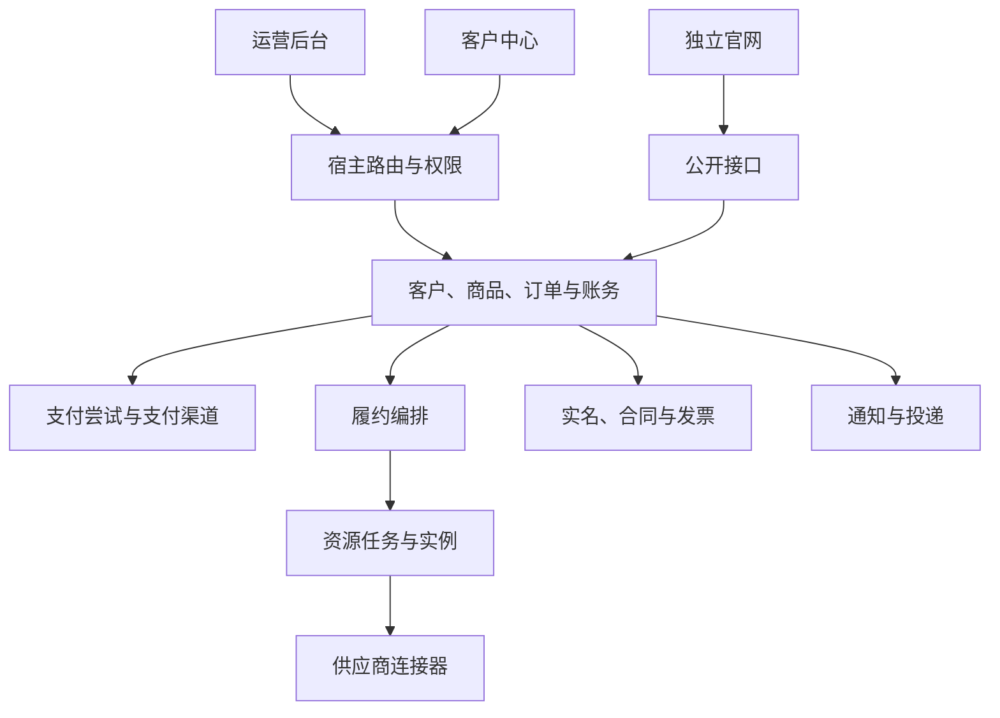

# 项目源码与业务定位地图

记录日期：2026-10-10。源码基线：`c561b8d9`及当时工作区。用途：后续用户逐项反馈业务和页面问题时，快速找到相关实现。本文是源码观察记录，不替代业务偏好、正式规范或当前代码。

## 读取范围与可信度

- 已扫描主要应用与全部25个插件的源码文件清单、插件声明、服务目录和页面入口；附录记录可继续定位的目录。
- 已阅读宿主启动编排、后台权限路由及插件页面注册、客户中心账户路由、官网商品请求实现，以及结账事务、支付提交和资源任务状态机的关键源码。
- 其他领域目前只完成职责和文件定位，没有逐文件读完全部实现。未做全项目缺陷审计，未运行服务、浏览器、数据库查询或业务测试，不能据此认定已有流程正确。
- 用户当前判断是“很多业务与页面不合理”，尚未提供具体错误及期望。不能把现有实现当作用户认可的业务规则，也不预先改变收费、权限、数据归属或主要流程。

## 总体结构

| 位置 | 当前职责 |
| --- | --- |
| `apps/lina-core` | `GoFrame v2`宿主，认证、角色、菜单、会话、数据范围、文件、定时任务及插件运行时 |
| `apps/lina-vben/apps/web-antd` | 运营后台，`Vue`、`Vben`和`Ant Design Vue`，装配宿主页面和插件页面 |
| `apps/lina-vben/apps/web-customer` | 客户中心，账户、购买、订单、账务、服务、合规与客服页面 |
| `apps/lina-vben/packages` | 前端基础组件、布局、请求、状态和权限等共享实现 |
| `apps/lina-plugins` | 业务及通用能力插件，各自声明菜单、接口、资源和依赖 |
| `apps/lina-websites` | 独立官网工作区，默认站点、站点模板、协议、开发包和打包工具 |
| `hack`、`Makefile` | 构建、生成、启动、测试和交付工具；`linactl`位于`hack/tools/linactl` |
| `openspec` | 当前规范、活跃变更和历史归档 |
| `.agents` | 规则、业务偏好、技能与上下文导航 |

根目录`go.work`当前显式列出宿主与`linactl`两个模块；插件另外有各自的`go.mod`，不能仅凭根工作区清单判断插件是否存在或已装配。当前存在`.contributing`。根目录未发现`.gitmodules`，因此不能照搬根说明中的子模块介绍推断本地仓库组织。

图中表示定位关系，并非所有调用的完整依赖图或严格执行顺序。

## 页面如何找到实际业务

### 运营后台

读取入口为`apps/lina-vben/apps/web-antd/src/router/access.ts`：取得后端菜单，按租户与插件状态过滤，组织菜单，再生成可访问路由。菜单显示异常需要同时查菜单来源、过滤逻辑和权限，不能只查页面模板。

`apps/lina-vben/apps/web-antd/src/views/system/plugin/dynamic-page.vue`根据页面所属插件和入口参数，或路由路径，查找注册组件；`apps/lina-vben/apps/web-antd/src/plugins/page-registry.ts`从`virtual:lina-plugin-pages`建立注册表。实际业务页面通常位于对应插件的`frontend/pages`，不一定在宿主`views`目录。

定位顺序：页面地址或菜单文案 → 插件`plugin.yaml`及语言包 → `frontend/pages`页面与请求客户端 → `backend/api`契约 → `backend/internal/controller` → `backend/internal/service`。

### 客户中心

账户页面路由集中在`apps/lina-vben/apps/web-customer/src/router/routes/modules/account.ts`，另有`customer-service.ts`和动态商品目录路由。视图在`src/views/account`，业务请求在`src/api/idc`。

已确认同一个页面文件被多个路由复用：购物车、订单列表和订单详情共用`commerce/index.vue`；财务总览、账单、交易和续费等复用`finance/index.vue`。修改前要核对路由分支，避免修正一个入口时影响其他入口。

| 用户反馈领域 | 客户中心首查位置 | 后端首查插件与服务 |
| --- | --- | --- |
| 商品、配置与购买 | `views/account/products`、`api/idc/purchase-configuration.ts` | `idc-core`的`catalog`、`configurationcontract`、`productautomation` |
| 购物车、报价与订单 | `views/account/commerce`、`api/idc/customer-commerce.ts` | `idc-core`的`commerce` |
| 账单、余额与续费 | `views/account/finance`、`api/idc/customer-finance.ts` | `idc-core`的`billing`、`renewal`、`financeops` |
| 支付与退款 | `api/idc/customer-payments.ts`、`api/idc/customer-refunds.ts` | `idc-payment`及`idc-core`账务服务 |
| 服务分类与服务器 | `views/account/product-directories`、`views/account/servers` | `idc-core`的`productdirectory`、`serveroperation`与`idc-resource` |
| 实名、合同与税务发票 | `api/idc/personal-verification.ts`、`customer-contracts.ts`、`customer-tax-invoices.ts` | `idc-compliance`及`idc-core`相关能力接口 |
| 工单与通知 | `api/idc/support.ts`、`notifications.ts` | `idc-core`的`supportdesk`与`idc-notify` |

表中前端简写均相对于客户中心`src`目录。

### 独立官网

页面位于`apps/lina-websites/sites/default/app/pages`，主要展示组件和公开请求客户端位于`app/components/public`。已读`catalog-client.ts`，商品列表与详情调用`/x/idc-core/api/v1/public/catalog/products`系列接口。官网页面、客户中心页面和后台品牌配置是不同入口，不宜互相当作替代实现。

## 已核对的关键调用逻辑

### 宿主启动与插件装配

`apps/lina-core/main.go`加载配置和日志后执行命令树；`internal/cmd/cmd_http.go`进入`internal/cmd/internal/httpstartup/httpstartup.go`的`Run`。

`Run`依次配置服务器、创建共享运行期服务、准备插件启动上下文、绑定宿主接口、注册源码插件接口、完成后续运行期装配、绑定前端与接口文档，再启动服务器。共享依赖集中在`httpstartup_runtime.go`。业务插件的装配还需继续追踪各自`backend/plugin.go`及能力注册代码。

### 报价转换为订单

证据：`apps/lina-plugins/idc-core/backend/internal/service/commerce/commerce_checkout.go`中的`CheckoutAccountQuote`与`checkoutInTransaction`。

1. 从当前已激活客户主体确定归属，校验报价编号和幂等键。
2. 在数据库事务中锁定幂等请求和报价，校验重复下单、报价有效期、购物车、客户版本、库存与合同条件。
3. 建立订单、应收账单、库存占用及履约相关记录，绑定结构化配置、处理试用资格与预留证据、关闭购物车，并入队订单创建事件。
4. 零金额订单还会调用结算服务，并检查结算依据。此处不能简单理解为“无需支付所以直接开通”。

以上是已读取代码的行为摘要；完整履约触发、取消、退款和失败补偿仍需在具体问题中继续核对。

### 支付与账务边界

证据：`apps/lina-plugins/idc-payment/backend/plugin.go`及`backend/internal/service/paymentflow/service.go`。

支付插件从`idc-core`的`billingcap`取得账务能力，装配渠道、支付尝试、支付流程、对账和异常资金服务。支付流程支持订单支付、授信还款和余额充值，不应混用三者的业务对象。

`submit`在调用渠道前持久化已提交状态。请求已发出后发生传输错误或返回异常，会调用`MarkSubmissionUnknown`；尚未发出则走`FailAndRelease`。页面返回的`confirming`不是最终成功；状态读取还验证当前访问主体。退款完整路径本轮未逐函数核验。

### 资源执行与未知结果

证据：`apps/lina-plugins/idc-resource/backend/internal/service/resourcetask/resourcetask_state.go`。

任务存在`pending`、`submitting`、`accepted`、`running`、`retry_wait`、`succeeded`、`failed`、`result_unknown`、`manual_takeover`和`canceled`状态。状态转换要求明确的接受、未接受、查询观察或人工授权证据；终态不能任意再次转换。遇到“超时”“开通卡住”“重复执行”时，需要区分业务订单、履约单元、资源任务及上游实际状态。

## 数据、测试与规范定位

- 插件接口契约通常在`backend/api`，持久化代码在`backend/internal/dao`及`backend/internal/model`，迁移在`manifest/sql`。生成目录不能作为手工补丁入口。
- 插件间契约通常在`backend/cap`；排查跨模块问题时，同时查看消费者、能力注册和真正拥有业务数据的服务。
- 后端测试与源码相邻，包含单元测试及数据库相关测试；前端有相邻的`*.test.ts`，端到端测试分布在`hack/tests`和插件`hack/tests`，官网有独立的`sites/default/tests`。存在测试文件不代表当前测试已通过。
- 当前业务确认以`.agents/memory/preferences`对应主题为准；导航入口是`.agents/CONTEXT.md`。本地图不复制业务原文，不把源码状态升级为业务决定。

## 当前协作状态

活跃变更目录：`add-idc-server-operations-platform`、`harden-idc-runtime-delivery`、`add-plugin-market-docs`、`streamline-agent-context`。本轮只列名称，没有全读或更改这些变更的任务状态。

启动时已有`idc-portal`品牌页、插件声明、语言包、说明文档、后端测试及端到端测试改动，同时`add-idc-server-operations-platform/tasks.md`已修改。本轮不接管这些改动。

## 后续反馈处理方式

用户描述页面、操作、实际表现和希望的结果后，先定位具体调用链，报告有证据的根因，再实施并进行对应验证。涉及业务语义的真实歧义先确认；已确定的技术修复直接推进。结构记录随相关实现变化更新，但每次修改仍以当前源码和完整相关规范为准。

本轮只新增本文及源码索引，无运行期、权限、缓存、国际化、数据库或页面行为变更。附录是自动扫描的定位资料，不代表其中所有文件均已人工阅读。

## 插件目录附录

完整服务目录、客户中心及官网页面路径见[源码定位索引](project-source-index.json)。以下数量来自当前文件清单，不表示运行期启用状态。

| 插件 | 声明类型 | 服务目录数 | 顶层页面数 |
| --- | --- | --- | --- |
| `content-notice` | `source` | 1 | 3 |
| `idc-ai` | `source` | 1 | 1 |
| `idc-baota` | `dynamic` | 0 | 0 |
| `idc-channel` | `source` | 1 | 1 |
| `idc-compliance` | `source` | 21 | 7 |
| `idc-core` | `source` | 56 | 18 |
| `idc-dcim` | `dynamic` | 0 | 0 |
| `idc-notify` | `source` | 2 | 4 |
| `idc-payment` | `source` | 5 | 3 |
| `idc-payment-alipay` | `dynamic` | 0 | 0 |
| `idc-payment-epay` | `dynamic` | 0 | 0 |
| `idc-payment-unionpay` | `dynamic` | 0 | 0 |
| `idc-payment-wechatpay` | `dynamic` | 0 | 0 |
| `idc-portal` | `source` | 2 | 2 |
| `idc-resource` | `source` | 27 | 7 |
| `idc-v10` | `dynamic` | 0 | 0 |
| `idc-zjmf-finance` | `dynamic` | 0 | 0 |
| `idc-zjmfcloud` | `dynamic` | 0 | 0 |
| `idc-zjmfmigrate` | `dynamic` | 1 | 0 |
| `org-core` | `source` | 2 | 5 |
| `shared-services` | `source` | 5 | 0 |
| `staff-access` | `source` | 2 | 1 |
| `tenant-core` | `source` | 9 | 2 |
| `vben-adapter` | `source` | 0 | 0 |
| `yunsu-ssl` | `dynamic` | 0 | 0 |
