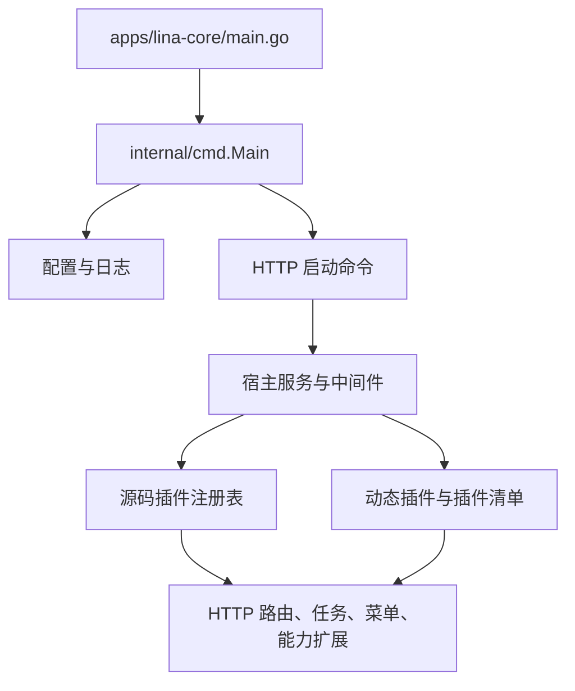

# LinaPro 项目源码结构与运行逻辑记录

更新时间：2026-10-10

这是一份当前源码的导航记录，用于后续问题定位。它基于宿主入口、插件注册入口、核心业务服务、前端路由和官网包的结构阅读，不代表已经逐文件审计全部实现。业务含义、权限、数据归属和页面交互出现冲突时，以对应规范和用户确认作为准则。

## 一、顶层目录

| 目录 | 职责 | 主要技术边界 |
| --- | --- | --- |
| `apps/lina-core` | 通用宿主、启动命令、认证、权限、租户、菜单、文件、任务、插件运行时 | Go、GoFrame、宿主插件契约 |
| `apps/lina-plugins` | 业务插件和外部 Provider 适配器 | 每个插件独立 `plugin.yaml`、后端和可选前端 |
| `apps/lina-vben/apps/web-antd` | 管理端前端 | Vue 3、Vite、Vben、Ant Design Vue |
| `apps/lina-vben/apps/web-customer` | 客户中心前端 | 与管理端保持 Vben 结构对齐，客户业务页面独立 |
| `apps/lina-websites` | 公开官网包、官网契约、SDK、打包器、起步模板 | Nuxt、TypeScript、可安装预编译包 |
| `hack` | 仓库工具、测试工具、构建与部署辅助 | Go、Node.js、Playwright 等 |
| `openspec` | 活跃能力变更和规范产物 | 业务契约、设计、任务、验证 |
| `localdocs` | 本地排查和部署参考资料 | 非运行时业务契约 |
| `.agents` | Agent 规则、偏好、上下文导航和技能 | 任务治理与协作入口 |

根目录通过 `go.work` 直接管理 `apps/lina-core` 和 `hack/tools/linactl`；各业务插件通常有自己的 `go.mod`，前端应用和官网包由各自的 `package.json`、`pnpm-workspace.yaml` 管理。

## 二、宿主启动与插件装配

启动链路如下：



`apps/lina-core/main.go`只负责取得初始上下文、读取日志配置、构建 `internal/cmd.Main` 并运行命令树。宿主的通用控制器和服务位于 `apps/lina-core/internal`：

- `internal/controller`：认证、用户、角色、菜单、插件、任务、文件、字典、国际化等通用 HTTP 控制器。
- `internal/service`：业务上下文、数据范围、租户、会话、权限、缓存、任务调度、插件生命周期、文件和存储等共享服务。
- `internal/dao`、`internal/model`：宿主自身数据访问、DO 和 Entity。
- `pkg/plugin/pluginhost`：插件声明、注册、HTTP 路由、Job、菜单过滤、权限过滤、业务扩展和能力 SPI。
- `internal/packed`：宿主内置 manifest、静态资源和打包资源。

源码插件通常在各自的 `backend/plugin.go` 中通过 `pluginhost.NewDeclarations` 声明能力，再调用 `RegisterSourcePlugin` 注册。HTTP 路由和后台任务不是在宿主集中硬编码，而是由插件在运行时向宿主注册；宿主负责公共中间件、生命周期、权限和调度边界。

## 三、插件分层

当前 `apps/lina-plugins` 有 26 个插件目录，按 `plugin.yaml` 的 `type` 分为 `source` 和 `dynamic` 两类。

### 核心源码插件

- `idc-core`：客户、商品目录、报价、购物车、订单、账务、合同、工单、内容、营销、客户服务、履约和运营工作台等业务拥有者。
- `idc-resource`：Provider 账号、接口能力、服务器、容量、资源任务、开通、续费和服务器操作。
- `idc-payment`：支付渠道配置、支付尝试、回调、查询、退款和对账。
- `idc-compliance`：实名认证、企业审核、电子合同、发票和合规证据。
- `idc-portal`：官网品牌、客户外部菜单和公开入口桥接。
- `idc-notify`、`content-notice`：通知通道、通知模板、投递和内容公告。
- `tenant-core`、`org-core`、`staff-access`：租户、组织、岗位和员工资格等平台能力。
- `shared-services`：跨插件复用的人机验证、站内消息等共享服务。
- `idc-ai`、`idc-channel`、`vben-adapter`：AI 运营辅助、下游渠道和前端插件适配。

### 动态 Provider 插件

`idc-baota`、`idc-dcim`、`idc-v10`、`idc-zjmf-finance`、`idc-zjmfcloud`、`idc-zjmfmigrate`、`yunsu-ssl` 是资源或迁移适配器；`idc-payment-alipay`、`idc-payment-epay`、`idc-payment-unionpay`、`idc-payment-wechatpay` 是支付 Provider。它们通过 `business_extensions` 声明由拥有者插件消费的能力，不直接拥有核心订单或财务事实。

插件常见目录结构：

```text
apps/lina-plugins/<plugin-id>/
├── plugin.yaml                 # 身份、类型、依赖、菜单、扩展点、资源
├── backend/
│   ├── plugin.go               # 注册入口和运行时装配
│   ├── api/                    # API 契约和版本化 DTO
│   ├── cap/                    # 对外能力契约与 SPI
│   └── internal/
│       ├── controller/         # HTTP 控制器
│       ├── service/            # 业务服务
│       ├── dao/                # 数据访问
│       ├── model/              # DO、Entity 等生成或模型代码
│       └── composition/        # 运行时、Job、Provider 组合
├── frontend/
│   ├── pages/                  # 插件页面入口
│   └── src/                    # 复杂页面工作区和请求适配
└── manifest/                  # 文案、菜单、权限和插件资源
```

## 四、后端业务调用链

### 客户下单和履约

客户中心的订单结算入口位于 `idc-core` 的账户 Controller。`CommerceOrderCheckout` 接收报价号和幂等键，调用 `commerce.CheckoutAccountQuote`。核心服务负责报价有效性、客户归属、金额和订单事实；后续由履约和结算任务消费订单状态。

### 支付和财务

`idc-payment` 绑定三组 HTTP 路由：公开回调、客户账户支付操作、管理员对账和异常资金操作。支付任务以有界批次运行，包括确认、订单关闭、退款、异常退款、主动查询和每日对账；财务事实仍由 `idc-core` 的账务服务和结算服务拥有。

### Provider 和服务器

`idc-resource` 在插件注册阶段绑定 Provider 声明、密钥管理、接口候选、资源投影和服务器操作能力。运行时通过动态 Provider 工厂访问外部系统，任务由资源插件持有；`idc-core` 的履约服务只消费能力契约，不应直接依赖某个 Provider 实现。

### 异步任务

宿主提供统一 Job 注册和主节点约束。插件在 `RegisterJobs` 中注册周期任务，常见实现带批量上限和幂等语义。已确认的核心结算投递任务由 `idc-core` 注册，在不要求 Provider 在线的前提下把已结算订单物化为本地服务和运营意图。

## 五、前端结构和页面逻辑

### 管理端 `web-antd`

页面由宿主路由、插件菜单和动态页面容器共同组成。`src/router` 处理登录后路由和权限刷新；`src/plugins` 维护插件页面注册；`src/views/system/plugin/dynamic-page.vue` 根据插件拥有者、入口或路由查找页面组件，找不到时展示 404。插件页面可以是 `frontend/pages/*.vue`，也可以挂载复杂的 `src/*Workspace.vue`。

### 客户中心 `web-customer`

客户中心与 `web-antd` 保持启动、请求、状态、布局、国际化和组件结构对齐，但业务路由独立。主要页面集中在 `src/views/account`，包括商品目录、服务器、购物车、订单、财务、授信、退款、发票和客户服务。`src/router` 中的访问守卫、租户访问和登录后落地页决定客户可见页面。

### 插件前端

复杂的 `idc-core` 工作区通过 `frontend/src/mount.ts` 和 `App.vue` 挂载，再按路由选择内容、财务、资源操作、支持、运营和销售渠道工作区。轻量插件页面直接由宿主动态页面容器加载。前端请求通常位于页面旁的 `*-client.ts`、`src/*/api.ts` 或 `src/runtime/request.ts`，页面状态和后端 DTO 之间存在一层适配。

## 六、官网包边界

`apps/lina-websites` 与 Vben 应用独立，包含：

- `packages/site-contracts`：官网契约和 schema。
- `packages/site-sdk`：官网调用 SDK。
- `packages/site-packager`：官网预编译包打包和校验。
- `sites/default`：默认官网实现，目前被文档明确标注为此前错误合并的 Nuxt 原型迁移基线。
- `templates/nuxt-starter`：第三方官网起步模板。

官网只负责公开获客和内容路由；购物车、登录、结算、支付、账户和售后通过后端权威引用交给客户中心。IDC 商家安装的是自包含预编译压缩包，实例本地负责校验、暂存、预览、发布、切换和回滚。

## 七、当前定位风险

以下是结构性观察，不是未经确认的业务判定：

1. `idc-core/backend/plugin.go` 同时导入并装配大量 capability、Controller 和 service，属于高复杂度启动边界；后续问题要先判断是宿主契约、插件装配还是具体 service 的问题。
2. 管理端动态页面既支持插件注册表，也支持按路由兜底查找；菜单、路由、页面入口和 manifest 不一致时，可能出现菜单能显示但页面 404，或页面可访问但菜单缺失。
3. `web-customer` 的多个业务路由复用同一个页面容器，例如订单、发票和交易页面分别使用同一入口组件；排查页面错误时必须继续读取路由参数和容器内部的分发逻辑，不能只看路由名称。
4. 插件 manifest、后端 API、前端页面和 i18n 是四套关联资源；只修改其中一套容易出现权限、菜单、文案或动态加载不一致。
5. 当前工作区已有 `idc-portal` 的 README、品牌页面、插件清单、后端测试和 E2E 文件改动；后续修改必须避开覆盖这些未提交内容。
6. 源码树中同时存在源码插件和动态 Provider，且很多能力由 owner/provider 分工完成；遇到“功能不工作”时需要沿 `plugin.yaml` 的依赖和 `business_extensions` 继续追踪，不能只在页面层补逻辑。

## 八、后续问题定位顺序

收到具体问题后，按下面顺序缩小范围：

1. 先确定用户看到的是管理端、客户中心、官网还是插件独立页面。
2. 根据路由或按钮找到前端页面、请求适配和对应 API。
3. 在插件 `backend/internal/controller` 找到入口，再追到 service、DAO 和 capability owner。
4. 若涉及异步、支付、履约或 Provider，继续追 Job、状态表、幂等键和 owner/provider SPI。
5. 若涉及菜单、权限或页面加载，交叉检查 `plugin.yaml`、manifest、宿主注册表、动态页面容器和前端 i18n。
6. 先报告有证据的根因或阻断点，再按影响范围选择局部修复或 OpenSpec 变更。
