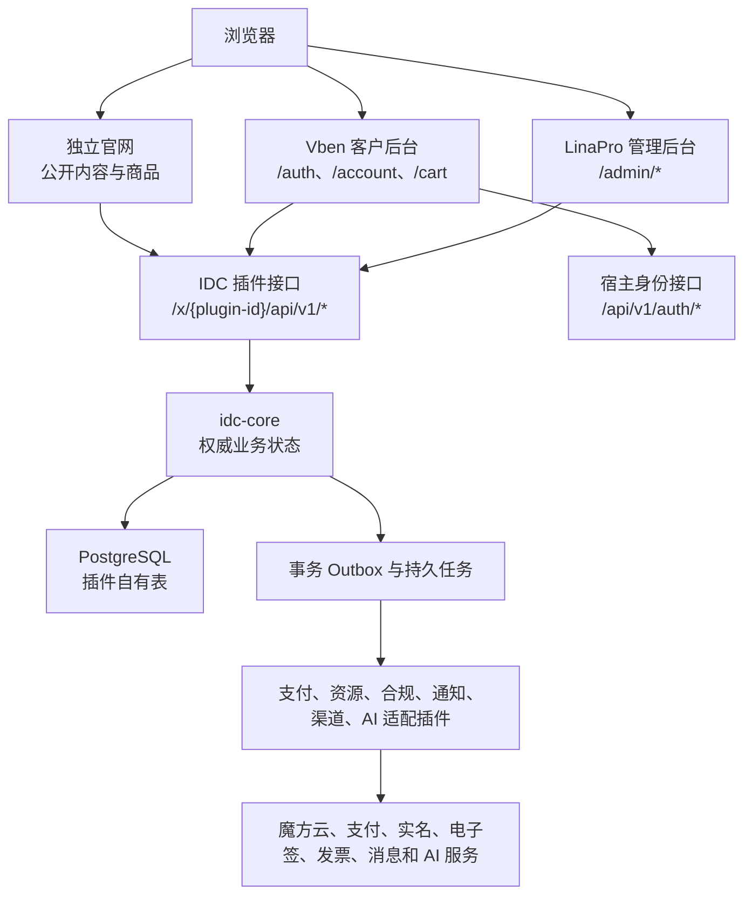
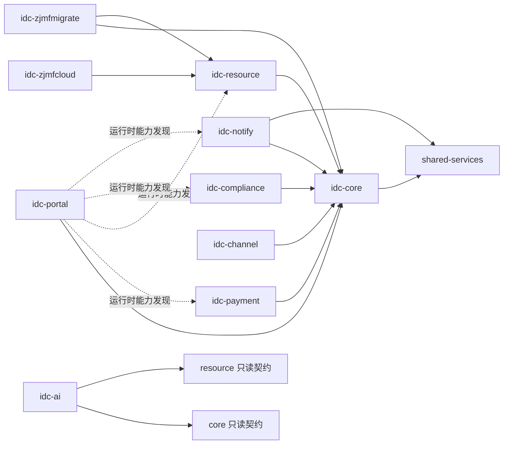
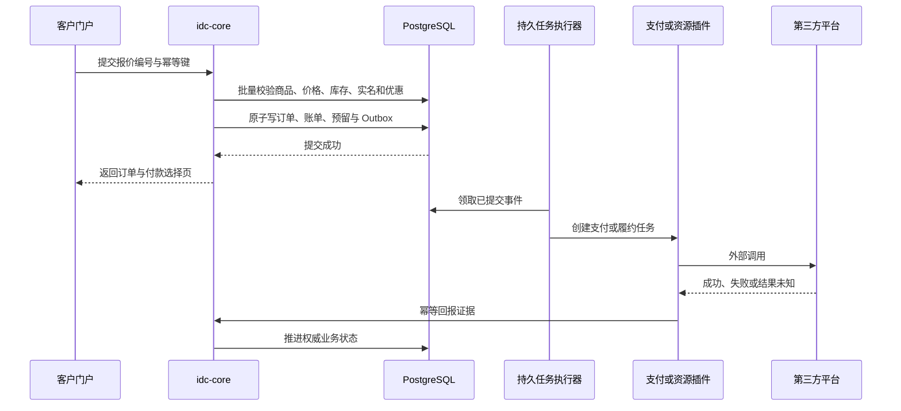
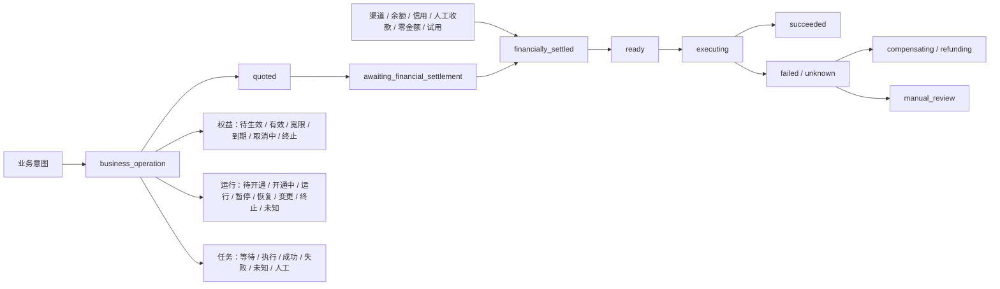
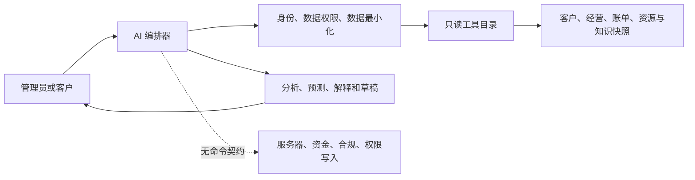

## Context

> **FB-52 已确认纠偏：** 商品分类和商品都是商家自定义内容，核心平台理论上可以销售任何东西，服务器只是已经实现的首批插件能力。下文凡是把固定服务器字段描述成通用商品模型、把所有正常插件都描述为内置源码插件、把智简魔方连接器描述为不可卸载内置插件，或要求官方/第三方插件带品牌前缀的旧表述，均由本节和`idc-product-fulfillment`、`idc-plugin-extension-governance`增量规范取代。实现阶段必须先修正这些旧实现，不能继续沿错误方向扩展。根因、执行门禁和验收矩阵统一记录在[`FB-52 基础模型纠偏记录`](./fb-52-foundational-model-correction.md)，逐文件影响和保护基线见[`FB-52 全仓影响清单与保护方案`](./fb-52-impact-inventory.md)。

本项目采用两层同构但受众不同的插件化。`LinaPro`是面向开发者的全栈框架，源码插件用于组合系统且必须与宿主隔离；当前服务器业务与财务平台是开发者基于该框架交付给商家的成品平台，商品、订单、账务、通知、资源和官网等业务拥有方以强制内置源码插件构成不可拆卸地基。商家不需要理解或管理这些地基插件，只在相应业务菜单中使用其能力；统一插件管理只展示商家能够上传和管理的动态`WASM`扩展。动态扩展必须逐项使用地基插件发布的扩展点、页面槽位和安全桥，因此安装新的供应商、短信、支付、商品履约或官网扩展不需要修改 LinaPro 宿主，也不能破坏平台业务规则。

现有插件管理中的通用“开发指南”是用户明确授权的宿主治理例外，可以由`web-antd`现有插件管理页面和宿主语言资源承载；它只说明框架级插件清单、扩展点、安全桥、页面表面、构建测试和生命周期，不得包含`IDC`业务页面、业务接口、供应商配置或业务依赖。除这一明确例外与既有必要宿主接线外，后台业务实现仍必须位于对应业务插件`frontend/`中。

本设计的业务动机见`proposal.md`。当前代码库提供稳定的`LinaPro`宿主、管理后台、身份权限、数据权限、插件生命周期、对象存储、作业、缓存、锁、通知和国际化基础能力，但没有`IDC`客户、商品、订单、资金、服务器资源、合规或运营领域。登录后的客户功能唯一进入`apps/lina-vben/apps/web-customer/`；该应用与`web-antd`同级，并在结构、入口、Vben/Vite 写法、路由、请求、状态、偏好、主题、布局、国际化、组件、类型检查和构建方式上完整对齐`web-antd`。`web-antd`本身只作为 LinaPro 宿主前端，除上文明确授权的通用插件开发指南和必要宿主配置外不得修改任何源码、页面、路由、接口、状态、多语言或依赖，这些例外也不得承载 IDC 业务。官网唯一进入独立的`apps/lina-websites/`。项目根`.contributing`已按用户授权改为所有权边界：`apps/lina-vben`内归属本项目的`web-customer`业务代码和必要接入可以修改，不能因父目录名称一概禁止；这项授权对`web-antd`仅包含上述通用插件开发指南和必要宿主配置。`apps/lina-core/`、`web-antd`的业务源码、业务页面和业务依赖、根`hack/`和无关共享框架实现仍保持 Lina 上游边界；任何情况下都不得把项目业务逻辑混入 Lina 宿主，也不得以插件内临时前端冒充最终用户端交付。IDC 管理页面及其组件、接口客户端、路由、状态、多语言资源和业务专用依赖必须由对应业务插件的`frontend/`拥有，并通过既有插件前端机制显示在后台；现有机制不能独立承载依赖时，先设计插件自有构建和交付方式，不得向`web-antd/package.json`加入业务依赖作为捷径。第十一阶段在实现后台工单、内容与通知页面前，先为`idc-core`和`idc-notify`建立各插件自有的独立前端构建、配置与依赖边界，独立构建不得借用或修改`web-antd`依赖，产物仍由既有插件前端机制加载；若既有机制不能消费该产物，停止后台页面实现并先补齐经过审查的插件交付契约。人机验证和后台任务站内信统一由新增的独立`shared-services`插件拥有，`lina-core`与`web-antd`保持零业务改动。

业务基线采用“老智简魔方财务核心全集、业务管理系统`V10`核心与官方应用、当前官方市场高频运营需求”的并集，而不是照抄某一版菜单。公开资料显示`V10`更接近轻量业务内核与应用商店，老财务系统在客户`360°`、账单、工单、销售与佣金等方面更深入；本地旧源码静态审计也证明其购物车同步访问上游、重复逐项查询和阻塞式伪异步是分钟级结算等待的高概率原因。

研究只用于功能、状态和异常语义的`clean-room`设计，不复制旧系统代码、模板、图片、数据库结构、认证或授权逻辑。逐项来源、证据类型、访问日期、验证状态和未决项记录在[功能证据矩阵](./evidence.md)，来源功能到规范、任务和 E2E 的映射记录在[首版覆盖追踪矩阵](./coverage.md)；市场描述只作为需求信号，不作为已验证接口事实。关键参考入口包括：

- [智简魔方业务管理系统 V10](https://www.idcsmart.com/business.html)
- [V10 官方开源仓库](https://github.com/idcsmart/ZJMF-CBAP)
- [智简魔方财务系统使用文档](https://docs.idcsmart.com/docs/%E8%B4%A2%E5%8A%A1%E7%B3%BB%E7%BB%9F%E4%BD%BF%E7%94%A8%E6%96%87%E6%A1%A3)
- [智简魔方财务系统开发文档](https://docs.idcsmart.com/docs/%E8%B4%A2%E5%8A%A1%E7%B3%BB%E7%BB%9F%E5%BC%80%E5%8F%91%E6%96%87%E6%A1%A3)
- [智简魔方云文档](https://docs.idcsmart.com/docs/%E9%AD%94%E6%96%B9%E4%BA%91)
- [智简魔方官方应用市场](https://my.idcsmart.com/shop/shop_app.html)

旧源码的当前本机入口为`C:/Users/Saopig/Desktop/魔方财务系统/`，关键证据位于`app/home/controller/CartController.php`、`app/common/logic/Shop.php`、`app/common/logic/Invoices.php`、`app/common/logic/Host.php`、`app/common.php`和`app/admin/controller/PublicController.php`。其中结算会逐商品同步访问上游、反复装配配置和价格，所谓`asyncCurlMulti`仍等待站内`HTTP`调用完成；新系统禁止复用该执行模型。

### 功能覆盖基线

客户与交易域首版覆盖：

| 能力组 | 首版基线 |
|---|---|
| 客户 | 个人、企业、等级、分组、标签、自定义字段、备注、跟进、黑名单、客户`360°` |
| 商品 | 商家自定义分类与任意商品、插件声明的配置方案、库存、显式多币种价格、一次性/周期/阶梯/按量计费；服务器升降级属于服务器插件能力 |
| 交易 | 购物车、报价快照、订单、应收账单、余额、信用、人工收款、支付、在线退款、对账 |
| 增长 | 优惠券、代金券、积分、充值赠送、返现、活动、代理商、`AFF`、销售和佣金结算 |

交付与合规域首版覆盖：

| 能力组 | 首版基线 |
|---|---|
| 服务 | 云服务器、裸金属、开通、暂停、恢复、续费、重装、密码、控制台、变配、转移、终止 |
| 资源 | 服务器插件可把`IP`、磁盘、备份、快照和流量作为服务器附属能力；商家也可以用自定义商品或其他插件独立销售，不由核心禁止 |
| 支持 | 售前、客户与内部工单、部门、状态、`SLA`、分配、上游转发、备注、附件、评价 |
| 合规 | 个人实人认证、企业人工认证、腾讯电子签、诺诺电子发票、隐私同意和审计 |

运营与扩展域首版覆盖：

| 能力组 | 首版基线 |
|---|---|
| 触达 | 站内信、邮件、短信、微信公众号、企业微信、签名`Webhook`及可插拔协作渠道 |
| 运营 | 任务中心、风险、库存、成本、毛利、收入、现金流、退款、渠道、供应商质量和审计报表 |
| 门户 | 官网、客户中心、新闻、公告、知识库、下载、导航、`SEO`、品牌、中英文和移动端 |
| `AI` | 经营问答、诊断、预测、知识检索、工单与内容草稿、客户只读助手，永久禁止业务写入 |
| 迁移 | 预检、演练、分批、断点、增量、幂等、冲突、附件、资金和服务对账 |

## Goals / Non-Goals

**Goals:**

- 复用现有通用插件宿主，以内置源码业务拥有方和可安装动态扩展插件共同交付，并使每个安装实例只服务一个商家。
- 把订单、资金和服务状态作为系统自己的权威领域，第三方平台仅通过适配器提供能力和证据。
- 保证公开报价和结算完全基于本地已发布数据，达到结算`p95≤2`秒、`p99≤5`秒的硬门禁。
- 让所有外部写操作可幂等、可查询、可重试、可对账、可人工接管，避免未知结果下的重复扣款、重复退款或重复开通。
- 用统一权限、审计、国际化、秘密保护和数据权限支撑自营与编译交付。
- 让`AI`成为有业务数据和证据的运营副驾驶，同时在架构层彻底拿掉写操作能力。

**Non-Goals:**

- 首版不在同一安装实例承载多个独立`IDC`商家，也不把终端客户建模为`LinaPro`租户。
- 首版不承诺官方团队同时提供所有供应商连接器，但商家从第一版起就能手工销售任意商品，也能安装相应自动化插件销售域名、证书、`CDN`、手机或其他商品；通用商品核心不得限制类型。
- 通用退款入口按订单项、退款数量和退款金额工作。只有订单冻结的插件契约明确声明持续管理能力且实际产生长期服务权益时，客户才可以进一步选择具体权益，以便预览终止、停机或数据影响；退款数量与所选权益数量是两类独立事实，不要求一一相等，例如按订单项履约的一件长期权益可以对应购买数量大于一的退款。一次性交付、实物和人工服务不创建这种选择，也不依赖旧服务器履约单元。
- 首版企业客户不提供多成员、企业内部角色、审批流或统一账单。
- 首版不提供海外支付、实时汇率换算或跨币种余额兑换。
- 商业授权中心推迟到核心业务完成后；电子签与发票连接服务使用的实例身份不等同于最终商业许可证体系。
- 不部署或运行来源不明、涉及解密或授权绕过的第三方魔方插件，只把公开名称作为功能索引。

## Decisions

### 1. 采用一个 LinaPro 插件宿主和四维插件声明

正式交付只使用现有 LinaPro 插件宿主和插件管理，不另建第二套管理器。插件用四个互不替代的维度声明：运行类型是`source`或`dynamic`，分发方式是`builtin`或`managed`，业务扩展点说明它能在商品履约、短信、支付、官网模板等哪个页面被选择，前端表面分别说明它向后台或客户中心贡献什么菜单和页面。

`tenant-core`以及拥有商品、订单、账务、权限等稳定契约的基础插件采用`source + builtin`，随系统强制启用且不出现在插件管理列表。智简魔方云、魔方`DCIM`、魔方业务系统`V10`、魔方财务系统、宝塔面板、`SSL`、短信供应商和支付网关等连接器采用`dynamic + managed`，由管理员上传、安装、升级和卸载，并只出现在匹配的业务配置页面。服务器连接器按上游系统分别交付，不能用一个万能插件混合不同上游；服务器接口只在`idc-resource`的服务器供应商接口页面维护，并成为端点、账号、秘密、协议、渠道和资源池路由的唯一权威记录，商品自动化只引用现有接口实例而不重复保存配置。同一魔方`DCIM`插件允许管理员在新增接口实例时从旧版和`BMS`两种已声明协议中明确选择一种，保存后冻结该类型及对应配置，不得运行时猜测或自动降级。魔方财务原生转发动作只属于独立魔方财务插件。首版不开发手机连接器，但通用商品核心仍允许人工销售手机和未来安装手机插件。停止新销售与停用、卸载分开：停售后新商品和新购买不能再选择该插件，但已有服务菜单、管理、续期和售后继续工作；只有引用和在途任务排空后才允许停用或卸载。

插件安装、插件设置和插件业务数据是三个不同概念。清单用结构化基数声明区分`multiple`多实例配置与`singleton`单例设置：供应商、短信、支付、商品自动化等连接器通常是多实例，只有业务上确实只需一份安装级设置的插件才声明单例。单例只限制设置份数，不限制插件拥有的业务资源；例如官网的站点名称和`Logo`可以是一份设置，新闻仍由官网业务拥有方按普通列表和完整增删改查维护。宿主只负责按声明装配入口、表单和权限，不把不同业务的数据塞进一张万能配置表。

现有插件管理页面增加一个普通“开发指南”按钮，在当前页面内展开仓库随版本交付的双语指南。内容覆盖清单四维声明、扩展点、源码插件、动态`WASM`插件、后台/客户中心页面、安全桥、接口实例、商品履约、测试、打包和生命周期。它是现有插件管理的帮助内容，不是新的插件管理器；页面使用宿主标准`Card`、目录和折叠内容，不依赖外部站点，不使用营销横幅。

可上传插件的前端在宿主治理的隔离环境运行，只能使用版本化、按能力授权的页面桥和接口代理，不得取得原始访问令牌或宿主全局状态。数据或动作请求先由宿主后端根据活动发布版本核对表面能力和精确路由，再重新证明当前身份属于所选宿主：后台核对精确表面权限，客户拒绝超级管理员、模拟身份、非默认商家上下文和非本人数据范围；通过后才签发绑定当前会话、用户、租户、插件、后台或客户宿主、表面、版本、能力、HTTP 方法和实际路径的两分钟防篡改票据。动态路由只接受该不透明票据，不信任浏览器可伪造的绑定请求头，并继续执行普通后台权限与数据范围或当前客户对象所有权校验。宿主负责主题、语言、字体、间距、骨架屏、资源预热、自动高度、路由、标题和标签页同步；验收不得出现边框、双页头、双滚动条、白屏闪烁、明显布局跳动或独立系统跳转感。官方插件 ID 直接删除`linapro-`且不增加替代品牌前缀；第三方插件可以自行命名，只需满足安全字符、当前实例唯一和安装后稳定。

每个`IDC`插件使用`platform_only`、`supports_multi_tenant: false`和`global`业务作用域，但所有业务表仍保留宿主默认租户上下文，以维持宿主数据权限与未来治理一致性。



选择该方案是因为宿主已提供稳定通用能力，且根规则禁止业务污染核心。拒绝另建第二套后台，因为会重复身份、权限、菜单、运维和升级体系；也拒绝把所有业务塞入单一宿主服务，因为会破坏插件交付边界。

### 2. 插件按权威状态与外部适配边界拆分

| 插件 | 权威责任 | 运行依赖 |
|---|---|---|
| `shared-services` | 用途绑定、短期单次的人机验证，以及明确收件人、稳定来源和幂等号约束的后台任务站内信 | 无 |
| `idc-core` | 客户、通用商品、营销、购物车、报价、订单、账单、账本、服务权益、工单、销售、佣金、本地合规状态、`Outbox`、幂等与审计 | `shared-services` |
| `idc-payment` | 支付领域真相、支付与退款尝试、回调、主动查询、渠道对账；具体网关由动态支付插件扩展 | `core` |
| `idc-resource` | 服务器`Provider`契约、资源池、供应商引用、资源与生命周期任务编排 | `core` |
| 动态服务器连接器 | 例如智简魔方公有云`v1`协议、认证、能力描述和请求/响应转换；自身不保存上游映射或任务真相 | `resource` |
| `idc-compliance` | 合规案件与人工审核工作台；具体实名、电子签和发票供应商可由扩展插件连接 | `core`、`notify`提供的统一安全短信验证码能力 |
| `idc-notify` | 通知模板、偏好、重试和送达审计；具体短信供应商由动态短信插件扩展 | `core`、`shared-services` |
| `idc-channel` | 下游访问令牌、商品发布、渠道请求与`Webhook`投递；不拥有订单、资金或服务真相 | `core` |
| `idc-ai` | 商家`OpenAI`兼容配置、只读工具、洞察、预测、检索和草稿 | `core`、`resource`只读契约 |
| `idc-portal` | 官网包、公开/客户 API 装配、精确路由、购物车交接和认证桥接，不拥有权威交易表或前端源码 | 硬依赖`core`，其他能力运行时发现 |
| `idc-zjmfmigrate` | 源数据预检、映射、导入、冲突和对账 | `core`、`resource` |

`idc-core`虽然覆盖多个业务子域，但内部必须按`customer`、`catalog`、`commerce`、`billing`、`service`、`support`、`growth`、`audit`等包严格分层。订单、资金和通用服务权益由同一插件拥有，是因为插件之间没有跨插件数据库事务；若按页面数量拆成大量插件，会把本来需要原子提交的交易变成分布式事务。

外围插件只允许依赖拥有方公开的`backend/cap/<domain>cap`，禁止导入其他插件`backend/internal`、跨插件查表或建立数据库外键。`shared-services`拥有人机验证和后台任务站内信公开能力，`core`拥有`idccap`与`secretcap`，`resource`拥有`resourcecap`与版本化`Provider SPI`；每项能力都必须提供源码插件 helper、带 owner 的 descriptor、dispatcher、`hostServices`授权、bridge SDK、版本兼容和依赖检查。`AI`只能导入只读 descriptor，迁移使用独立导入契约。外围插件通过不透明业务编号领取任务、调用第三方并幂等回报，最终业务状态始终由权威拥有者决定。

服务器`Provider`契约由`resourcecap/spi`拥有；官方或第三方动态连接器通过版本化 descriptor、`hostServices`授权和 bridge 装配，不修改`lina-core`。连接器清单必须声明对`idc-core`秘密能力和`idc-resource`资源能力的精确依赖与方法。源码连接器只通过显式构造注入的 callback accessor 短暂使用秘密；普通 owner invocation、普通请求响应载荷和 WASM 内存不得取得秘密明文或可自行读取的秘密句柄。托管动态连接器在完成宿主管理出站代理或等价专用保密通道的独立设计与安全审查前，任何依赖供应商秘密的方法必须失败关闭；通过审查后也只能由宿主在绑定插件、接口实例、scope、字段、用途、方法和短时上下文的边界内代用秘密。宿主完成依赖、启用状态、租户、权限和方法授权后，才提供对应的受管出站能力、时钟、脱敏日志和结果回报桥。连接器不得取得运行期全局`Resolve/Get`、跨插件数据库访问或业务服务定位器，共享真相只在`resource`数据库、宿主缓存和锁中。

声明键冲突、未知契约主版本、依赖版本不满足或工厂为空必须在启动装配时失败；内部`Provider`开关关闭时仍保留声明和历史数据，但禁止新建客户端和新任务，排空后只允许历史查询。声明快照冻结后禁止追加，测试必须证明重复注册失败、装配顺序与 Go `init`顺序无关、停用后不再构造适配器，并静态禁止消费插件导入`resource`的`internal`包。这个 registrar 是只写后冻结的启动装配接缝，不是全局服务定位器；运行期调用只经过构造函数注入的`resourcecap.Provider`接口。

历史“资源库存终态自动生成商品草稿”方向已由 FB-52 停止。`resource`不得依据容量观测、定时同步或后台刷新自动创建或修改商品草稿、商品库存或商品销售状态；服务器供应商容量如需同步，只能在服务器插件内部以有界持久任务观测，供异步履约判断使用，不进入通用商品、报价和结账事实。

服务器接口详情中的上游商品导入是与容量观测分离的管理员显式动作。动态连接器只通过`idc-resource`拥有的版本化只读契约返回有界、可本地化的商品销售资料、上游价格和连接器声明配置，不取得商品写权限；`idc-resource`也不得直写商品私表，而是把管理员选择和冻结的接口实例修订交给`idc-core`商品拥有方公开契约，由商品拥有方创建新的未上架草稿并物化连接器、接口实例及其声明配置。管理员导入时选择本地分类、核对默认名称，并选择按上游价格加价或自行填写最终售价；地址标识自动生成，金额按币种标准最小货币单位四舍五入。上游没有明确声明的配置只记录为待补齐，不按标签猜测硬件字段；不完整基础价或配置附加价不得合成为整机售价。用户确认允许此类不完整资料先生成草稿，页面必须列出缺项。管理员随后在商品管理中补齐发布门禁，最终仍只能调用商品核心唯一发布服务手动上架，导入动作本身绝不切换销售版本。同一次提交的重试必须返回原草稿；来源证据、草稿、绑定和价目在同一事务提交，远端读取发生于事务外，不能在读取上游时长时间持有数据库锁。

通用商品核心只保存版本化配置组、字段声明、可选值、选择规则和价格影响，不预置服务器组件枚举。固定方案可以把插件字段冻结为不可选值，可配置方案允许客户在插件声明范围内选择；保存、发布、报价和开通均按插件契约版本校验，后台和客户页面不得直接展示原始`JSON`。地区、线路、机房、处理器、内存、磁盘、带宽和镜像只是服务器插件声明的一套字段；域名、证书类型和通配符支持可以由证书插件声明，手机号、颜色和物流方式可以由手机插件声明。分类名称不决定商品类型，`IP`、磁盘、备份或任何其他内容能否独立销售由商家和相应插件决定，核心不得禁止。

商品复制是一项创建新商品身份和新`copy + draft`版本的后台事务。请求必须显式提供新商品的中英文名称、摘要和公开 slug，不自动生成单语言“副本”文案。服务用一次有界集合装配读取源版本的通用配置声明、计费规则和价格，以目标版本号加源业务号的稳定摘要生成新的内部业务号，再按固定批次写入并重建所有内部引用。复制不得带入商品库存、成本、自动化接口实例绑定、当前版本指针、发布状态或供应商身份，避免复制动作意外获得履约和销售能力；目标必须经过普通发布完整性检查并重新选择履约方式及接口实例后才能销售。

普通版本发布服务是商品域唯一的版本状态切换入口。它先锁父版本和商品，集合校验通用配置、逐币种价格、税务、简单库存、履约方式及接口实例绑定，再原子核对并切换旧发布版本和商品当前版本指针。服务器、证书、手机或其他插件都只能通过冻结的商品自动化契约接入；管理员显式导入上游商品也只创建未上架草稿，不存在 Provider 容量快照自动导入或第二条发布路径。

自动化接口管理使用三项互不替代的精确权限：查看接口、管理接口和写入商品版本履约绑定。写入绑定同时要求查看接口权限，商品详情中的安全绑定摘要只复用既有商品查询权限。接口显示名称是面向未来操作的可变资料，改名不得回写任何既有绑定或历史快照。物理删除只允许从未被任何商品版本引用的误建接口，并与员工审计同事务提交；接口一旦被草稿、已发布或历史版本引用过就形成永久身份，只能停止或恢复新销售。恢复新销售必须先从宿主重新发现精确插件发布、商品履约扩展点、契约和方法，再按当前结构化接口配置完成服务端校验；任一证据变化、缺失或依赖不可用都保持停止状态。列表、详情、改名、删除、停止和恢复均先授权再读取对象，并按数据范围隐藏不可见目标。

所有商品库存都是商品版本自身的简单设置，只保存是否跟踪、当前可售数量和并发版本，由商家在新增或编辑商品版本时维护。报价和结账只集合读取本地商品库存，订单创建后冻结库存结果；库存不调用插件、不从供应商同步，也不增加审核、确认权限、原因说明或单独审计流程。服务器资源池的上游容量、线路、地域和安全余量只可作为服务器插件异步履约时的内部判断，不得修改、同步或冒充通用商品库存。

core 内历史商品库存与资源池路由服务没有生产调用且属于错误通用模型，已经连同专用测试和错误码删除，不保留兼容入口。通用商品只冻结一个自动化接口实例和插件契约，不读取资源池候选、不接受资源池指纹，也不决定供应商新单路由。

服务器插件或其连接器可以在自己的接口实例内部以有界 PostgreSQL 投影管理多个资源池、供应商容量、地区、线路、维护和新单策略。财务结清后的持久履约任务把冻结商品配置与订单证据交给服务器业务拥有方，由其确定性选择资源池并保存快照号、指纹、观察时间和选择依据；缺失、过期、未知或容量不足时按冻结契约重试、切换或人工接管，不能停止通用商品销售、修改商品简单库存或让客户请求同步探测上游。

资源创建失败且供应商明确尚未创建资源时，服务器插件可以在同一接口实例内部排除原选择并路由到兼容备用池。一旦上游资源已经创建，服务器插件永久保留原接口实例、资源池和上游资源编号，不因新单策略变化自动迁移历史服务器。`SSL`、手机、`CDN`等插件使用各自接口实例和私有配置，不继承资源池字段。



拒绝让支付、资源和合规插件直接改订单、资金或服务表，也拒绝建立同步站内`HTTP`回调链；前者破坏单一事实来源，后者会重现旧系统的阻塞与未知结果问题。

上游商品读取与导入准备之间使用进程内、不可经`JSON`输入的读取证据，绑定资源接口、不可变配置修订与商品履约发布证据。资源拥有方通过同一修订读取地址、设置和秘密引用，读取完成后复核当前绑定；商品拥有方在准备时和提交事务内核对该证据。投影滞后或读取中配置变化均拒绝导入，不跨修订拼接数据。导入的动态候选解析同样携带期望资源修订并参与缓存键；数据库修订是所有实例共享的权威源，不允许旧缓存跨修订放行。该补强只维护既有绑定正确性，不改变用户流程、权限或金额口径。

### 3. 客户后台照抄 Vben，官网完全独立

客户后台唯一前端源码放在`apps/lina-vben/apps/web-customer/`，包名固定为`@lina/web-customer`。它必须直接以`apps/lina-vben/apps/web-antd/`为母版，统一使用 Vben、Vue 3、Vite、Ant Design Vue 和同一 workspace 共享包。`src/app.vue`、`src/main.ts`、`src/bootstrap.ts`、`src/preferences.ts`、`src/router/`、`src/api/request.ts`、`src/store/`、`src/locales/`、`src/layouts/`、`src/adapter/`、`src/components/`和`src/views/`等结构、装配方式、导入别名、请求封装、偏好系统、主题系统、页面容器、表单反馈与国际化写法必须与`web-antd`一致，不得使用 Nuxt 的`app/`、文件路由、Nuxt 状态、Nuxt 请求层或另一套偏好实现替代。允许不同的内容只包括包名、应用标题、`6032`端口、存储命名空间、客户业务路由、客户业务接口、品牌值和客户页面；禁止复制管理后台的系统管理业务页、管理权限菜单和管理状态。

官网不放入`lina-vben`。官网开发与交付工作区固定为`apps/lina-websites/`，至少包含默认官网`sites/default/`、稳定数据类型`packages/site-contracts/`、开发工具`packages/site-sdk/`、第三方 Nuxt 起步模板`templates/nuxt-starter/`和中英文开发文档`docs/`。默认官网和首版受支持的第三方官网包使用 Nuxt 服务端渲染；第三方开发者可以在自己的独立仓库引用发布后的契约与`SDK`，不需要读取、复制或修改`web-antd`、`web-customer`和插件后端源码。

官网包是独立的预编译`.zip`交付物，不是`web-customer`主题目录，也不随 LinaPro 主程序重新编译。每个包必须自带已经构建好的服务端渲染产物、静态资源和不可变清单；清单声明包标识、版本、兼容的平台与官网契约版本、启动入口、健康检查、文件摘要、支持语言、拥有的公开路由、配置模式和所需能力。包内禁止安装脚本、包管理器下载步骤和运行时依赖解析，安装过程不得访问公网执行`npm install`或同类命令。

商家在自己的 LinaPro 后台上传官网`.zip`后，本地`idc-portal`负责流式接收并写入暂存区，检查压缩包格式、文件数量、压缩前后大小、路径穿越、绝对路径、符号链接、重复文件名、清单、文件摘要、来源信任和兼容范围，再解压到按`site_id/version/content_digest`隔离的不可变目录。候选版本使用安装包内置的锁定运行时在低权限独立进程中启动，只获得公开接口地址、站点修订和最小运行目录，不获得数据库、供应商、支付、合规或商家秘密；健康检查、路由保留字、服务端渲染、静态资源、双语和`SEO`预检通过后才允许管理员预览。上传、安装、发布、回滚和卸载都要求独立权限、重新认证、审计和幂等键。

发布只原子切换当前站点版本指针和路由目标，不重编译、不覆盖当前目录，也不重启管理后台和客户后台。切换失败继续服务上一个健康版本；发布后新版本持续失败时进入人工处理并允许一键回滚，系统不得在结果不明时自动反复切换。后台可以动态上传新的完整官网包，并在任意已安装且验证通过的版本之间选择，但不能上传一段 Vue、JavaScript、CSS、组件路径或服务端模板当作配置执行。第三方代码的签名、扫描、进程隔离和升级策略属于官网包交付契约，不得退化为数据库中的任意代码执行。

官网开发规范必须同时冻结版本化接口、类型、错误格式、语言与币种上下文、缓存修订、`SEO`字段、路由保留字、认证跳转、匿名购物车和结算交接。官网只能调用插件发布的`public`接口，不得直连数据库、管理接口、供应商或商家秘密；客户后台通过`account`接口访问当前客户数据。`site-contracts`是官网数据形状的唯一事实来源，`site-sdk`只封装公开读取、加入购物车和安全跳转，不保存权威价格或交易状态。

开发环境接口固定使用`6030`，`web-antd`管理后台固定使用`6031`，`web-customer`固定使用`6032`，官网使用独立端口和进程。生产路由把`/`、`/products/*`、`/pages/*`、新闻、公告、知识库、下载和联系等公开路径交给当前已发布官网包，把`/auth/*`、`/account/*`、`/cart`、`/checkout/*`和支付返回交给`web-customer`，把`/admin/*`交给`web-antd`；`/api`、`/x`和`/x-assets`继续由既有后端边界处理。公开官网输出完整 HTML、标题、描述、规范链接、语言替代链接、`Open Graph`、站点地图和适用结构化数据；客户后台路由统一使用`noindex`及`private, no-store`。

匿名购物车和登录客户购物车都以插件后端为权威。官网加入商品时只提交商品与配置选择，由后端重新计价并返回不透明购物车引用；进入`/cart`后由`web-customer`重新读取权威购物车，登录后由后端事务合并匿名购物车。官网与客户后台不得通过 URL、本地存储或页面源码共享价格、客户号、购物车内容或支付结果。

旧`idc-portal/portal`迁移必须按目标归属拆分：公开商品展示和配置器进入默认官网，购物车、订单、财务、个人实名和企业认证进入 Vben 结构的`web-customer`。对应`E2E`、页面对象、mock 和截图基线也按官网与客户后台分别迁移。两个新边界的类型、双语、路由、安全、真实浏览器和构建门禁全部通过后，才能删除旧源码、`dist`、独立锁文件、构建配置、测试副本和静态壳；失败时保留旧源码并回滚发布指向，禁止长期维护两套可编辑实现。

由于宿主忘记密码邮件默认可能指向`/admin/auth/reset-password`，`idc-portal`后端在通用管理端`SPA`处理器之前注册该精确`GET`桥接路由，仅做保留原`token`的`302`跳转到`web-customer`的`/auth/reset-password`，不修改宿主认证逻辑。

### 4. 身份与数据权限采用双层模型

宿主`sys_user`只承担登录身份，客户受众不再由宿主默认角色名称或不稳定的角色编号推断。`idc-core`维护对`sys_user_id`唯一的`principal_audience`绑定，首版受众只能是`customer`或`staff`且互斥；客户接口只承认已激活的`customer`绑定。十个插件的所有后台接口权限统一进入稳定的`idc:admin:*`命名空间，员工通过邀请激活或首次成功通过`Auth → Tenancy → Permission → Data Scope`的`IDC`后台请求时幂等绑定`staff`；超级管理员也按`staff`处理。该幂等建立必须真正接入每个插件的后台请求链或共享管理授权器，不能只保留未调用的服务方法；它只能发生在宿主认证、租户、精确权限和数据范围均已成功之后，客户受众、委托身份、无权或失权身份、不支持的数据范围和跨实例请求都失败关闭。若身份已绑定另一受众，系统拒绝隐式转换并要求使用独立登录身份和受审计的解绑/重绑流程。

Portal 自助注册采用显式、可验证的客户开户意图，而不是“访问即建客户”。注册前，门户在通过人机校验和频控后创建短期、单次、只保存规范化用户名与联系方式哈希、客户类型、浏览器随机数和返回目标的`customer_onboarding_intent`；随后仍调用宿主原生注册与登录接口。认证成功后，门户携带不透明意图令牌调用`/account/onboarding/redeem`，服务端以`bizctxcap.Service.Current(ctx)`取得当前用户编号、用户名和可用授权投影，校验令牌、浏览器随机数、有效期、联系方式验证码、宿主注册返回编号与当前编号一致、未绑定受众，并以超级管理员标记或任何`idc:admin:*`有效权限排除后台身份，最后在一个事务中消费意图、建立`customer`受众、创建唯一`customer_subject`并写审计。权限判断只使用插件自己注册的稳定权限命名空间，不查询或绑定宿主角色；令牌重放、字段不一致、过期或并发兑换只能得到同一结果或安全失败。

当前`LinaPro`源码插件`HTTP`上下文只投影身份、租户和数据范围，没有填充`bizctxcap`已声明的`Permissions`与`IsSuperAdmin`字段；动态插件路径不受此缺口影响。根规则禁止本业务变更修改宿主，因此源码插件采用安全补偿而不把零值当成普通客户：先使用上下文中实际存在的超级管理员、平台绕过和`idc:admin:*`快照，再通过宿主公开`Authz`能力保守排除平台全数据管理员，并对`*:*:*`和`IDC`权限全集执行每批不超过 200 项的精确授权查询。员工首次绑定还要求宿主已求值得到 1 至 4 之一的数据范围，零值和不支持值均拒绝。`idc-core`维护唯一权限目录，仓库测试以`Go AST`强制后台接口同时位于`backend/api/admin/`并使用`/admin`路由、恰有非空权限属性，且十个`IDC`插件的后台`API`、菜单/按钮和权限目录三个集合完全一致；授权查询或目录治理失败一律拒绝开户。该方案是冻结权限全集下的`fail-closed`补偿，不声称恢复了源码插件缺失的原始上下文快照，也不使用角色名称、角色编号或宿主表查询。

未绑定身份直接访问`/account`只得到不泄露账号存在性的“需要完成客户开户”状态，不创建任何业务记录；后台创建客户提供“发送激活邀请”和“直接创建可登录客户”两个明确入口。激活邀请仍先建立待激活主体，再使用管理员发出的固定 24 小时单次邀请完成绑定；同一待激活客户只保留一个有效邀请，重发在同一事务结束旧邀请，管理员不设置、不生成也不查看密码，客户从收到的链接进入`web-customer`自行注册或登录宿主身份后兑换。直接创建入口由管理员填写手机号或邮箱登录账号和初始密码，通过公开`usercap.Create`能力原子建立独立宿主身份、活动客户主体和客户受众，不发送短信、邮件或激活邀请；初始密码只在当前请求到宿主密码哈希边界之间短暂存在，后台不得回显、再次读取或写入日志、审计和普通业务数据库，宿主身份带“首次登录必须改密”约束。两种入口都使用国家或地区标准选项，手机号入口还必须使用国际区号标准选项，并在后端独立校验。若邀请已指定已有宿主身份，当前登录身份必须精确匹配。已有员工受众、超级管理员或持有任何有效`idc:admin:*`权限的身份一律拒绝兑换并提示使用独立客户账号，不提供隐式或一键受众转换。`POST /account/onboarding/redeem`和`POST /account/activation-invitations/redeem`是允许未绑定身份调用的客户命名空间写接口，采用`Auth → Tenancy → No Existing Audience → Intent/Invitation Validation`窄门禁，只能原子建立首次绑定，不能读取或操作任何其他客户数据；开户状态查询同样只返回当前身份是否需要开户。除这些窄端点外，所有`/account/*`接口必须先有激活客户绑定。

后台员工访问路径执行`Auth → Tenancy → Permission → Data Scope → Staff Audience`，并拒绝已有客户绑定的身份。普通客户自助接口执行`Auth → Tenancy → Active Customer Binding → current_user_id → customer_subject_id → object.customer_subject_id`，不复用后台菜单权限标签；每个查询、下载、聚合和动作都执行主体所有权过滤。任何越权编号统一返回不可见，不能通过状态码、数量或`AI`回答泄露对象存在性。新注册用户在门户无感完成意图兑换后即可访问客户中心，但无法访问`/admin`业务接口。

企业首版仍是一个身份对应一个企业主体；技术、账务和普通联系人只接收授权通知，不获得登录权限。宿主租户切换能力不向终端客户展示。

普通联系人由客户在`@lina/web-customer`的资料页维护，固定只承担通知接收职责。新增和修改至少要求邮箱或手机号之一；邮箱变化只重置邮箱验证，手机号变化只重置手机号验证。归档采用保留历史的状态变更，并在同一事务撤销当前联系人角色，不做物理删除。联系人写入使用客户所有权守卫、乐观版本、幂等键和同事务审计；普通联系人不得取得登录、工单、付款、服务器操作或合同签署权限，也不得代替合规插件拥有的合同签署经办人。

客户地址分为联系、账单、注册和服务四类，每一类最多一个当前默认地址。客户在`@lina/web-customer`把另一地址设为默认时，系统在同一事务取消该类原默认地址；归档保留历史并清除默认标记，但不自动猜测新的默认地址。地址写入与联系人相同地使用客户所有权守卫、乐观版本、幂等键和同事务审计，越权编号与不存在编号统一不可见。

客户账户工作流把“当前认证投影”和“变更申请”严格分离。个人或企业已认证法定资料只能创建带不透明合规案件引用、来源认证状态、来源版本和变更字段类别的复核申请；`core`不接收或保存拟替换的姓名、证件号、统一社会信用代码、证件、执照、人脸或上传材料，也不把这些内容写入审计或异步任务。合规插件完成复核前，当前认证结果保持不变。同一客户同一时间只允许一个活动复核申请。

账户运营状态转换使用独立于门户自助服务的后台能力，内部状态矩阵和数据库约束共同禁止任意跳转。该能力除直接员工身份外，还必须由注入的授权器证明精确的账户状态权限和目标客户数据范围；仅持有任意`idc:admin:*`权限不足以修改状态。通用转换永远不能进入`anonymized`，匿名化只能由已批准注销的专用完成流程触发且不可恢复。

注销由客户领域拥有策略，但不直接读取账本、服务、账单、合同或业务操作表。各领域通过版本化批量预检契约返回完整的`customer_no + blocker code + aggregate count + checked_at`投影；缺少、重复、过期、未知代码或依赖错误全部失败关闭。存在资金、服务、账单、合同或进行中操作时只返回阻碍结果，不创建注销授权；无硬阻碍时，在同一事务追加`account_closure`同意证据并创建待复核申请。法定留存表示哪些证据必须继续保存，不等同于业务阻碍，也不授权删除。批准和实际匿名化属于后续专用完成路径，执行前必须再次运行全部预检，避免检查后新增欠款或服务的竞态。

客户数据导出仅覆盖本人可交付数据。请求先绑定客户、范围、格式、主体版本和幂等范围取得最近重新认证证明，在业务事务外单次消费证明；随后在一个客户事务内锁定并重验主体、追加`data_export`同意证据、复用统一异步任务服务创建真实任务、保存不透明请求/任务关联并写审计。任务载荷只包含导出 schema、范围、格式和主体版本，不包含证明、会话、客户资料或文件。执行状态唯一由异步任务领域持有；导出文件必须私有、短期有效且下载时重新执行所有权校验。

客户标签批量变更使用单独的高精度权限，仅接受直接活动员工和当前可安全表达的全量/商家数据范围。命令在规范化后最多包含 100 个客户和 20 个标签，按稳定顺序锁定对象，先写入一条封印审计事件和集合化不可变客户链接，再使用一条集合化 SQL 调整关系。审计事件签名的客户数量和集合摘要必须与链接表重验；幂等重放只返回原审计结果，不重复执行标签写入。

后台客户`360°`的跨领域摘要采用启动期声明并冻结的贡献接口。`core`只统计自己拥有的订单、应收账单、客户资金账户涉及的账本交易、服务实例、工单和客户审计；`compliance`只统计合同与税务发票；`notify`只统计通知投递。贡献方以一次集合查询返回每个请求客户、每个声明代码的完整非负数量，协调器拒绝缺失、重复、越权代码和查询错误，不把故障显示成零，也不跨插件直接查表。分组和标签的完整明细使用客户级独立游标，游标绑定客户编号、分组或标签类型、界面语言和页大小，并在翻页前重验权威边界。

客户运营写操作保留可追溯历史。备注只追加；更正会新增备注并在同一事务把被更正备注标记为已撤回，旧正文仍保留。跟进先保存计划，随后只允许从计划明确进入完成或取消。黑名单先创建`pending`提案，不产生业务限制；单独批准后进入`active`，待审批可以驳回，已生效可以撤销。首版不要求不同人员复核，但提交、批准、驳回和撤销是独立动作与独立审计；全部动作要求直接活动员工、`idc:admin:customer:update`、可表达的数据范围和同事务业务审计。

后台客户协助使用独立、固定 15 分钟、明显标识且单次交接的完整客户模拟登录。启动要求直接活动员工、独立精确权限、目标客户数据范围、明确确认和 10 至 512 字原因，工单编号可选；同一员工只保留一个活动会话，新会话结束旧会话。会话进入目标客户真实使用的同一套客户中心，不额外隐藏付款、退款、密码与密钥、控制台、重装、换`IP`、终止等客户本人可用功能；这些动作仍必须逐项通过原业务的余额、实名、订单状态、重新认证、二次确认、敏感操作和供应商能力门禁，员工身份不能绕过。宿主令牌同时保留真实员工、目标客户和协助会话号，启动、交接、每次使用、主动结束、被新会话替代与到期进入不可变事件和业务审计；短期交接口令不得进入普通页面参数，消费一次、过期、退出、替代或撤销后立即失效。

### 5. 领域数据以所有权和不变量拆分

核心数据按以下聚合划分，实际字段在各插件实现前通过增量`SQL`和接口规范细化：

- 客户：客户主体、联系人、地址、等级、分组、标签、自定义字段、同意、备注、跟进、黑名单和风险标记。
- 商品：商家自定义分类、商品、发布版本、插件声明的不透明配置方案、逐币种价格、计费规则、简单库存和成本设置；不拥有资源池、供应商容量或服务器固定字段。
- 交易：购物车、购物车项、报价快照、订单、订单项、本地库存预留和履约状态。
- 财务：`billing_invoice`、账单明细、账本账户、账本交易、分录、余额快照、支付分配、退款申请和调账审批。
- 服务：服务实例、规格快照、资源分配、供应商引用、操作任务、到期与续费策略。
- 合规：实名申请、认证快照、合同、签约流程、合同文件、`tax_invoice`、红冲和用量记录。
- 支持与增长：工单、回复、附件、`SLA`、推荐关系、销售归属、佣金、结算、券、积分和活动。
- 平台运行：事务`Outbox`、幂等记录、任务尝试、审计事件、通知投递、迁移批次和来源映射。

每类跨插件记录只有一个可写拥有者：

| 记录类别 | 唯一写入者 | 其他插件只保存 |
|---|---|---|
| 客户、商品、订单、`billing_invoice`、账本、退款申请、信用账户、服务权益、业务操作、工单、增长资产 | `idc-core` | 不透明业务编号与只读投影 |
| 支付与渠道退款尝试、回调、查询、渠道证据 | `idc-payment` | `core`退款或账单编号 |
| Provider、资源池、上游资源映射、资源任务、快照与原始证据 | `idc-resource` | 具体 Provider 适配器只返回规范化结果，不持久化第二份真相 |
| 认证案件、敏感材料、合同流程与文件、`tax_invoice`和税务证据 | `idc-compliance` | `core`仅保存门禁状态与关联编号 |
| 通知投递、渠道回执和退订证据 | `idc-notify` | `core`业务事件编号 |
| 下游令牌、订阅、请求证据和`Webhook`投递 | `idc-channel` | `core`订单、资金与服务编号 |
| 迁移暂存、来源映射、批次与差异 | `idc-zjmfmigrate` | 目标插件只保存新模型记录 |

旧魔方中的`invoices`实际表示应收账单，而`VoucherController`才表示税务发票。本系统明确使用`billing_invoice`与`tax_invoice`两个概念，接口、页面、状态和存储都不得混用。

`idc-compliance`的数据底座按法律事实和业务聚合拆分：`verification_case`保存个人/企业认证状态和脱敏结果，`enterprise_material`只保存私有加密对象引用与摘要；`contract`冻结订单、服务、金额、模板、变量和签署方摘要，`contract_flow`、`contract_signer`与`contract_file`保存流程、顺序及归档文件元数据；`tax_invoice`与`tax_invoice_allocation/item/file`分别保存税务发票头、逐应收账单分配、税目金额和归档文件；`red_letter_task`保存退款对应的红字流程，`red_letter_allocation`以不可变明细把每次红字金额追溯到原税务发票分配和不透明退款分配，`external_evidence`只追加第三方事件摘要和私有对象引用。插件内部关系可使用限制删除的外键，客户、订单、服务、`billing_invoice`和退款继续只使用不透明编号，不建立跨插件数据库外键。

该底座禁止保存人脸图片或视频、证件原件、合同正文、发票原件和第三方原始报文。文件与快照使用私有对象引用和`SHA-256`完整性摘要，身份及发票号码的精确查询必须使用带密钥摘要，禁止保存无盐公开哈希。法律记录不使用软删除；企业材料使用显式留存、删除待办和法律保全状态，归档合同/发票文件由数据库触发器锁定内容与归属并拒绝物理删除，但允许显式推进留存和法律保全元数据，外部证据严格禁止修改或删除。所有金额使用最小货币单位整数，币种使用大写三字符代码，外币开票只有在换算分子、分母、日期和来源全部冻结时才允许落库。

核心表使用内部高效主键和对外不可猜测业务编号；跨插件只传对外业务编号。资金、订单、服务、审计和来源映射采用唯一约束保护幂等。跨领域关系使用业务编号与应用级校验，不建立跨插件数据库外键。

所有实际插件表采用`plugin_<full_plugin_id_snake>_<entity>`完整前缀，每个插件在自身`hack/config.yaml`显式维护`DAO tables/removePrefix`并执行`make dao`；`api/`契约变更后执行插件级`make ctrl`。接口时间点使用`int64` Unix 毫秒，纯日期使用`YYYY-MM-DD`；枚举使用稳定代码、宿主字典及插件中英文资源，不能以中文文本入库。

### 6. API 按宿主、插件和受众分层

宿主继续提供`/api/v1/auth/login`、`register`、`refresh`和`logout`。业务接口统一使用插件路径：

```text
/x/idc-core/api/v1/public/...
/x/idc-core/api/v1/account/...
/x/idc-core/api/v1/admin/...
/x/idc-payment/api/v1/account/...
/x/idc-payment/api/v1/admin/...
/x/idc-payment/api/v1/callbacks/{channel}
/x/idc-resource/api/v1/account/...
/x/idc-resource/api/v1/admin/...
/x/idc-compliance/api/v1/account/...
/x/idc-compliance/api/v1/callbacks/{provider}
/x/idc-channel/api/v1/channel/...
/x/idc-channel/api/v1/webhooks/...
```

所有列表采用有界分页、稳定排序、字段投影和一致的数据权限。跨对象批量详情使用集合化接口，客户概览和运营工作台使用专用聚合接口，避免前端瀑布调用。写接口携带幂等键或资源版本，状态冲突返回当前状态与可执行动作，不返回供应商原始错误堆栈。

第三方回调先验证来源、签名、时间窗、商家绑定和业务归属，再以唯一事件编号去重；回调只落接收记录和任务，不在回调请求内运行长业务链。

### 7. 报价与结算只依赖本地发布快照

商品草稿经发布后形成不可变版本。每个可销售组合必须为客户所选币种显式配置商品价、必选项价、一次性费用和续费价；缺任何必需价格即不可用该币种销售。系统不使用实时汇率或其他币种兜底。

固定、一次性、阶梯和按量计费共享版本化规则。周期使用“单位加数量”表达，覆盖小时、天、月和一至十年；价格版本同时锁定含税或未税、税率、税收分类、计税币种和最小货币单位舍入规则。按量数据分成“权威计费计量”和“仅观察监控”，权威数据晚到时生成待补算或明确的暂估与差额，不猜测用量。

公开商品、配置、价格和可售性全部来自本地发布数据与商品版本简单库存。目录、报价和结账不读取供应商容量，也不在客户请求中同步访问插件或魔方云；供应商容量不足只由插件在付款或审核通过后的异步履约中返回明确失败、结果未知或人工接管结论。

公开销售目录只读取`active`商品指向的`published`当前版本，按启用分类、明确大写币种和字面名称前缀筛选，不接受或返回固定商品类型。列表使用独立用途密钥保护的`sort_order + id`不透明 keyset 游标，每页最多 24 项；一次有界投影聚合双语分类、通用销售资料和完整价格中出现的币种，详情以公开 slug 精确读取同一安全投影。API 不返回商品内部编号、版本内部编号、插件原始配置、资源池、成本、Provider 标识、快照指纹或数据库主键。在 0.9 至 0.13 完成插件接口、配置、履约和服务器迁移之前，通用目录不得继续用旧服务器资源池推断所有商品的可售性，也不得把基础价格或最低选项价格冒充最终可付款报价。

客户购买配置由 0.10 建立的插件版本化声明提供。通用商品核心只按冻结的声明版本保存和校验不透明配置值，不发布`CPU`、内存、磁盘、带宽、地区、线路、域名、证书、手机或物流等固定字段，也不把旧`component_type_code + normalized_value`包装成新协议。公开配置响应只包含插件声明允许客户看到的双语标签、受约束选项和安全值，不返回原始参数名、任意`JSON`、规则内部编号、成本、资源池、Provider 字段或数据库主键；商品切换正式版本、插件契约变化或部署密钥轮换后旧配置修订必须失败关闭。0.8 期间旧服务器配置图只作为后续服务器插件迁移的数据源并停止通过通用写入口继续扩张。

0.10 的结构化配置协议固定使用宿主管理的字段白名单：单行文本、多行文本、整数、小数、开关、单选、多选、日期、日期时间、密码或密钥、树选择、国家省市区地址联动和受治理文件上传。手机号、邮箱、域名和网址是文本字段的宿主白名单格式校验，不是商品类型。接口配置、后台商品配置和客户购买配置共享字段、候选、约束和快照协议，但密码或密钥只允许接口配置并使用`secretcap`保存且永不回显；后台商品配置和客户购买配置不得收集接口秘密；地址、树选择和文件上传必须走宿主发布的数据源、上传、文件类型、大小、身份和数据范围能力，插件不能提供任意地址脚本、上传地址或直连对象存储凭据。

选择类字段可以包含有界、稳定排序、双语的静态候选，也可以声明逐项授权、版本化且有返回上限的动态候选方法。动态候选首版固定为一次批量协议：请求最多包含 128 个字段，每项携带目标字段、父级路径和当前选择；每个字段最多返回 512 个候选，整份响应最多 1 MiB，返回项只包含目标字段、安全候选值、父级安全值和中英文标签。未知或重复字段、重复候选、越界数量和错误父级关系一律失败关闭。短时有界缓存必须以精确插件版本、授权方法和完整输入摘要组成缓存键，不能跨版本或不同选择复用。动态候选修订必须进入插件声明摘要、商品版本冻结证据和公开配置修订，批量读取不得按字段或候选产生`N+1`。公开 DTO 只返回双语标签、说明、宿主控件类型和安全候选值；稳定字段键、原始枚举、内部编号、私有错误和任意`JSON`只存在于受治理的服务端边界，不得进入用户界面、日志证据或公开快照。

条件协议只允许等于、不等于、包含、数值比较、为空和非空，并允许在固定深度、固定节点数内使用`AND/OR`组合。条件结果只允许显示、隐藏、必填、禁用、候选过滤以及`requires/excludes`；`requires`引用多个值时必须全部满足，`excludes`引用多个值时命中任意一个即冲突。隐藏或禁用字段的客户端残留值不能绕过服务端校验。宿主拒绝脚本、任意表达式、跨字段计算、动态执行代码和不受限正则。相同的声明编译器和类型化值校验器必须用于接口保存、恢复新销售、商品配置保存、发布预览、最终发布、公开配置、报价、订单快照和开通前重检，避免每个入口形成不同语义。

文件字段必须声明最大文件数量、单文件大小、总大小、允许的 MIME 类型、允许的扩展名和是否要求安全扫描。匿名官网只展示要求并要求登录，不生成上传地址或文件令牌；登录后的用户中心按“预留上传、私有存储上传、服务端检查、可用令牌”完成。上传预留 1 小时内有效；检查通过后的未下单令牌有效 7 天，可由原上传账号在同一商品版本和配置修订下反复配置、报价和加入购物车，报价和购物车不得提前消费令牌。正式下单时令牌原子绑定订单并转成永久历史证据，不得用于另一笔订单；商品版本或配置修订失效、原上传账号主动撤销时立即停止新使用。令牌只属于精确上传登录账号，同一企业客户的其他账号也不能复用；需要共享时必须通过以后单独设计的明确授权流程。检查通过前的文件、存储凭据、真实路径和扫描原始结果不得作为有效购买配置或进入公开接口。

配置价格只能由商品核心以明确币种、整数最小货币单位和正式发布的显式价格方案表达，并随商品版本冻结。插件不得在公开配置或报价同步请求内远程询价、临时改价、跨币种兜底或返回客户应付金额；插件复杂业务校验只能通过扩展点明确发布并逐项授权的纯校验方法执行，且不能产生外部副作用。接口秘密轮换只更新`secretcap`引用修订；商品版本、订单、服务和履约快照冻结接口身份、契约、配置声明与秘密修订证据，不复制明文秘密。

业务扩展专属声明采用“宿主通用描述、业务拥有方类型化校验”的边界。宿主清单模型只保存有界的`type/version/values`描述，统一完成安全格式、深拷贝、发布快照、方法授权和完整声明摘要，不出现商品履约粒度、语义方法角色或未来其他业务扩展字段。内置源码业务拥有方通过源码插件声明入口按`owner + extension point + contract version`注册校验器；catalog 在源码与动态插件共同的安装、升级路径中，把同一提供方发布版本的完整规范化声明组隔离复制后交给校验器。业务拥有方负责字段类型、必填项、方法引用和发布版本内唯一性；拥有方、精确版本校验器或唯一有效结果缺失，以及重复注册或校验失败时全部失败关闭。冻结描述属于声明摘要的一部分，因此历史发布版本继续按原摘要精确读取，升级不能漂移既有绑定。

0.8 删除旧`/configuration`、`/configuration-validations`和`/configuration-quotes`公开路由，官网只展示通用商品资料，不再消费服务器专用配置图。0.10 建立版本化插件配置契约后，客户购买配置与当前权威报价必须通过商品履约扩展点的受治理接口重新提供：输入只包含商品公开身份、冻结契约修订、原样大写三字母币种和完整结构化选择；服务端先按冻结契约校验，再以固定有界查询读取通用计费规则、该币种价格和唯一税务策略。金额在 HTTP 边界一律使用十进制字符串，前端只用`BigInt`格式化而不执行金额运算。响应不得暴露原始参数名、数据库主键、成本、资源池或供应商私有数据，也不得冒充结算事务持久化的锁价快照；具体版本化路由和桥方法由 0.10 的商品履约扩展契约统一定义，不沿用已删除的服务器专用路由。

正式商品版本及其配置图在统一发布后不可变，因此配置读取可把完整安全图放入每进程最多 256 项的`LRU`派生缓存。PostgreSQL 是唯一权威源；每次配置校验仍先从共享数据库读取当前商品、启用分类和`published`版本并核对不透明修订，命中后才使用该修订对应的不可变图，所以切换版本、停用商品/分类或轮换部署密钥没有陈旧窗口。多实例各自按同一数据库版本化修订重建，不需要广播本地图内容；缓存遗漏、驱逐、进程重启或节点间未预热只会退化为固定查询次数的数据库重建，不改变校验结果。旧修订条目不再可命中并按容量自然驱逐，缓存不保存原始规范值、价格、成本或 Provider 数据。缓存以原子快照暴露命中、未命中、写入、驱逐和损坏计数，供运营指标适配器读取；损坏条目按一次未命中移除并从 PostgreSQL 重建，指标采集失败不影响公开读取或权威校验。

商品目录权威数据由`idc-core`持有。分类只是商家可自定义的目录树，不保存或推断商品种类；分类和商品稳定身份使用可恢复软删除，商品发布版本、计费规则、逐币种价格与税务策略使用显式生命周期或不可变历史。金额统一使用最小货币单位整数，不保存浮点资金。旧服务器配置、资源池绑定、库存投影和成本观测在 0.8 只作为待迁移资产保留，通用商品 API、发布门禁和页面不再把它们当成每种商品必须具备的字段；0.10 和 0.13 完成插件配置与服务器迁移并逐项对账前不得删除这些唯一来源。高频列表和报价继续集合化装配，禁止逐商品访问插件、资源池或上游。

商品库存只由商家在新增或编辑商品版本时直接设置，`idc-resource`不得把供应商计划、资源池或容量同步成商品库存，也不得据此自动创建商品草稿。服务器插件可以保留供应商容量观测，用于管理员判断上游是否具备交付条件；该观测是资源插件自己的运行信息，与商品库存、库存审核和商品发布没有关系。

供应商容量观测由`idc-resource`通过持久任务异步刷新。任务以固定上限分页读取供应商，失败或结果未知时保留上一份完整观测，不修改商品和订单；后台只展示渠道名称、容量类别、更新时间、可读状态和可读失败原因，不展示内部编号、供应商原始报文、凭据或技术错误。列表使用有界集合查询，不按行补查渠道或状态。



结算路径只允许本地校验、批量读取、价格快照、订单与账单事务及`Outbox`写入。支付网络调用、通知、上游开通、合同、发票、插件业务事件和`AI`全部在提交后执行。性能验收使用版本控制的 benchmark manifest 固定硬件、数据库规模、购物车项数、每项配置数、并发、冷热缓存、查询上限、数据准备与报告格式，不能用“代表性数据”作为不可复现门禁。

后台员工可以为权限范围内客户创建人工报价和协助订单，但任何人工价格、折扣或付款条件都必须有原因、有效期和审批证据；后台不得用直接改状态的方式绕过实名、收款、信用或履约状态机。

任务`5.8`把“人工价格”收敛为权威目录基准价之上的追加式固定金额优惠证据，不提供直接覆盖单价或总价的字段。协助报价仅支持`standard_prepay`与`extended_prepay`两种预付条件；延长账期只改变未付款订单的付款截止时间，仍必须在收款、有效信用或合法零金额规则满足后才能履约。每份申请保存明确客户、逐币种项目、原因、内部备注、有效期和请求摘要，任何协助申请都必须由不同于申请人的第二位有权限员工审批；审批时重新校验客户版本、商品版本、通用配置、价格、税务、简单库存和优惠上限，再生成`staff`来源不可变报价。后台下单使用独立管理员入口和幂等摘要，但复用同一订单、账单、简单库存预留、通用交付与事务`Outbox`写入，不接受也不返回“已付款”“已开通”或服务状态覆盖参数。

交易数据底座把可编辑意图与不可变商业证据分开。每个游客或客户同一时刻最多有一个活动购物车，购物车只保存单一明确币种、当前报价指针和可编辑项目；游客所有权只保存随机令牌摘要，登录合并必须消费明确的源购物车并保留合并去向。每次配置变更都生成一份追加式配置快照头和类型化值行，快照锁定商品版本、插件与声明修订、选择摘要、双语安全文案、宿主字段类型、安全值和数量，购物车项目只替换快照引用，不覆盖旧证据；服务器、证书、手机或其他专用语义只能进入对应插件的契约快照，不能成为交易核心固定列。

结算报价使用追加式报价头、报价项、价格构成和优惠调整四层快照。报价头锁定购物车或后台客户上下文、币种、有效期、输入、定价、资格、商品简单库存和内容摘要；报价项锁定商品版本、计费周期、不透明配置快照、税务与舍入策略、简单库存结论、冻结插件履约证据、合同、风险决定和逐项金额，不保存或解释资源池路由与供应商库存快照。价格构成与优惠调整分别保留基础或配置收费和营销、代理或人工优惠来源。报价金额只使用最小货币单位整数，并在头与项目层同时满足“优惠不超过小计、净额等于小计减优惠、总额等于净额加税额”。配置和报价快照在数据库层禁止更新或删除。

订单只能由带客户主体的有效报价创建。订单头以“客户 + 幂等键摘要”唯一，保留请求摘要、付款有效期、原币种合计和明确状态；订单项复制报价项中的不可变商品、配置、计费、税务、路由和金额事实，不能因后续商品或税率变化而改写。订单金额与订单状态分离，订单项商业快照在数据库层不可修改；后续退款、账单和账本只追加自己的分配与资金证据，不回写历史报价金额。

通用库存预留按订单项和商品版本简单库存保存`held/committed/consumed/released/expired`生命周期，并以部分唯一索引保证一个订单项同时最多一份活动预留。结算事务集合锁定商品版本库存、汇总活动预留并条件创建新预留，不读取资源池或供应商库存。每个订单项统一形成一份交付记录；权威结清并满足履约方式后，才按冻结插件契约声明的`per_order_item`或`per_quantity_unit`粒度建立履约意图，分别维护待审核、等待、执行、成功、失败、结果未知、人工处理和取消状态。通用履约事实只保存插件、接口实例、契约版本和脱敏证据的不透明引用，不拥有供应商真相，也不写死服务器逐台结构。

任务`5.1`只建立交易域表和约束，不提前创建`billing_invoice`、账本或支付分配。财务表仍由任务`6.1`独立拥有；任务`5.4`必须在两套底座都完成后，才可以在同一个`core`数据库事务中组合订单、账单、库存预留和`Outbox`，避免用临时账单字段形成第二套资金模型。

任务`5.4`的客户结账入口只接受当前活动客户主体、不可变报价号和原始幂等键。原始幂等键只在进程内计算`SHA-256`，订单以“客户 + 幂等摘要”唯一，并额外保存绑定客户、报价和来源的请求摘要；相同键和相同请求安全复用首单，相同键换报价或同报价换键均拒绝。事务固定按“幂等作用域、报价、购物车、客户、排序后的商品版本简单库存、营销预留”取锁，先返回已提交重放，再校验报价仍为购物车最新报价、客户版本未变化且有效期未过。每笔结账最多处理`100`个报价项；所有项目、账单明细、通用配置快照和简单库存预留都批量写入，禁止逐项查询，也不在结账时预先展开服务器履约单元。

库存提交校验以商品版本为互斥边界。结账锁定报价涉及的商品版本简单库存并集合汇总全部`held/committed`预留；同一商品版本的并发购买不能超卖。需要跟踪库存的项目创建一份`held`预留，不跟踪库存的项目不伪造库存事实。库存没有人工确认模式，也不借风险或履约审核改变库存结论。预留有效期、订单付款有效期和待付账单截止时间使用同一数据库时间基准。

订单头、订单项、原始待付账单、账单明细、简单库存预留、通用配置快照、营销名额核销、购物车关闭和`commerce.order.created`事件必须在同一个本地 PostgreSQL 事务提交。账单行逐字段复制不可变订单项的未税、优惠、净额、税额和总额，并由`6.1`的延迟约束在提交前复核；当前步骤不创建履约意图、长期服务、支付、退款、账本交易、分录或余额快照。Outbox 生产者必须绑定调用方显式数据库和活动事务，任何 Outbox 或营销核销失败都回滚全部交易记录。同步路径禁止调用支付渠道、自动化插件、通知、合同、税务发票或`AI`。

任务`5.5`把付款有效期变为本地商家策略快照，结账只读取当前策略并把最终截止时间固化到订单、账单和库存预留，之后修改策略不得追溯改写旧订单。超时扫描由`idc-core`通过宿主托管任务在主节点执行，每批使用固定上限和`FOR UPDATE SKIP LOCKED`领取到期订单；扫描只访问本地 PostgreSQL，不在事务中调用支付渠道或其他外部系统。

订单取消采用两段式核心状态机。仍为`pending_payment`或`manual_review`且不存在资金分配、活动资金锁定或非等待付款履约的订单，可以在一个事务内取消订单与待付账单、终止尚未越过外部调用边界的等待履约意图、释放或过期本地库存预留、冲回未付款订单已核销的营销名额，并写取消证据和`commerce.order.cancelled`事件。已经进入`payment_processing`的订单只创建唯一的`pending_payment_closure`取消意图并发出`commerce.order.cancellation.requested`，在支付 owner 通过受治理契约证明全部未完成尝试已关闭或根本不存在前，核心不得取消账单、释放库存或把订单伪装成已取消。

任务`5.5`只实现核心取消、超时和支付关单接缝；支付尝试表、渠道关单执行、关闭结果回报和迟到成功款归属仍由任务`7.1`与`7.14`的`idc-payment`owner负责。支付插件创建任何支付尝试前必须先通过核心契约把订单从`pending_payment`原子推进为`payment_processing`，从而与客户取消共用订单行锁；取消后的真实成功款只能进入待归属异常款，不能复活订单或履约。人工风险审核使用独立追加证据和精确权限，批准只能解除风险待审条件，拒绝复用同一取消引擎；库存人工确认和人工履约审核不能被风险批准顺带绕过。

任务`5.6`在核心交易域建立“付款准备上下文”，而不是把实名供应商状态复制成另一套权威认证。客户从当前活动主体发起准备时，核心锁定其订单和待付账单，再读取客户域当前个人或企业认证投影；未认证、认证中、拒绝、过期或撤销都只生成可恢复的阻断上下文，认证完成后以同一上下文号重新权威读取并恢复精确订单、账单、金额、币种和付款截止时间。上下文中的认证状态、认证案例号和版本只是最近一次评估快照，任何实际付款创建前必须重新评估当前客户与订单，不能永久相信曾经的`ready`。

付款准备只处理正金额、零实收、零分配的原始待付订单。个人与企业都必须使用各自当前`verified`投影且认证有效期未过；客户账户、订单所有权、账单关系、币种、金额和截止时间任一不一致都失败关闭。订单仍有独立风控、库存人工确认或人工履约时，上下文进入等待订单审核；订单取消、到期或已经不再可付款时进入封闭展示状态。`requires_contract`只作为订单信息返回，付款准备不查询合同状态；普通个人订单没有强制签约标记时不产生任何合同门禁，强制合同也只在后续履约前由合规 owner处理。

任务`5.7`把既有交易服务装配为三类明确边界，而不是让页面直接拼内部接口：匿名目录继续只负责商品发现；`account`接口只从当前活动客户受众取得所有权，提供购物车、正式报价、原子结账、付款准备/恢复、客户取消和订单读取；`admin`接口使用直接活动员工、精确权限和可表达数据范围提供订单队列与详情。客户和后台订单列表分别使用固定页上限与稳定业务游标，详情用单个聚合接口集合读取订单项目、账单、简单库存预留、通用交付记录与履约意图、取消和风控摘要，禁止前端为每行或每个项目补发请求。

Portal 的结算操作保持短而可恢复：购物车页面一次读取当前权威购物车；点击确认价格创建一份新报价并展示相对上次页面快照的金额和项目差异；只有客户明确接受当前报价后才以浏览器持久化的单次随机幂等键创建订单，超时或重复点击复用原订单。订单创建后立即请求付款准备；待实名时只保存服务端上下文号并引导认证，返回后以同一上下文恢复，页面不得把本地`ready`当作支付授权。一次结账交互最多依次执行“报价、订单、付款准备”三个本地请求，不同步访问支付、Provider、通知、合同或`AI`。

后台订单页面是工作台适配层，不新增第二套订单状态写入。列表只展示安全摘要；详情抽屉显示资金、库存、履约、取消和风控的当前事实，并且只在服务端投影证明动作可用且当前员工拥有相应精确权限时显示按钮。风险批准和驳回继续调用`5.5`的两条独立资源；支付或履约结果未知时页面只提供刷新与进入后续专用处置流程的入口，禁止直接把订单改成已付、已完成或已取消。

### 8. 资金采用不可变账本和严格渠道确认

每个币种拥有独立客户余额账户，余额可充值和消费但不可主动提现，也不可跨币种兑换。余额主动提现是用户批准的首版覆盖例外，不作为“只多不少”的遗漏；退款仍默认原路退回，原渠道明确不可退时必须经客户确认才能退入余额。代理、`AFF`与销售佣金使用独立佣金账户，绝不与消费余额混用。账本交易必须资金守恒，错误通过冲销或调整分录纠正，禁止修改原流水。

财务数据底座把应收、资金事实、可用余额投影和审批意图拆开。`billing_invoice`与明细保存客户、订单或服务来源、显式币种、未税/优惠/净额/税额/总额、已付/可退/已退金额和生命周期；账单明细是追加式商业证据，账单头只允许由后续状态机按版本推进金额聚合与生命周期。原始订单账单以订单唯一，后续合并或拆分通过独立关系和分配扩展，禁止覆盖原始明细或跨币种组合。

账本账户按“所有者类型 + 所有者引用 + 账户类型 + 币种”唯一。客户余额、信用、赠送、佣金和系统现金、应收、收入、税款、退款清算必须使用不同账户类型，并冻结借方或贷方正常余额方向；客户消费余额和赠送账户在数据库层标记不可提现。账本交易按唯一业务来源幂等，每笔先声明精确借贷合计和分录数，所有分录只能引用同币种账户；可延迟约束在事务提交前重算分录数、借方、贷方并要求三者与交易头完全一致。交易、分录和余额快照禁止更新或删除，纠错只能创建引用原交易的反向交易。

余额快照不是第二套资金事实，而是每个账户按账本交易追加的可重建投影；快照保存正常余额方向、期初、当笔借贷、期末、序号、前一快照和内容摘要，并用确定性金额公式校验。资金锁定独立保存原始金额及已消费/已释放非负分桶，活动、部分消费和终态都必须满足守恒；支付和退款分配分别追加到账单、明细、原支付来源与账本交易，分配本身禁止改写，冲回使用关联原分配的新记录。

人工调账申请只保存意图、证据摘要、请求人、金额、对象和生命周期，不在待审核阶段创建资金分录。需要复核时，审批记录必须由不同的直接员工追加，且只能在审批后由后续服务创建唯一账本交易并推进已入账状态；拒绝、取消或审批失败不能留下账本或余额变化。任务`6.1`只建立这些数据库不变量和生成模型，`6.2`以后实现资金服务与状态机，`5.4`只消费账单创建能力完成新购原子结账。

任务`6.2`的账本服务只暴露“已确认充值”“可用余额消费”“余额锁定消费”和“完整冲销”等固定业务语义，不提供由调用方自由指定账户、借贷方向或金额组合的通用分录接口。渠道确认仍由`payment`所有者负责，`core`只接受带唯一业务来源和不可变证据摘要的已确认事实；该内部服务在支付回调与账单状态机装配前没有 HTTP 路由，页面返回或调用方自报成功不能触发充值。

每次资金写入先按业务来源取得事务级幂等锁，再按账户号稳定排序锁定所有受影响账户，从数据库当前快照计算余额，不信任调用方余额。充值固定借记商家现金、贷记客户余额；普通余额消费和锁定余额消费固定借记同币种客户余额、贷记商家收入。活动锁定和未过期部分锁定从可用余额扣除，创建、消费、释放和过期均与账户锁使用同一顺序；同一业务来源不能改绑其他客户。余额、赠送、信用和佣金使用不同账户号，任一账户都不能为其他账户自动兜底或执行跨币种兑换。

冲销是引用原交易的完整反向新交易，不修改原交易、分录或快照，也不能再次冲销同一原交易或冲销冲销交易。客户余额被冲减时还必须扣除未过期锁定后仍有足额可用资金。余额快照重建从不可变交易和分录按同账户入账顺序重新计算，并逐步核对序号、前序引用、当笔借贷和期末余额；重建结果是只读完整性报告，不删除、覆盖或“修复”历史快照，发现差异失败关闭并转人工核对。

任务`6.3`把账单生命周期收敛为内部固定语义服务，调用方不能提交目标状态或直接覆盖金额。草稿开立、数据库到期时间、零资金取消、支付分配、退款分配、对应冲回和精确坏账写销证据共同推导`draft/pending_payment/partially_paid/paid/overdue/cancelled/partially_refunded/refunded/bad_debt`；每次操作先锁账单，再验证不可变账本交易和追加式分配，并以账单版本条件更新头部投影。相同业务来源和相同内容安全重放，改换交易、金额、明细或原分配一律冲突；超额支付保持未分配，不能为了凑平账单自动吞入。

支付分配可以绑定整张账单或明确明细，但不能超过账单或明细剩余金额；退款必须同时绑定账单明细、原支付分配和已完成退款账本交易，并受账单可退余额、明细可退上限、原支付有效余额与账本交易未分配余额四层约束。`paid_amount`与`refunded_amount`始终等于追加分配净额，`refundable_amount = min(paid_amount, 明细可退上限合计) - refunded_amount`只在已结清账单上成立；部分退款不得把整张账单标为全退。坏账只能针对已到期且仍有欠款的账单，并要求同币种、未冲销、精确等于欠款的应收贷记与坏账费用借记；坏账是终态，后续回款必须先由专用流程冲回写销，不能直接复活。

支付插件负责渠道通信，`core`负责账单和资金真相。支付宝首版明确支持电脑网站与手机网站支付；微信首版支持`Native`与`H5`，`JSAPI`仅在商家完成公众号授权时启用。页面返回只显示“确认中”，只有验签异步通知或适配器已验证的主动查单结果才能入账；币种、金额、商户或交易归属不一致一律拒绝。客户可以组合使用同币种余额和一个在线渠道，系统先锁定余额额度，渠道确认后原子完成分配；失败或超时释放锁定。

本地易支付文档只证明`submit.php`、同步`return_url`、异步`notify_url`、`MD5`签名和支付类型，未证明`mapi.php`、`api.php`、主动查单、关单、退款或对账。首版适配器只启用已验证能力；未获得正式文档或隔离环境契约验证的能力保持关闭。易支付退款仍可在线申请、审批和冻结账务，但渠道执行转人工并保留证据，禁止猜测接口或探测生产环境。

支付对账由`idc-payment`拥有渠道侧批次、来源记录、差异、健康快照和补入账申请；`idc-core`继续唯一拥有客户、账单、账本、统一结清和履约事实。每个本地商家支付通道按商家时区的自然日生成唯一批次，单批来源和本地候选均有固定上限并使用集合查询，保存来源类型、不可变证据摘要、统计和完成时间。支付宝、微信只在账单下载或权威查询能力已经通过对应商家运行时验证时自动执行；易支付当前明确显示`automatic_reconciliation_unavailable`并转人工，不调用未验证接口。

差异固定分为`local_missing`、`provider_missing`、`amount_mismatch`、`status_mismatch`和`duplicate_transaction`。渠道健康只投影通道启用状态、最近验证时间、自动对账能力、最近成功批次、未解决差异数、结果未知数和连续失败数，不把缺少自动能力显示成健康成功。后台列表、详情、补入账提交和补入账复核分别使用独立精确权限；页面不展示秘密、签名原文或渠道原始报文。

`local_missing`只有在渠道权威成功记录能够精确绑定既有支付尝试，且当前商家通道、客户摘要、币种、金额、渠道交易号和证据全部一致时才进入受控补入账。提交动作只冻结原事实与申请摘要，不入账；另一名员工复核时在事务内重新锁定差异、申请和支付尝试并重新检查全部条件。批准后只创建幂等支付确认工作，继续调用现有`billingcap`与统一结清链路，禁止直接更新账单、余额、订单或履约状态。自审、同键改内容、差异变化、证据不足、字段不匹配和已有成功确认全部拒绝；其余差异只能保留核对或以固定原因驳回。

退款资格、申请、审批、业务影响、账本结果和`refundable_amount/refunded_amount`由`core`拥有；`payment`只拥有渠道退款尝试、回调、查询、对账和证据。客户从当前登录主体自己的订单中选择一个或多个订单项、退款数量并分别填写不超过可退上限的金额，原因固定为重复购买、配置选错、服务问题、不再需要和其他，其中其他必须填写说明。只有订单冻结插件契约声明持续管理且已经产生长期服务权益时，客户才可进一步选择具体权益；提交前由`core`冻结每项金额、权益版本、业务拥有方提供的停止使用或数据影响和审批方式。服务器插件可以把停机、数据删除和服务器终止投影为自己的具体影响，其他长期服务使用各自插件语义；一次性交付不创建虚假权益或服务器影响。权益或快照版本变化后不得沿用旧确认。

尚未开通、没有危险操作且规则明确的申请可以自动批准；已经开通、会影响资源、存在结果未知或资金异常的申请必须人工审核。人工审核只允许具备独立退款审核权限的员工执行；达到商家逐币种高额退款门槛时要求批准人最近重新完成宿主完整登录，但不强制第二名员工复核。开通、换`IP`、变配、终止或其他危险任务结果未知时冻结退款执行并先完成人工核对。账单区分`partially_refunded`与`refunded`，每次退款分配到原订单项、原支付分配、税务发票和佣金。默认原路退款；只有原渠道明确证明无法退款时，才通知客户作出可审计的同币种余额退款确认。组合付款中任一原付款部分明确不可退时，整笔申请和全部尚未执行的来源都进入等待确认，禁止其他来源抢先形成部分退款；客户同意后仅把明确不可退部分改退同币种余额，其余部分仍按原路处理，再统一放行整笔执行。拒绝或未回复都保持整笔待处理且不得自动入余额。所有渠道预检完成前，本地余额来源不得执行；存在仍需原路退回的渠道来源时，先取得这些来源的权威成功结果，再执行本地余额或额度释放。渠道执行明确拒绝时整单进入人工确认，结果未知时进入结果未知核对，两者都停止后续来源且不释放冲突锁；已经权威成功的来源保留真实资金事实，不伪造回滚。

每个退款来源只有在渠道或本地拥有方给出权威成功结果后，才在同一个数据库事务中写入平衡账本、原账单明细与原支付分配关联、来源完成事件和当前账单状态。只有全部当前有效来源都成功且都存在不可变退款分配时，退款申请才进入成功；随后一次发布退款成功、佣金冲回请求和税务调整请求事件。冻结插件契约声明持续管理且需要终止长期权益的成功退款继续保留真实权益状态和活动冲突锁，并为每个受影响权益创建业务拥有方终止或人工接管任务；一次性交付或无需终止权益的退款才直接释放退款冲突锁。服务器资源回收、停机和数据删除由服务器插件投影和执行，不进入其他商品的通用退款事实。

订单取消时关闭所有未完成支付尝试。取消后到达的真实成功款进入“待归属资金”，绝不复活旧订单或自动履约。后台只能选择同一客户已经自行创建的另一张未付新订单，系统不得自动建单；核心 owner 必须重新校验新订单的当前价格、库存、实名和风险，并要求待归属款的币种、金额与新订单当前未付金额完全一致，才允许人工分配。其余情况只能原路退款；通道不能自动退款时创建人工原路退款任务，资金继续保持待处理，直到后台上传退款凭证并确认完成，禁止自动转入余额。渠道撤销、退单或结算后逆转以冲销和争议资金推进，保留原入账流水且不直接倒退服务状态。

授信是独立逐币种信用账户，不是余额字段。它包含审批、总额、占用、可用、账单日、还款期、预还款、逾期、冻结、坏账和服务处置；信用、余额、赠送和佣金分别核算。订单只有在渠道付款、余额、有效信用、经审核人工收款、合法零金额、百分百优惠或试用资格之一满足后才产生统一`financially_settled`事件。

`financially_settled`是订单取得履约资格的唯一财务入口，不等同于支付渠道通知、账单状态变化或网络恰好一次投递。结清协调器必须锁定订单和原始订单账单，重新读取当前活动客户的个人或企业实名投影，验证风险已经批准，并把结清头、全部有界来源证据、订单/零金额账单状态和一个事务 Outbox 事件原子提交。订单号与账单号均只能对应一个结清头，Outbox 使用稳定去重键；消息基础设施可以至少一次投递，阶段`8.2.b`的履约消费者必须以结清号幂等处理。

正金额普通结清只接受仍有效的`channel_payment`、`balance`和`manual_receipt`支付分配净额，所有来源合计必须精确等于订单与账单总额。经审核人工收款还必须回指已提交的人工收款申请和同一账本交易；已被账本冲销、被支付分配冲回、属于`migration`或由账单减免补足的金额不能产生新履约资格。合法零金额要求订单原始小计、优惠和税额都为零；百分百优惠要求正数小计被优惠精确抵消且净额和税额为零，两者都不得伪造支付交易。有效信用引用同订单、同账单、同客户、同币种且金额守恒的信用敞口，并由`6.12.b`在同一结清事务创建和占用；试用必须先按客户、商品和订单项购买数量占用权威资格，再由统一结清消费。

试用资格按“客户 + 商品”累计，不随商品版本或插件配置变化重置。匿名目录只能返回需要客户上下文的稳定状态；最终客户报价与后台协助报价以一次有界集合查询读取当前`held + consumed`权威投影，并把试用上限和既往次数冻结进报价及订单项。试用必须整单只包含试用项，所有安装费、周期费、优惠、税额和应付金额均为零；游客购物车不得加入需要客户上下文的试用项。结账按商品稳定排序锁定资格范围，以`当前 held + consumed + 本次订单项数量 <= 冻结上限`重新判定，并为订单项创建唯一`held`试用资格；实际履约粒度仍由冻结插件契约决定，不预建服务器逐台单元。因此两个分别取得的有效报价并发结账时仍只有剩余资格允许的订单可以提交。

试用统一结清重新锁定资格范围和每台权益，核对当前有效个人或企业实名、冻结商品/规则/订单/账单/履约归属、持有截止时间、资格变动链和不可变摘要，然后把全部`held`权益转为`consumed`、同步推进客户商品投影、追加`consume`变动，并与唯一结清事实和 Outbox 在同一事务提交。该路径不创建支付分配、渠道交易、账本交易、余额快照或信用敞口。待付款订单取消将仍持有的权益转为`released`；付款期限到期取消转为`expired`，两者都归还占用但保留追加式变动历史；已经消费的资格永久计入商品范围。资格范围、每台权益和`hold/consume/release/expire`变动由延迟约束在提交时校验投影闭合，历史变动禁止更新或删除。

账单必须明确区分现金实付、减免和信用结清。信用购买在账单保存独立的`credit_amount_minor`并进入`credit_settled`，不能把授信写入`paid_amount_minor`或伪造支付分配；其金额守恒为`paid_amount_minor + waived_amount_minor + credit_amount_minor <= total_amount_minor`，而`credit_settled`只允许正金额订单由同额信用独占结清。信用结清账单不产生现金可退额，后续退款必须由专用信用释放或账期冲减流程处理；普通付款、退款、减免、坏账、合并和拆分均须拒绝存在信用结清金额的账单。

渠道支付、余额支付和经审核人工收款属于已经发生的资金事实：owner 必须先在自己的事务中幂等保存账本与支付分配，再调用统一结清。结清时实名、风控或商业证据暂不满足，只能让订单继续停在待处理状态并允许重试，不能回滚或冲销已经确认的到账事实。信用额度占用不属于外部到账，因此必须由结清协调器从锁定订单推导客户、币种、账单和金额，在同一事务内完成额度占用、敞口、占用流水、信用账单状态、结清事实和 Outbox；任一步失败必须全部回滚，调用方不得自行提交敞口编号或金额。

支付插件与财务 owner 之间使用`billingcap`版本化能力。支付插件只在完成渠道验签或权威主动查询后提交支付尝试号、账单号、币种、正数最小货币单位金额和不可变证据摘要；能力不接收客户、订单、商家账户、账单状态或履约状态。`core`重新锁定账单并推导所有归属，原子提交账本交易和支付分配，再在独立事务请求统一结清。同一支付尝试的精确重放复用原资金事实，改账单、币种、金额或证据必须冲突；结清失败不回滚已经确认的资金。阶段`6.12.b`只冻结并发布该最小入口，支付插件的回调、主动查询和实际调用由阶段`7`实现。

付款、零金额、百分百优惠、信用和试用 owner 都只能调用统一结清协调器，不能直接推进库存预留、履约意图、长期服务权益或业务拥有方状态。结清事务最多固化`1000`条来源证据，超限或任一来源无法验证时转人工核对，不在同步请求中逐来源查询外部系统。阶段`6.12`只建立结清权威事实和事件；履约消费者在结清后才按冻结插件契约建立履约意图并推进交付，避免财务模块跨边界写其他业务拥有方状态。

信用账户持久化采用“当前投影 + 不可变前后快照流水”：账户总额固定等于可用额、未出账本金、已出账本金和已核销本金之和，逾期本金只作为已出账本金子集；每次投影版本递增必须存在一条连续流水，数据库在事务提交时核对版本、前后状态、金额变化语义和最新投影。逐币种政策、审批决定、账户条款、账单明细、还款分配、坏账及流水均只追加。高额申请按政策阈值强制两名不同员工审批，员工申请禁止自审；只保存私有风险资料引用和摘要。信用账单头与不可变明细、还款分配净额和双人复核坏账净额在提交时守恒，预还款只能分配到同账户同币种的未出账本金，资金来源枚举不包含佣金。逾期案件与信用账户冻结相关联，但后续服务处置继续通过独立任务推进，不在账务事务内直接覆盖服务状态。

信用逾期案件的`opened_at`固定等于账单`payment_due_at`，宽限截止时间由冻结条款在该时刻上计算；调度器实际检测时间只用于逾期标记和流水，任务停机或延迟不得重新起算宽限。宽限结束后，账务事务只冻结新的信用占用并与同一显式数据库事务创建脱敏的耐久服务处置任务，不直接写服务运行态或调用 Provider；处理器执行前必须重读案件，已被还款解决时安全跳过。逾期部分还款同步缩减案件本金和账户逾期本金，足额还款把案件归零并标记解决，但信用账户继续冻结，必须经过后续受控人工恢复，避免待执行服务任务与自动解冻竞态。

违约费用以账单到期时刻后的完整`24`小时为计费日，使用条款冻结的日基点、当前未偿本金、最小货币单位整数向上取整并受条款总上限约束；每次调度和逾期还款前都从最后一个不可变计费截止日补齐，避免停机晚扫或还款抢先降低应计基数。违约费用只追加账单明细、逾期案件金额和无余额变化的账户流水，不能回写原本金；还款仍严格先费用后本金。坏账核销消费两名不同员工的批准证据和精确坏账费用/应收账本交易，把账单终结为`written_off`；后续回款使用独立`bad_debt_recovery`分配冲回坏账费用并恢复已核销本金额度，原账单不复活，账户保持`bad_debt`。只有在逾期本金、已核销本金和未解决案件均为零时，带账户版本、原因、证据摘要和直接员工的人工恢复才能追加`unfreeze`流水并恢复为活动或到期状态。信用对账按账户号 keyset 每批最多`100`个账户，以单条集合查询核对账户、敞口、活动逾期案件和最新流水；同批差异合并为一个高优先级脱敏耐久任务，避免逐账户查询或告警风暴。

信用审批允许把高额申请的第一票同意作为合法待审事实单独提交，第二名员工之后可以同意或拒绝；只有满足全部连续审批时，才在同一事务创建客户同币种信用账本账户、信用账户、不可变条款和首条额度授予流水。政策和申请以原始幂等键派生不透明业务号，原始键不落库；同键重放必须匹配完整内容。额度占用按信用账户行串行化，先核对活动客户、账户有效期、状态、币种、可用额和来源重放，再原子创建敞口、更新账户投影并追加完整流水；未出账取消只允许完整释放对应敞口。已出账、部分还款或退款不得走该简化释放入口，必须进入后续按应收与真实还款来源分层的退款分配流程。

信用账户的可见操作分属两个既有前端边界。客户在`web-customer`的“财务中心 → 信用账户”自行填写申请额度和有效期并上传证明材料，查看申请、账户、账单并以同币种余额还款；单次申请最多`10`个文件，每个不超过`20 MiB`、合计不超过`200 MiB`，只接受`PDF/JPG/PNG`。材料进入插件自有私有对象和不可变摘要，客户提交后不能替换；后台有权审核人员只能通过短期受权读取查看，不提供公开永久链接。待付款账单详情只有在服务端确认同币种活动额度足够时才提供“使用信用额度支付”，确认区显示账单金额和支付后剩余额度。后台员工在`idc-core/frontend`自有的“财务管理 → 授信管理”查看申请材料并按冻结政策连续独立审批，同时查看账户、账单和逾期状态。插件通过现有前端装配机制显示页面，禁止把 IDC 授信页面、接口客户端、状态、文案或依赖写入`web-antd`。

信用购买退款在同一信用账户事务中按“未出账本金、已出账未还本金、已实际偿还本金”的顺序分配。前两部分只冲减对应敞口和账单应收并恢复同币种可用额，不伪造现金退款；已还部分必须逐笔反向关联原还款分配，按原在线支付、客户余额或经审核人工收款来源退回，且不再增加可用信用额度。退款明细、还款反向分配、敞口投影、账单负数退款明细和账户前后快照必须逐笔可追溯。部分退款后账单继续依剩余应收和实还推导状态；整笔信用账单因退款减为零时进入独立`refunded`终态，不冒充已付款、已结清或已取消。

信用账单边界由账户条款的账单日和商家`IANA`时区共同解释，不假定服务器本地时区。单张账单最多集合化锁定和写入 10,000 条未出账敞口，敞口明细负责逐笔追溯，账户只追加一条账单汇总流水并推进一次版本，避免按明细产生账户更新`N+1`。还款必须引用已经提交的同币种分层账本交易，交易类型、业务来源、借贷总额和应收贷记必须与还款完全匹配；在线支付与人工收款要求等额商家现金借记，客户余额还款要求对应客户余额借记，支付清算或佣金分录不能冒充已到账资金。账单还款先清费用再清本金；只有实际清偿的本金恢复信用可用额，并按账单明细顺序减少敞口与已出账本金。未出账预还款只减少指定敞口未出账本金。当前领域服务只消费支付、余额或人工收款 owner 已确认的账本证据，不自行访问渠道或伪造到账；主节点账期扫描和各资金 owner 接线单独完成。

账单合并和拆分只接受尚未发生任何支付、退款、减免或结清活动的待付/逾期账单。合并限定同客户、同币种，把整条来源明细复制成一张新的`consolidation`账单；拆分要求每条来源明细恰好进入一个新账单，禁止把一条明细金额任意切开。来源账单与来源明细永不移动或改写，事务内写入来源、新账单和逐项派生证据后，以乐观版本批量关闭来源支付入口。新账单保留来源最早到期时间，因此历史欠款不会因合并而延后，已过期结果直接保持逾期。单次最多`100`张来源/目标账单和`10000`条明细，原始幂等键只在进程内计算`SHA-256`摘要。

人工收款与账单减免是两类不同财务事实。经核验线下款必须带私有付款证明引用、商家到账账户引用、业务用途、原因和证据摘要；分配到账单时借记商家现金、贷记应收并生成`manual_receipt`支付分配，分配到余额时借记商家现金、贷记客户同币种余额，不伪造在线渠道回调。账单减免借记独立减免费用、贷记应收，并写入不可变减免分配；账单分别保存实付与减免，只有二者之和达到应付才结清，可退金额仍只从真实实付和明细可退上限推导。

高额复核阈值按币种分别配置为不可变版本，不进行汇率换算；每笔申请冻结创建时命中的阈值版本，金额达到阈值必须由第二位有权限财务人员批准后才能入账。某币种未配置阈值时默认所有人工收款和减免均需复核。复核人不得等于申请人，拒绝只终止意图且不生成账本或分配，批准、账本、分配、账单状态和申请入账状态在一个数据库事务内提交。

财务运营便利能力继续由`idc-core`闭环拥有。账单重发只引用客户已经验证的开票邮箱，后台只得到脱敏地址和确认动作，命令不接收临时收件地址；投递通过有版本的通知意图交给通知 owner，core 不伪造送达事实。订单、账单和服务内部备注采用只追加时间线，保存目标类型、不透明目标编号、员工、内容、更正关系和时间，禁止更新或删除，也不进入任何客户读模型。保存筛选以当前员工和固定页面范围为所有权，只保存规范化筛选条件，读取时仍重新应用当前精确权限和数据范围，不能共享或形成权限快照旁路。

批量续费采用“业务插件权益列表勾选、统一周期、逐服务预览、二次确认、逐项执行”的流程。只有冻结契约声明持续管理和续费能力的业务插件才能提供入口；通用财务核心不得让员工手填权益编号，也不得自行推断续费价格、周期、到期日或动作资格。业务插件集合化读取自己拥有的续费事实，逐项返回价格、预计到期时间、可执行状态及脱敏失败原因；确认时携带预览摘要和权益版本重新校验，每个权益独立调用业务拥有方续费服务并产生独立`business_operation`，一项失败不得回滚其他项。财务导出只生成`XLSX`，覆盖账单、交易、调账和应收四类有界投影；任务异步执行，私有文件与下载票据固定`24`小时失效。系统在创建任务、生成文件和下载三个时点都重新检查员工精确权限与当前可表示数据范围，权限缩小后禁止生成或下载超出当前范围的数据；创建时快照只用于检测权限变化，绝不能授予后续访问。导出使用 keyset 分批和集合查询，禁止逐行补查。

拒绝延续旧系统“回调先加余额再查重复”“币种不符时替换成本地金额”“部分退款把整张账单标记已退款”等行为。

### 9. 状态机、Outbox 与人工接管是统一运行内核

订单、账单、支付、退款、服务、资源任务、合同、发票、佣金和迁移批次都使用集中状态转换规则；后台不得直接覆盖状态字段。服务事实拆成`entitlement_status`、`runtime_status`和`provider_task_status`，因此可以同时表达“处于宽限期但资源仍运行”或“权益已终止但资源回收待人工”。每次转换校验来源状态、权限、业务不变量、资源版本和幂等键，并生成审计事件。



新购、续费、付费变配、收费换`IP`、快照或流量包在报价或业务意图确认时创建`business_operation`，必须经过`financially_settled`才能进入`ready/executing`。免费管理动作、退款、暂停、恢复和终止同样使用操作聚合，但按资格、审批和当前状态进入`ready`，不要求产生一笔新的财务结算。上游续期失败不得静默缩短客户权益；付费变更失败按结果确定性退款或人工接管；退款成功但资源回收失败时冻结冲突操作；续费到账与暂停、终止并发时按操作版本和不可逆点收敛。

服务器日常操作统一通过`core`拥有的业务操作和`resource`拥有的 Provider 任务两段收敛。客户所有权或员工动作专用权限与数据范围在读取目标存在性前失败关闭；同一服务的互斥操作只允许一个活动任务。权益处于`active`或`grace`时都应用同一运行状态矩阵：`running`允许关机、重启、重置密码、控制台和重装，`stopped`允许开机、重置密码和重装；`suspended`、`terminating`、`unknown`或存在未结束任务时全部拒绝，控制台不对`stopped`开放。普通开机直接提交，普通关机和重启先确认，强制关机、强制重启、重装、重置密码、换`IP`和变配使用明确影响的二次确认。高风险操作默认还要求客户在当前有效登录会话中再次点击确认，不重新输入账号密码，也不检查最近几分钟是否完成完整登录；服务端签发的短期单次确认必须精确绑定当前客户、会话、服务器、动作、规范化参数和请求号。商家可明确关闭该策略但不能绕过其他门禁。开关机、重启和改密固定免费，换`IP`与变配按已发布规则选择免费操作或先报价结清。改密输入、重装输出和控制台票据分别走当前操作秘密句柄、一次性秘密交付和短期票据，普通参数与投影不出现明文。重装必须从服务所属渠道最后一个完整镜像快照选择明确可用镜像；页面按分组显示名称、操作系统类型、架构和启动方式，并把登录端口、格式化数据盘和系统盘大小放入默认不改的高级设置。重装成功后不自动弹出新密码，客户必须主动点击“查看新密码（仅一次）”并再次确认，领取后永久不可再次读取。明确失败结案后可创建新的独立操作，结果未知时只允许只读查询或人工接管，禁止重放 Provider 写入，也禁止用通用运行状态推断重启、重装、变配或改密成功。

续费只对冻结插件契约明确声明持续管理、续期支持和到期管理语义，并已经创建长期`service_entitlement`的订单项开放；一次性交付没有续费入口。续费模式在不可变权益价格快照和续费操作创建时按冻结的业务拥有方、契约版本与能力证据确定，后续不能由调用方改写，也不能按插件 ID、商品名称或分类猜测。契约明确要求外部确认续期时，系统通过版本化业务拥有方接缝创建持久任务，并等待真实成功回报后推进新到期日；契约明确由本地权益管理期限时，才允许在财务结清后由 core 原子推进本地权益，不创建虚假的外部任务、到期快照或对账证据。能力缺失、未知、条件不满足、证据过期或与冻结契约冲突时一律失败关闭并进入人工处理。服务器 Provider 续期只是服务器业务拥有方的一种实现；智简魔方公有云当前冻结契约不支持供应商续期，只能按其冻结的本地权益语义处理，新契约不得追溯篡改历史操作。

长期权益到期自动化使用创建权益时冻结的不可变生命周期策略版本，而不是运行时读取会变化的商品默认值。策略保存宽限秒数、提醒时间和冻结业务拥有方允许的到期动作；新策略只用于新权益，后续修改不追溯历史。主节点调度器只按 PostgreSQL 时间以有界集合生成提醒、进入宽限、标记到期及契约明确允许的拥有方动作任务，任务冻结权益版本、到期日、策略版本、业务拥有方和幂等摘要，绝不在扫描事务里直接调用外部供应商或改写其他插件状态。续费推进到期日后，旧到期日任务因版本与到期栅栏失效；任务执行必须通过冻结业务拥有方接缝收敛，未知结果只允许查询或人工处理。服务器插件可以在自己的契约中把到期动作实现为暂停、恢复或终止 Provider 资源，并继续执行服务器三维状态、不可逆点和资源回收保护；这些运行状态与 Provider 规则不是其他长期权益的通用字段。

`Outbox`与业务数据同事务提交。任务记录包含业务对象、幂等键、外部编号、尝试、下次执行、最后错误、结果证据和人工状态。外部写请求超时后先查任务和资源，再决定重试。达到阈值、状态未知或补偿失败后进入人工接管，绝不提供无证据的“强制成功”。

`resource` owner 的`Provider`任务进一步区分`pending`、`submitting`、`accepted`、`running`、`retry_wait`、`succeeded`、`failed`、`result_unknown`、`manual_takeover`和`canceled`。只有明确证明上游未接受写入，才允许`submitting`进入重试或失败；无法证明是否接受时只能进入`result_unknown`。已经取得上游接受证据的任务在查询暂时故障时保持`accepted/running`，不得倒退为可重试状态，也不得仅因查询失败改成结果未知；它只能被权威任务/资源观察收敛，或由独立授权并审计的人工接管。成功、失败、取消和人工接管都是封闭终态，任何同状态覆盖或非法跃迁均由 owner 拒绝。

任务领取使用有界批次和`FOR UPDATE SKIP LOCKED`，同一事务内先把租约已过期的`submitting`写任务冻结为`result_unknown`，再领取`pending/retry_wait`；禁止把中断的上游写请求重新放回队列。可执行时间、租约开始和过期判断统一读取 PostgreSQL 权威时间，不使用应用节点时钟，避免多节点时钟偏差改变领取结果。一次批次共享随机租约令牌，但每个任务仍以任务号、当前状态、尝试次数和租约共同形成后续转换栅栏。

任务创建先验证完整非秘密`OperationRequest`，再在同一事务内以共享锁确认渠道和可选资源池仍启用，停用流程必须等待在途创建结束。调用方幂等键只计算并持久化 SHA-256 摘要；相同渠道和摘要返回同一任务，相同摘要若对应不同能力、资源、资源池、执行策略或规范化参数则拒绝冲突，不创建第二条任务。任务参数以稳定对象语义规范化后写入`JSONB`，秘密输入和机密输出只通过独立任务秘密绑定保存核心秘密句柄。

任务秘密输入与任务创建同事务写入，只保存不可序列化句柄的不透明引用；有界批量领取用一次集合查询恢复每个任务的句柄列表，禁止逐任务读取。任务一旦得到除`retry_wait`以外的确定提交结果，或因执行租约过期进入`result_unknown`，输入绑定就在同一事务撤销；只有已证明上游未接受且仍有重试预算时，输入绑定才保留给下一次同任务尝试。任务 DTO、日志、审计和普通 JSON 永不包含秘密引用。

异步 Provider 返回已接受、运行或带外部任务号的终态时，本地任务转换与`channel + external_task_ref + external_resource_ref + step`权威绑定同事务提交；上游状态必须与目标本地状态精确匹配。缺少任务号的同步成功后续由资源映射路径收敛，写入结果未知且没有任何外部编号时保持无绑定的查询优先状态，均不得伪造上游任务号。

已具备上游任务绑定的`accepted/running/result_unknown`任务按`next_observe_at`进入独立只读观察队列。观察领取同样以 PostgreSQL 时间、最多 32 条、`FOR UPDATE SKIP LOCKED`和任务号/状态/随机令牌/版本/有效期形成租约栅栏，但不增加写提交尝试次数；租约过期后可以安全重领，因为该路径只允许调用`QueryTask`。一批任务只执行一次任务集合查询和一次最新上游绑定集合查询，不按任务读取数据库。观察结果必须完整通过`OperationResult`校验，且返回的外部任务号必须与已绑定任务号精确一致；已知外部资源号也必须一致。同状态刷新只能经过这条带权威观察证据的路径，普通状态转换继续拒绝同状态覆盖。查询调用失败只记录固定脱敏摘要、释放观察租约并延后`next_observe_at`，不得改变已知`accepted/running/result_unknown`状态；终态观察、本地任务状态和上游绑定观察进度在同一事务收敛。

Provider 执行协调器只依赖启动期显式注入的完整任务服务、冻结后的 Provider 构造函数和 resource owner 资源映射解析器，不读取运行期全局注册表。每次写执行与只读观察均最多处理 32 条；数据库领取保持集合化，整批任务只调用一次资源映射投影，同一批内每个渠道只构造一次 Provider，领取后的外部操作按独立任务执行并受该固定上限约束。写前先把本地资源号解析为当前渠道和资源池下的权威上游资源号，开通动作允许尚无上游资源号，其他能力缺失映射时不得调用 Provider。Provider 构造失败、资源解析失败和合法的已知未接受错误，才能按尝试预算进入`retry_wait`；原始错误、超时或不合法响应统一转换成固定脱敏的`result_unknown`，绝不把上游原文写入任务。Provider 返回的任务号、资源号、状态、进度和秘密句柄必须先通过能力契约校验；上游省略已知资源号时沿用写请求中已经解析并校验的权威上游资源号，再在任务租约事务中原子保存上游任务绑定、撤销输入秘密、附加输出秘密绑定和推进任务状态。

该执行协调器在资源映射原子收敛、秘密句柄孤儿补偿和`pluginhost.Jobs`装配完成前，只是内部可测试组件，不得注册为生产 worker。没有上游任务号的未知结果只允许按活跃的“本地资源 + 渠道 + 资源池”精确映射调用`QueryResource`；快照时间不得早于本次观察租约，只有启动、停止、暂停、恢复和终止这类幂等目标状态能力可以按精确目标状态收敛。资源观察租约的时间下界使用独立`observation_claimed_at`业务字段，以 PostgreSQL 时间在领取事务中写入并作为`ClaimedAt`原样返回；不得复用 GoFrame 自动维护的`updated_at`。换`IP`必须由任务规范化参数中的期望`ip_num`与快照白名单投影中的实际`ip_count`精确一致证明，并额外保存不可变数量证据；重启、重装、变配和重置密码不得用通用运行状态猜测成功。拥有方目标状态证据、通过白名单校验的 Provider 证据和任务成功状态必须同事务写入不可变历史。尤其是开通同步成功或后续任务观察成功，必须先在 resource owner 事务中建立经过渠道、资源池与本地资源核对的映射，才能对外宣称资源开通成功；不得以本地资源号代替上游编号，也不得因 Provider 已返回成功就跳过映射和跨 owner 回报。

宿主没有通用业务事件总线，因此`IDC`业务事件由`idc-core`自有`Outbox`承担；所有定时、轮询、重试和快照任务通过源码插件`pluginhost.Jobs`注册到宿主作业系统，插件不得自行启动根级 worker 或无托管 goroutine。宿主锁和缓存能力只作为可靠执行基础。

### 10. Provider 契约隔离魔方云语义

`idc-resource`公开版本化`Provider`能力，包括认证、能力发现、容量观测、成本、余额、开通、查询、启动、关机、重启、暂停、恢复、续期、重置密码、控制台、重装、变配、换`IP`、快照、备份、安全组、`NAT`、虚拟介质、流量包、终止和上游工单。每个适配器声明能力矩阵、参数限制和版本，门户和后台只展示实际支持的动作。`resource`通过`ProviderEnv`向适配器注入`core secretcap`访问器，适配器不能复制加密实现或读取其他插件秘密。

指定目标员工的业务资格不扩展宿主`Authz`，也不读取宿主角色表。新增独立内建源码插件`staff-access`，以版本化`staffaccesscap`拥有“目标员工是否可被选为某类业务处理人”的资格、能力编码、有限作用域、有效期、停用、乐观版本和不可变审计。它只通过宿主公开`usercap`确认当前操作人可见范围内的目标用户仍存在且启用，不解释 IDC 业务对象；消费插件继续使用宿主`Authz`授权当前操作人，并用自己的数据权限、部门和对象事实约束目标范围。两侧任一检查失败均失败关闭。官方`org-core`可提供部门、岗位和组织资料，但不提供目标权限与数据范围，因此不承担该职责。

`Provider SPI`的可执行装配路径固定为“适配器`init`声明工厂 → `resource`启动回调冻结声明 → `resource`用宿主与 owner 能力构造`ProviderEnv` → 构造函数注入编排服务 → 按渠道配置惰性创建适配器”。`ProviderEnv`只包含当前适配器被授权的秘密引用访问器、加密输出 sink、受安全策略约束的`HTTP client`、时钟、日志、指标和取消上下文，不暴露`capability.Services`整包、其他插件服务实现或数据库句柄。秘密 accessor 和 sink 使用渠道引用摘要派生的独立 scope；sink 把机密输出直接交给`core`信封管理器并只返回不可序列化 handle。Provider 只返回规范化响应、外部任务引用和脱敏证据，不能持久化资源映射、推进本地服务状态或直接发送业务通知。

`resource`拥有安全出站 HTTP 客户端，而不是让适配器创建裸`http.Client`。客户端只允许与渠道配置完全一致的`HTTPS scheme + hostname + port`，拒绝`Host`覆盖、userinfo、fragment 和所有重定向，强制 TLS 1.2 以上并使用系统信任链。每次新连接都重新解析 DNS；解析结果中只要混入私网、回环、链路本地、共享地址、基准测试、文档、组播或保留地址就整体拒绝，全部通过后直接拨号已校验 IP，使 DNS 校验与实际连接之间不存在再次按主机名解析的重绑定窗口。适配器仍必须在响应边界核对证书主机名和最终请求 URL，两层校验不能互相替代。工单域的旧魔方财务渠道使用同等级安全出站策略，但由`idc-core`独立保存端点、认证模式、`secretcap`账号句柄、上游部门映射和渠道状态，不复用资源 Provider 配置、认证会话、客户编号或实例编号。

`resource`持久层把配置与历史分开：渠道和资源池使用可恢复软删除；秘密绑定、资源映射、资源任务、上游任务绑定、任务对账证据、能力快照、库存快照、成本/余额/到期和健康观测使用显式生命周期或不可变历史，不允许软删除抹去证据。任务对账证据只保存稳定来源、类型、有限引用、脱敏摘要和观察时间，不保存原始响应或秘密引用。渠道秘密表只保存`secretcap.Handle.OpaqueRef`的不透明路由引用，不保存明文、密文副本、密钥标识或脱敏摘要；普通列表、API、日志和审计禁止读取该列。启用渠道构造固定为一次渠道投影加一次全部活跃绑定查询，不按绑定逐条查询；停用或软删除渠道在读取边界直接拒绝，Provider 工厂不会被调用。

Provider 写健康以 PostgreSQL 为唯一权威源，不依赖进程内缓存判断跨作业保护。每次已持久化的上游写结果在同一渠道行锁内推进有界样本窗口，并追加只包含操作类别、规范结果、毫秒耗时、稳定摘要码和数据库观察时间的不可变健康快照；原始错误和响应不得落库。首个安全默认策略在至少 5 个样本后，于失败总数达到 3、未知结果达到 2 或连续失败达到 3 时开启 5 分钟写保护。任务领取 SQL 通过同渠道保护状态直接排除未到期任务，不增加尝试次数；执行器再对整批最多 32 个渠道执行一次集合门禁以覆盖领取后的已提交保护变化。保护到期以数据库时钟集合复位；精确任务和资源观察不经过写门禁。

商家后台健康页只读取本地渠道与当前健康状态的一次有界联表投影，每页最多 100 个渠道，不调用 Provider，也不读取端点、凭据、原始错误或不可变历史。四类最新观测随健康快照在同一事务更新到当前状态行；无观测渠道返回安全默认策略与`unknown`，而不是伪造健康。策略范围固定为窗口 5—100、最少样本 3—窗口、失败阈值 1—窗口、未知阈值 1—失败阈值、连续失败阈值 1—窗口、保护时长 60—86400 秒。策略更新使用独立`idc:admin:resource:health-policy:write`权限、精确渠道目标、策略版本和同事务业务审计；缩小窗口不得小于当前样本数，收紧后命中当前窗口会立即保护，已开启保护即使放宽阈值也保持原期限且不得缩短。当前页面不提供手工解除保护、强制成功或上游实例操作。管理员通知与带独立权限和证据的人工接管仍属于父任务后续切片。

健康管理的依赖装配固定由`resource`的`pluginhost.HTTP`回调拥有：回调冻结`core`声明的`managementcap`工厂，以宿主服务构造一次`Runtime`，再分别注入库存与健康管理服务和 Controller，不允许运行期全局查找。`Runtime.Authorizer`只接受直接活动员工、默认商家和宿主可表示的全量或商家数据范围，部门、自身、不支持范围、模拟和代操作全部失败关闭；健康列表只查询`tenant_id = 0`，策略写进一步把授权目标、渠道行锁和审计目标同时固定为同一个渠道编号。`Runtime.Audit`与资源 DAO 使用请求上下文中的同一 PostgreSQL 事务，因此策略和业务审计必须共同提交或共同回滚。路由与作业可以构造各自的无状态服务实例，权威健康和策略状态始终只在 PostgreSQL，不增加缓存或失效路径。

健康采集覆盖实际越过 Provider 边界的写入、精确任务查询、精确资源查询和容量观测分页；Provider 构造失败、本地映射失败或保护门禁不伪造成上游样本。每条本地任务、资源观察或容量观测结果必须先持久化，再追加健康快照；健康追加失败允许作业报告失败并由监控暴露，但不得回滚或伪装已经保存的业务真相。查询返回合法但尚未达到目标状态时记为成功查询，只有调用错误或畸形/错对象响应才记失败或未知。认证分类错误在一次健康事务中追加原操作类别与`authentication`两个快照，避免把认证故障只归到业务操作或形成双写半完成；只有写类别推进熔断窗口，读与容量观测不得误开写熔断。

Provider 任务人工接管是“停止自动收敛并把责任明确交给当前员工”，不是结果裁决。后台任务队列以任务号键集分页，每页最多 100 条，只读本地任务、渠道和不可变接管记录；详情固定使用三次有界本地查询，分别装配任务/渠道/接管联表投影、最新上游绑定和最多 50 条脱敏任务证据，不返回规范化写参数、秘密绑定、凭据或原始 Provider 载荷。列表、详情和接管分别使用`idc:admin:resource:task:list`、`idc:admin:resource:task:query`与`idc:admin:resource:task:manual-takeover`权限；接管授权目标固定为任务号，部门、自身、不支持数据范围、模拟和代操作均失败关闭。

人工接管只接受`accepted/running/result_unknown`和调用方最后读取的精确任务版本，要求从该任务既有不可变证据中选择 1—16 条，并提交一个受约束原因码；不接受自由文本、上游状态、成功/失败结论、重试开关、任务/资源编号覆盖或任意操作人。服务在同一 PostgreSQL 事务锁定任务、集合核对证据归属与版本，追加唯一不可变接管记录，把任务置为封闭的`manual_takeover`并清除观察租约，再追加业务审计；审计失败整体回滚。相同操作者、版本、原因和证据集合的请求摘要允许安全重放，不同内容冲突。已经在途的只读查询可以完成网络读取，但它的状态写会被任务版本、状态和租约栅栏拒绝；接管接口永远不调用 Provider，也不能把任务改成成功、失败或重新可写。

官方动态连接器`idc-zjmfcloud`只实现魔方云生成式`v1`接口，使用登录换短期令牌、`access-token`请求头和任务编号查询语义；严禁混用魔方财务上下游接口的认证、资源编号、状态或签名。连接器通过 Provider bridge 返回规范化结果与脱敏证据，`idc-resource`唯一持久化本地任务、上游映射、快照和证据；未知状态不猜测成功。

魔方云上游用户映射由`resource`拥有方收敛，不由`core`或适配器持久化。`resourcecap`以可选`PrincipalProvider`扩展公开“精确用户名查重 + 创建”能力，用户名、密码及可选资料只通过渠道作用域的`secretcap.Handle`传递；当前首版只生成不含客户资料的确定性匿名用户名和独立随机密码。随机密码不在`resource`中生成：`core secretcap`拥有方通过可选`GeneratedManager`按固定 256 位 URL-safe 策略在加密边界内首次生成，相同幂等键和策略只恢复原句柄，不要求调用方重现或观察随机明文，从而保证并发和进程崩溃后的创建收敛。耐久状态机先调用`POST /user/check`，只有明确`id=0`才取得一次创建资格；`POST /user`返回的编号只是接受证据，必须再次查重并与预期编号一致后才能创建活动映射。未知创建、创建租约过期或畸形成功响应形成不可逆重放栅栏，只允许继续精确查重；明确未接受的创建也必须经过一次新的精确查重，才可在三次总写入预算内重试。所有适配器写请求都使用单次发送路径；`401`只失效缓存令牌并把本次写视为结果未知，不在同一次调用内刷新后重发。每个 worker 调用只领取一条任务，过期租约每轮最多恢复 32 条，定时作业每轮最多推进 8 条，因此数据库与远程调用均有固定上限且不存在按客户或资源循环查询。确认映射后撤销用户名和密码；进入人工核对前先撤销密码，只保留渠道加密的用户名句柄，不把上游账号或秘密写入诊断正文。

魔方云快照与备份共用一个动作化参数契约，但保持独立能力编码。创建严格要求`action=create`、正整数`disk_ref`和去除首尾空白后 1 至 128 字节的 UTF-8 名称，并映射为`POST /disks/:disk_ref/snapshots`的`type=snap|backup + name`表单；删除与恢复严格要求`action=delete|restore`和正整数`snapshot_ref`，分别映射为`DELETE /snapshots/:snapshot_ref`及`POST /snapshots/:snapshot_ref/restore?hostid=:resource_ref`。条件组合在适配器边界再次校验，未知字段、跨动作多余字段、控制字符、超长名称和非数字编号在认证前拒绝。真正写入前，创建固定读取一次当前实例详情核对磁盘编号，删除或恢复固定读取一次当前实例快照列表核对对象编号和`snap/backup`类型；目标缺失、重复、类型不符、列表超过固定上限或响应畸形全部失败关闭，不允许只凭调用方编号操作全局对象。旧连接器只能证明端点、方法和请求形状，不能证明普通成功标记等价于可查询任务，因此适配器进一步要求响应包含真实`taskid`才发布`accepted`；任何 2xx 空响应、仅状态标记、`401`、超时或连接歧义都进入结果未知并禁止自动重放。对象目录持久化、配额、客户/后台动作入口和拥有方业务编排仍由后续切片完成，不能因适配器端点映射而宣称父生命周期任务完成。

魔方云安全组在首个适配器切片中只提供当前实例的关系绑定与解绑，不把上游用户级共享对象的创建、规则编辑或删除混入服务器动作。`server.security-group`声明为条件能力，只接受`action=attach|detach`：绑定必须同时提交正整数`security_group_ref`，解绑不得携带对象编号或其他字段。绑定写入前固定读取一次当前实例详情，从中取得上游`user_id`、实例`type`、当前`security`，要求当前`security=0`，再固定调用一次`GET /security_groups?list_type=all&user=:user_id&type=:type`，要求候选有界、目标编号唯一且类型一致；替换已有绑定必须先显式解绑，不能由绑定动作隐式覆盖。解绑前要求当前`security`为有效正整数。绑定精确映射为`POST /security_groups/:security_group_ref/links`的`cloud=:resource_ref&type=1`，解绑按已安装前端证据映射为`DELETE /clouds/:resource_ref/security_groups`。适配器不暴露删除共享安全组、删除规则、批量或`force`参数。若写响应带真实`taskid`则发布`accepted`；否则普通成功、空响应、`401`或传输歧义都固定只读回查一次实例详情，只有`security`精确等于绑定目标或解绑后的`0`才以目标状态证据发布`succeeded`，无法证明时进入未知且不重放。安全组目录、规则模型、共享引用影响预览、资源拥有方编排和公开入口仍由后续切片负责。

魔方云`server.nat`首个适配器切片只提供实例级端口转发创建与删除，不混入文档中标记“以后支持”的共享 NAT 网关，也不开放 NAT 建站。创建严格要求`action=create`、1 至 128 字节无控制字符名称、明确且不为`22/80/443`的外部端口、合法内部端口和`tcp/udp/tcp_udp`协议；拒绝外部端口`0`和缺省值，防止响应丢失后无法唯一定位自动分配结果。删除严格要求`action=delete + nat_ref`，不接受其他字段。写前固定一次调用`GET /clouds/:resource_ref/nat_acl?list_type=all`并限制 10,000 条：创建拒绝任何外部端口与协议集合重叠，删除要求目标编号唯一存在。创建精确映射到`POST /clouds/:resource_ref/nat_acl`的`name/ext_port/int_port/protocol=1|2|3`，删除映射到`DELETE /nat_acl/:nat_ref?hostid=:resource_ref`。真实任务号发布`accepted`；否则普通成功、空响应、`401`或传输歧义只进行一次同列表回读，创建必须证明全部四个字段精确匹配且唯一，删除必须证明编号不存在，无法证明时进入未知且写入不重放。批量、`force`、NAT 网关和建站转发保持关闭；转发目录持久化、配额、资源拥有方编排和公开入口仍由后续切片负责。

魔方云`server.virtual-media`首个适配器切片只提供当前实例的 ISO 挂载与卸载。公开参数使用资源契约允许的`image_ref`，上游字段仍精确映射为`iso`。挂载严格要求`action=mount + image_ref`，写前固定读取一次`GET /clouds/:resource_ref`取得`node_id`和当前`iso`，要求当前未挂载，再固定读取一次`GET /node_isos?id=:node_id&type=node`的分组列表；分组和全部候选共用 10,000 条全局上限，目标编号必须唯一。任何已有挂载都必须先显式卸载，不能隐式替换。卸载只接受`action=unmount`，写前从实例详情取得当前正整数 ISO 编号并把它映射为请求表单，不接受调用方提交可能陈旧的编号。两种动作分别使用`POST/DELETE /clouds/:resource_ref/iso`和`iso=:observed_ref`；真实任务号发布`accepted`，否则普通成功、空响应、`401`或传输歧义只回读一次实例详情，只有`iso`精确等于挂载目标或卸载后的`0`才发布成功，无法证明时进入未知且写入不重放。ISO 目录持久化、公共动作入口和资源拥有方编排仍由后续切片负责。

魔方云`server.traffic-package`首个适配器切片只提供向有限流量实例追加临时流量，不在 Provider 内处理流量包售卖、付款、权益核销、自动解除暂停或周期重置。请求严格要求`action=add`和 1 至 1,000,000 的规范正整数`traffic_gb`，拒绝覆盖、减少、未知字段和`force`。写前固定读取一次`GET /clouds/:resource_ref`，从实例详情取得非负整数`traffic_quota/tmp_traffic`；`traffic_quota=0`表示无限流量并失败关闭，旧临时流量与本次增量相加溢出同样拒绝。适配器把冻结增量精确映射到一次`PUT /clouds/:resource_ref/temp_traffic`的`traffic=:traffic_gb`表单，并保存本次调用内的期望`tmp_traffic`后置值。真实任务号发布`accepted`；否则普通成功、空响应、`401`或传输歧义只回读一次实例详情，只有`tmp_traffic`精确等于冻结期望值才发布成功，无法证明或观察到其他增量时保持未知且不重放。支付与权益拥有方必须以自己的幂等事实决定何时提交该操作，后续是否恢复流量暂停由生命周期拥有方独立判断。

服务器附属能力按资源拥有方目录、core 业务操作与 Provider 任务三层闭环。客户可在`web-customer`操作自己服务器实际支持的快照、备份、安全组、实例级端口转发和虚拟介质；后台代操作只进入资源插件`frontend/`并使用动作专用权限、数据范围和员工审计。安全组、端口转发和虚拟介质首版不收费；快照、备份和流量包只消费商家已发布的免费额度与价格规则，免费额度内直接进入非财务操作，需要收费时必须等待统一`financially_settled`，没有适用规则时客户入口失败关闭。`8.7`只读展示当前`IP`和磁盘，换`IP`由`8.8`实现，磁盘增删与扩容由`8.9`统一变配和报价，附属能力接口不得绕过后续财务与数据删除门禁。

后台员工代客户创建快照、备份或流量包时沿用同一权威报价：免费额度内可以直接创建；需要收费时只生成客户待付款账单，客户付款并达到`financially_settled`后才执行，后台不得直接扣客户余额。服务器分类使用后台维护的固定目录，不把自由文本标签冒充分类；每台服务器最多选择一个当前启用分类，批量分配只接受既有启用分类编号，分类停用后保留历史关联但拒绝新的分配。服务器升级按当前周期剩余时间折算差价并在付款后立即生效；降级不退当前周期费用，只在下次续费时生效；磁盘缩容禁止自动执行并引导人工迁移。服务所有权转移由转出方填写接收方已注册邮箱，接口对邮箱是否存在返回相同受理提示，接收方必须在`web-customer`内于 24 小时内确认；商家只配置全局启用开关，双方确认后不再逐单等待后台审批。任何未付的服务器续费或增购账单、进行中退款、进行中或结果未知的服务器操作、待签或签署中的强制合同均阻止转移；这些未付账单不转给接收方，必须先由原客户付款、取消或由后台明确处理完毕。历史账单、支付、退款、合同、发票和工单继续归原客户。已经付款、仍在有效期内且明确只属于该服务器的快照和备份权益随服务器转给接收方，其他附属权益不转移；服务器及随附权益原有自动续费在转移完成后统一关闭，由接收方需要时自行重新开启。新客户只取得转移完成后的服务操作、续费、通知和新记录。

客户自助换`IP`使用独立于附属资源收费的版本化商家规则和`ip_change`业务操作，不冒充`addon`。规则按币种冻结是否启用、每台服务器滚动周期免费次数、周期天数、每日上限、超额单次含税最终价和库存快照最大年龄。客户不能选择新地址、资源池或 Provider 参数；core 从资源拥有方的新鲜当前`IP`目录取得现有数量，换址保持数量不变，并以该数量形成魔方 KVM 的`ip_num`。十五分钟报价先在资源拥有方按服务固定渠道和资源池串行预留相同数量库存，免费报价直接进入执行，收费报价必须等待`financially_settled`。明确未执行失败才释放，成功后消耗并以旧新地址集合的用途隔离摘要审计；结果未知继续保留预留和服务互斥，只查询或人工接管，绝不重放。

附属操作运行状态矩阵固定为：运行中或已关机都允许当前能力支持的快照/备份创建与删除、安全组、实例端口转发和虚拟介质操作，快照/备份恢复只接受已关机服务器；流量包在运行中、已关机或因流量暂停时均可购买，履约成功不自动开机或解除暂停。快照与备份分别按商家发布的“每台服务器免费份数 + 超额每份固定周期价格”形成权威报价，不按上游即时容量猜价；免费份数按单台服务器当前仍存在的同类对象计算，创建占用份数或收费，恢复和删除免费。商家为两类对象分别配置按天、按月或按年的周期，每个付费对象独立到期并自动续费；每次续费按当时已发布规则重新报价并把本次金额冻结到提醒和账单，历史周期不随改价变化；后来减少免费份数只影响新创建对象，已经免费绑定的旧对象继续免费且不追溯收费。删除立即释放免费占用或停止后续续费，但当前已开始周期不按剩余时间退款。流量包按商家发布的固定容量套餐及一次性总价售卖，并按商品指定适用套餐；客户不再自由填写`GB`乘单价。有效期跟随对应上游流量重置周期，购买前必须明确提示，不提供本地独立有效期或永久有效承诺。后台发布的附属能力价格固定为客户最终支付的含税金额，账单只能在该金额内部拆分税额，不能结账时额外加价。自动续费扣款失败时保留待付款账单，暂停对象恢复等使用操作，通知客户和所有拥有附属资源续费处理权限的后台人员，并生成同权限可见的待处理事项，但继续允许查看和删除；客户充值后可再次从同币种余额扣款，也可直接支付待付款账单，付款成功自动恢复并从付款成功当天重新计算一个完整的新周期，不追收暂停期间的周期费用；后台仍可人工处理，任何路径都禁止自动删除数据。所有写操作均需普通影响确认，恢复还须输入页面显示的唯一服务器编号，不能使用商品名称；结果未知继续占用服务级互斥并禁止重放，页面明确引导联系商家。

通用 Provider 契约包含`server.upstream-ticket`只表示平台能够对不同渠道统一表达能力，不表示每个资源协议都提供该端点。冻结的智简魔方云管理员`v1`契约没有工单端点，因此该适配器固定声明`unsupported`并在执行边界零网络失败关闭。旧财务系统源码中的上游工单使用`/zjmf_api_login`或`/resource_login`换取独立 JWT，再调用`/ticket/department`、`/upload_image`、`/ticket/create`和`/ticket/reply`；这是一套独立财务/资源渠道协议，不能与管理员`v1`混用认证、客户或实例编号。实际转发由工单域任务`11.4`拥有，并在字段选择、附件脱敏、编号映射、回复同步及内部备注隔离闭环后，按目标渠道发布自己的适配能力。

每个已发布商品版本最多绑定一个插件接口实例。服务器插件可以在该接口实例内部管理多个兼容资源池及新单路由优先级；已开通服务器永久保留原适配器、资源池和上游资源编号，调整新单路由不迁移历史服务器。故障转移只能由服务器插件在客户承诺不变且尚未向上游创建资源时处理，通用商品核心不参与资源池选择。

历史“完整 Provider 快照生成商品草稿”方向已经由`FB-52`废止。`idc-resource`可以继续以有界任务保存服务器供应商容量和计划快照，供服务器插件内部履约判断与迁移对账，但不得通过任何兼容层、草稿命令或第二条发布路径创建、修改或审核通用商品草稿，也不得影响商品库存、销售状态、报价或结账事实。

上游地址必须通过协议、主机、解析目标、证书、重定向和响应大小校验。生产验证只操作本次测试明确创建且再次核对的专用测试对象，任何无法证明归属的对象都停止写入。

### 11. 第三方合规随完整程序独立交付并由商家自营

个人实名认证使用安装实例所属`IDC`商家自己的阿里云账号接入金融级实人认证支付宝`H5 FACE`，由后台向导配置受`secretcap`保护的服务端凭据并由该商家承担费用；只有服务端主动查询权威结果后更新状态，本地不保存人脸照片，未成年人和不受支持证件不自动降级为弱认证。企业认证由客户提交资料、商家人工审核；该审核不能替代腾讯电子签作为签署方要求的企业认证。

阿里云原生调用固定为`POST https://saf.cn-shanghai.aliyuncs.com`、`ExecuteRequest`、`2017-03-31`和`fin_face_verify`，不允许后台覆盖端点、协议或产品参数。发起固定使用`FACE`、`CERT_INFO`与受支持的`IDENTITY_CARD`，保存 32 位外部订单号、`certifyId`和 30 分钟有效期，不保存`certifyUrl`、身份明文、图片、视频或供应商原始报文。查询返回`passed=F`同时表示失败或尚未提交，因此在有效期内保持非终态；只有`passed=T`可以完成认证，`407/408`或本地权威时间超过有效期才进入过期。浏览器回跳只触发服务端重查，不能直接改变认证结果。

阿里云凭据配置是安装实例级单例。数据库只保存`secretcap`不透明引用、安全展示元数据、配置版本和幂等围栏，不保存`AccessKey`原文、密文或派生摘要。新增和替换均先在同一事务把配置置为失败关闭的`updating`并写准备审计，再幂等修改秘密，最后在第二个事务提交`configured`和完成审计；任一中断都只能留下可恢复但不可用的配置。配置服务不是跨插件公开能力，只有直接员工在精确查询或写权限和固定目标范围内可以调用。

后台查询、写入和连通性验证分别使用`idc:admin:compliance:provider:query`、`idc:admin:compliance:provider:write`和`idc:admin:compliance:provider:validate`，授权目标固定为安装实例级服务商配置，不接受租户、客户或任意资源编号。新增、替换、专用恢复和验证还必须校验当前宿主会话属于同一员工及默认租户，并且完整登录时间不早于五分钟前；普通安全投影查询不附加该短期门禁。中断恢复使用数据库中由服务端生成的随机`secretcap`操作键，不依赖浏览器保存原请求键；只有同一次秘密创建、替换或精确重放成功并提交完成审计后才恢复`configured`。操作键与秘密更新时间围栏只作为不可见恢复和审计元数据，后续替换使用新的随机操作键覆盖，任何响应、页面、日志和审计快照均不得投影它们。

连通性验证只发送一次固定端点的合成`query`请求，使用随机虚构`certifyId`且绝不调用`init`、提交身份资料或产生本地认证案件。结果只投影`untested/reachable/rejected/unavailable`和 Unix 毫秒验证时间：预期的无效认证编号表示请求已到达，凭据、权限或场景明确拒绝才记为`rejected`，网络、供应商`5xx`及其他歧义结果统一记为`unavailable`。验证事务在远程查询后重新锁定并核对配置版本和秘密句柄，防止把旧凭据结果写到新代次。

运行期依赖全部在源码插件路由装配期建立：`idc-core`拥有的管理运行时提供精确授权和业务审计，宿主`sessioncap.Service`提供当前完整登录事实，合规插件从本插件配置绑定同一`secretcap`访问器与管理器，并创建复用有界`HTTP`客户端的阿里云检测器；控制器只接收合规配置`Service`。这些依赖均通过构造函数传递，不在请求控制器中创建独立服务图，不新增缓存或跨实例派生状态。

个人认证案件由`idc-compliance`独占，首次付款消费的个人实名投影由`idc-core`独占。两者通过仅允许`idc-compliance`在源码插件装配期注入的`identitycap`交互，不开放动态插件序列化桥、HTTP 或跨插件表访问。发起前由该能力从当前登录身份推导个人客户编号，并要求提交的同意编号正好是该客户最新一条`sensitive_personal_information`决定且状态为`granted`；系统恢复只允许用已经持久化的客户编号和案件编号提交单调状态投影。`core`从安装实例稳定且用途隔离的密钥派生身份证查重摘要，应用层先执行正常查重，数据库再以非空摘要唯一索引处理不同客户的并发抢占；命中或唯一围栏竞争失败均不写通过状态，而把案件转交人工复核。

当前自动认证能力矩阵只接受校验通过的中国大陆 18 位居民身份证和年满 14 周岁的客户；其他证件、错误校验码、非法出生日期和未满 14 周岁均在本地拒绝且零阿里云调用，不自动降级为弱认证。身份证号明文只在可清除缓冲、一次阿里云发起调用和案件专属`secretcap`加密快照中短暂出现；认证通过后的姓名另由`core`写入受客户资料权限保护的法定姓名字段，合规普通案件表、审计和任务均不得保存姓名明文。合规案件表只保存掩码、快照不透明引用，以及对快照内部随机挑战值计算的完整性摘要，摘要不由身份明文派生，也不保存`certifyUrl`、身份证明文或人脸材料。发起前先落本地案件、尝试、加密快照和`pending`付款门禁，随后只发送一次不可自动重放的`init`；传输歧义进入`initialization_unknown/review_required`。主动查询和浏览器回跳复用同一权威重查方法，只有`passed=T`提交`verified`；`identitycap`加入调用方默认数据库组的环境事务，使`core`付款门禁投影、合规案件与尝试终态、认证通过业务审计在同一事务提交，任一写入或审计失败都整体回滚并允许重新权威查询。数据库唯一围栏竞争先回滚环境事务，再以新事务转人工复核。`passed=F`在 30 分钟内继续等待，`407/408`或本地截止时间才提交`expired`。配置代次变化、快照不一致、查重命中和权威初始化未知均转人工复核，禁止伪造通过或盲目重放。

客户入口只在`idc-compliance`暴露当前客户本地状态、敏感个人信息单独同意、发起认证和权威重查四类账户接口，并只挂载`Auth + Tenancy`中间件；客户号、租户号和供应商回跳地址均不得进入请求 DTO。单独同意由`core`作为`customer_consent`唯一拥有方追加写入，固定类型为`sensitive_personal_information`、固定政策引用和当前政策版本，原始幂等键不持久化；随后发起接口仍必须重新读取该客户最新同意决定。供应商`returnUrl`由服务端读取安装实例部署配置中的唯一`HTTPS`客户后台公网源`LINAPRO_IDC_CUSTOMER_PUBLIC_ORIGIN`并拼接固定`/account/identity?verification_return=1`路径，禁止请求参数、`Referer`或任意 Host 头参与。浏览器返回只使`web-customer`调用权威重查写接口，页面先显示“正在核验”，只有服务端再次查询阿里云并提交`verified`后才能恢复同源账户内的购物车或订单路径；任何供应商页面、查询参数或前端状态都不能直接解除付款门禁。客户请求使用当前登录客户审计操作者，恢复作业使用`core`注入的固定可信系统操作者；两者由源码 SPI 显式组成，禁止合规插件伪造操作者。恢复作业只在宿主主节点通过`pluginhost.Jobs`每分钟运行一个最多 50 条的有界批次，只主动查询已有`certifyId`的尝试，绝不重放`init`。

企业认证原件、法定资料加密快照、案件审核和查看审计由`idc-compliance`独占，`idc-core`只提供近期完整登录证明、精确员工授权、业务审计和批准后的企业法定投影。后台目录固定使用最多 100 条、无精确总数的`(submitted_at DESC, case_no DESC)`签名键集游标；详情只读取一个案件及最多八份材料，不按返回行逐条查询。列表、详情、开始审核、批准、驳回和原件访问分别使用独立精确权限，并由管理运行时再次限制为当前直接员工、租户 0 和目标数据范围。原件访问上下文使用 PostgreSQL 持久化单次消费证明，绑定当前会话与固定长度案件材料摘要；消费时重新授权、锁定并核对材料可用性、私有密文摘要、认证信封和真实内容类型，先在同一事务追加不含对象引用、摘要、证明或身份明文的逐次查看审计，再以内存缓冲返回`no-store`附件。批准请求不得携带法定资料，只能在事务内锁定并重新核对服务端解密的法定快照及有界材料集合；企业登记标识唯一围栏冲突时整体回滚批准和核心投影，再以新事务进入`review_required`，不提供强制覆盖，法定资料变更重审期间继续保留原已认证投影。

企业审核依赖在合规插件路由装配期形成单一启动图：插件冻结核心发布的`managementcap`工厂并用宿主业务上下文、会话和授权服务构造管理运行时；同一`secretcap`来源分别绑定材料访问器与生成器，同一宿主私有存储实例同时注入客户提交服务和后台审核服务；`identitycap`通过源码 SPI 加载并只暴露企业投影窄能力。控制器不自行查库、创建服务图或持有密钥，运行期不新增缓存、跨插件表访问或动态插件序列化桥。

企业认证用户界面分属两个前端边界：`idc-compliance/frontend/`提供由插件机制显示在 LinaPro 后台的动态管理页及脱敏详情抽屉，`apps/lina-vben/apps/web-customer/`提供客户路由`/account/enterprise-verification`。客户当前状态读取从当前登录企业派生主体，只返回核心已认证投影、活动变更类别、最新案件和最多八条本人案件的安全材料元数据；材料文件名、对象引用、摘要、密钥和下载地址均不进入响应。`web-customer`只允许在`sessionStorage`保存随机重试键，不保存法定值、文件名、文件字节、材料号或客户号；刷新后依靠服务端当前状态继续草稿。已认证企业先提交仅含`legal_name`和/或`legal_identifier`类别的核心变更申请，再接受新告知并创建绑定复核案件，旧认证投影在新案件批准前持续展示和生效。后台页使用无精确总数的游标翻页，原件按钮依次签发并立即消费一次性上下文，只创建短生命周期 Blob 下载并立即撤销浏览器对象地址。

腾讯电子签适配器固定支持安装实例所属`IDC`商家使用自己的腾讯云企业账号、应用、`SecretId`、`SecretKey`和`AppId`独立接入，腾讯当前官方公开接口契约直接作为实现依据，不再设置软件提供方统一取得腾讯商务确认的前置条件。商家通过后台向导完成本方企业资料确认并前往腾讯办理认证、激活、印章与下载授权，秘密由购买方部署环境或本地`secretcap`保护。每套安装在运行时逐项验证购买方实际产品版本、实名、应用、目标接口权限、白名单、增值服务和套餐；不满足时只关闭对应能力并显示原因，不能把客户业务流量改为经过软件提供方。

自动签默认关闭。腾讯企业自动签授权的公开供应商范围主要是企业和印章类型，由第三方应用代表子企业发起还需要腾讯白名单；模板、业务范围、期限和风险上限是本系统在腾讯授权之上的本地失败关闭策略，不得误报为腾讯原生授权粒度。后台入口固定为“合规中心 → 电子合同 → 自动签授权”，新建本地授权必须选择允许自动签的模板，并分别选择“必须签署的订单合同”和“后台人工发起的可选合同”，默认只选前者。金额上限按单份合同总金额判断，每份授权只对应一个币种，不同币种不得混算，同一币种同时只允许一份生效授权，一份授权可以选择多个模板；次数上限按本次授权有效期内供应商明确接受的成功发起总次数计算，明确失败和同一请求的安全重试不重复计数。授权有效期最长一年，到期后必须重新授权。生效授权不可编辑，调整时先撤销再新建；授权关系冻结准确的模板版本，模板启用新版本后旧授权不得自动跟随，新版本必须重新授权。启用使用独立精确的企业自动签管理权限，要求当前员工最近五分钟完成完整登录，并在二次确认框核对模板、合同来源范围、期限、币种、单份金额上限和总次数；撤销只确认一次并立即生效。到期、金额超限、次数用完、模板版本失效、腾讯授权撤销或本地授权撤销后立即停止新的自动签，同时保留正常人工签署入口，已经发起的合同继续按腾讯权威状态处理。个人自动签首版固定关闭。

企业自动签授权由`idc-compliance`独占保存，授权、准确模板版本关系和供应商已接受用量分别使用本地表；状态与合同来源通过`idc_compliance_contract_auto_sign_status`和`idc_compliance_contract_auto_sign_source`字典治理，数据库值保持稳定英文码，中文和英文显示由插件语言包提供。该能力是安装实例唯一商家的全局法律授权，不属于部门或客户自有行数据，因此数据边界固定为`tenant_id=0`，不套用普通部门行权限；每个管理接口仍必须通过宿主`managementcap`按`idc:admin:compliance:contract-auto-sign:manage`重新授权，授权失败统一按不可见处理，命令必须再次锁定并核对目标授权。电子合同父菜单只承担结构和路由承载，不绑定模板查看权限；开通、模板和自动签页签及对应接口各自按精确权限显示和放行，确保只获得自动签权限的员工不会被模板权限挡住，也不会因此获得模板管理能力。

自动签服务在插件路由装配期只创建一次：宿主数据库、同一`managementcap`运行时、当前会话服务和购买方本地腾讯网关客户端由插件装配入口注入，列表、启用、撤销、自动签判断和供应商接受计数共用该实例；控制器不自行建库连接或绕过授权。列表使用固定每页 20 条和最多 50 条候选模板，模板关系按一条集合查询装配，不产生逐行查询；生效币种唯一索引作为并发最终围栏，唯一冲突转换成可理解的业务冲突。授权到期判断、计数锁定和已接受时间核对使用 PostgreSQL 权威时间与事务行锁；用量证据追加写入后再原子增加次数，同一幂等请求只返回既有结果。该能力不新增缓存，也不修改`web-antd`源码或依赖，后台页面、接口客户端和双语资源都由插件前端自有交付。

合同发起前必须匹配个人或企业认证主体，锁定模板版本、变量、订单、服务、金额、签署方与签署顺序，并提供预览。合同状态覆盖草稿、签署中、完成、拒签、过期、撤销、失败、重新发起和解除；回调丢失时主动查询对账。完成后在下载授权有效时归档最终`PDF`，在已购买出证报告包且满足调用主体要求时归档签署报告，并保存可验证的事件时间线、供应商存证元数据和文件哈希。公开区块链存证接口只返回短期二维码或查看链接，在腾讯提供并授权耐久文件接口前不得声称已归档“证据证书文件”；已归档文件不可修改或覆盖。

用户可见交互固定如下：后台入口为“合规中心 → 电子合同”；开通使用企业资料确认、腾讯办理、返回状态检查、印章与下载授权四步同页流程，财务、法务或其他获授权管理员可发起，法定代表人或超级管理员在腾讯页面完成其要求的认证。企业资料确认只读展示核心商家资料中的企业法定名称、地区和本地商家编号，不在`LinaPro`新增统一社会信用代码、法定代表人身份证、手机号或其他腾讯认证敏感资料收集；“前往腾讯办理”由服务端生成官方短期链接并在新窗口打开，保留原向导，完成外部认证后由发起人回到原页面点击“重新检查”。不可用时显示“暂不可开通”、具体原因和重新检查，不展示原始秘密输入框。

模板管理不新增菜单，与“开通配置”组成“电子合同”页面内的两个页签；既支持同步腾讯电子签已有模板，也支持在`LinaPro`编辑后提交腾讯。列表按更新时间倒序、每页 20 条，支持名称搜索以及适用范围、状态筛选，展示名称、适用范围、签署顺序、状态和更新时间。适用范围固定为个人、企业、全部客户，签署顺序固定为客户先签、商家先签、双方同时签。复制创建新的本地草稿并直接打开编辑，原模板和已使用版本保持不变；同一模板只能有一个启用中的本地版本，启用新版本时经一次确认自动停用旧版本。查看权限只允许列表和预览，独立模板管理权限控制复制、编辑、启用和停用，已使用版本不可直接删除。

本地草稿正文同时允许上传或替换`.doc`、`.docx`、`.pdf`、`.html`源文件，以及使用`LinaPro`在线富文本编辑器排版；两种来源都先冻结为带内容哈希的不可变`PDF`修订，管理员预览确认后再放置填写项与签章位置。腾讯同步模板正文只读；复制同步模板时只创建新的本地草稿并打开编辑，由管理员重新上传或在线编写正文，不假定腾讯正文能够被复制回本地。腾讯当前公开接口对既有模板正文修改与通过文件创建模板的支持边界必须在实现前以可验证官方契约冻结；不得把只允许改名的复制接口、单合同文件发起接口或腾讯控制台人工编辑虚构成本地正文编辑接口。当前购买方账号能力或可验证公开契约不支持提交时，提交动作必须失败关闭并展示可理解原因，禁止调用未公开接口或生成虚假腾讯模板编号。

新增、复制和编辑模板使用铺满页面的编辑界面；退出或提交成功后返回“合同模板”页签，并恢复进入编辑器前的名称搜索、适用范围、状态和页码。编辑器不自动保存，固定区分“保存草稿”和“生成`PDF`预览”；有未保存修改时离开页面须确认一次。上传文件与在线编辑互相切换前须确认一次，每次切换创建新的不可变正文修订，保留旧修订但只让当前草稿继续引用最新修订。腾讯模板同步只由持有模板管理权限的管理员手工触发，列表加载不自动调用供应商；失败保留现有本地和上次同步投影并允许重试。

合同编辑器的前端依赖和产物由`idc-compliance/frontend/`独立拥有。该目录使用自己的`package.json`与`pnpm-lock.yaml`锁定`Tiptap`、`pdfjs-dist`和构建工具，`vendor-src/`经过可重复的浏览器端预构建生成`vendor/`中的`ESM`文件、类型声明与摘要清单；插件页面只允许通过相对路径读取这些插件产物，`Vue`运行时继续由宿主共享，不得从`web-antd`借用业务依赖。`linactl build`固定先执行插件`hack/config.yaml`声明的前端构建，再构建宿主前端，并且插件嵌入范围只包含页面、预构建产物和清单，不包含`node_modules`或构建源码。这样后台仍通过现有插件机制显示合同页面，但`web-antd`的源码、页面和依赖保持 Lina 官方基线。

腾讯模板读取接口不能可靠提供`LinaPro`所需的适用客户、签署顺序或模板语言时，首次同步固定进入“待补充设置”状态，列表对缺失项显示未设置；管理员选择个人、企业或全部客户、客户先签、商家先签或双方同时签，以及中文或英文后，才允许在本地启用。腾讯签署角色如果明确固定为仅个人或仅企业，本地适用范围不得选“全部客户”，必须分别建立个人模板和企业模板；只有腾讯公开契约和同步结果都能证明同一角色支持两类客户时才允许“全部客户”，不能把身份不匹配留到真实提交时才失败。腾讯返回的启停状态与本地启用状态分别保存，腾讯显示启用不能自动启用本地模板。后续同步发现腾讯模板被停用时标记“腾讯已停用”；连续一次完整同步已确认该模板不再返回时标记“腾讯已下线”。两种状态都禁止新合同使用，但保留本地映射、历史合同和不可变版本，不能自动删除。

在线正文编辑器首版固定支持标题、字体样式、对齐、列表、表格、链接、分页和插入固定合同变量，不提供任意图片上传。固定变量清单为合同编号、客户姓名或企业名称、商家名称、订单编号、商品或服务名称、服务期限、金额、币种和签署日期；页面不得允许管理员创建没有权威数据来源的自定义变量。生成不可变`PDF`后，管理员必须打开预览并主动点击“确认此预览”，正文或`PDF`变化即清除旧确认。`PDF`字段放置采用从字段工具箱拖到预览页、可继续拖动、调整大小和删除的方式，归一化位置数字由系统内部保存，管理员不手工填写坐标。字段首版支持固定文本变量、客户签名或企业章、商家签名或企业章和签署日期，每个签署位置必须明确绑定客户或商家。模板启用前必须至少有一个客户方签署位置和一个商家方签署位置；个人客户模板的客户方只允许手写签名，企业客户模板的客户方允许手写签名或企业印章，全部客户通用模板的客户方固定为手写签名，商家方允许手写签名或企业印章。该约束由服务端按当前适用范围和不可变字段修订重新校验，页面提示或按钮禁用不能代替权威门禁。编辑动作按“保存草稿、生成预览、设置填写与签章位置、提交腾讯”推进；提交成功返回原模板列表，提交失败停留在编辑器、保留全部本地草稿和不可变修订。提交按钮是否可用由购买方账号能力与已验证腾讯公开契约共同决定，前端隐藏或禁用不能替代服务端失败关闭。

每个模板版本必须明确保存中文或英文语言设置，不能按浏览器语言或商品内容猜测；合同变量中的商品或服务名称使用该语言的权威名称。一个订单只生成一份合同；多商品或多服务订单在同一不可变合同快照中逐项列出名称、服务期限和分项金额，且合同总金额必须与订单总金额完全一致。签署前不可编辑预览中的签署日期保持空白并提示签署完成后填写，最终合同只接受腾讯权威结果中的签署日期，不能用本地发起时间或浏览器返回时间代替。

合同默认可选，后台可以在企业、商品或订单层明确选择“无需合同”或“必须签合同”；商品和订单还提供“沿用上一级”，商品沿用企业、订单沿用商品，订单层决定优先于商品层，商品层优先于企业层。无需合同时不创建自动合同且不阻止付款或开通，必须签合同时该层必须同时选择当前可用模板。商品层只能选择适用范围为“全部客户”的模板；企业层只能选择适用范围为“企业”或“全部客户”的模板；订单层必须由服务端按订单实际客户类型，只返回并接受“个人”或“企业”对应范围以及“全部客户”模板。逐级沿用后仍没有企业规则时，最终按默认无需合同处理，但存储和接口必须保留“沿用”与“明确无需”两种不同语义。多个商品规则落到同一模板时生成一份合同，落到不同模板时必须由后台在付款确认前为订单选定唯一模板，否则阻止形成可付款订单并提示修正规则。人工发起可选合同时也必须明确选模板，并由独立精确权限`idc:admin:compliance:contract:create`单独控制；商家可以把它分配给财务、法务或其他管理员，合同查看、合同模板管理和订单查看或操作权限都不能替代它。个人客户签署人固定取实名认证本人及已验证手机号。企业客户使用由合规插件拥有的独立合同签署经办人目录；首版唯一企业登录管理员在`@lina/web-customer`中添加姓名、证件和手机号，经办人分别完成本人实名认证和手机号验证后才进入候选。普通通知联系人只承担通知职责，不能自动升级为合同授权；目录不接受临时签署人、不复用未验证联系人，也不向`idc-core`暴露原始证件。后台发起合同只读取该企业当前有效的安全候选投影，并由有权后台人员选定一人。经办人停用只阻止新预览，不改变已冻结合同。签署人必须在生成预览前确定，预览创建后姓名、手机号、客户归属、验证版本和授权身份随加密快照冻结，缺失或不匹配时禁止生成预览和提交。订单只要未处于取消、关闭或全额退款状态就允许发起，已经付款、正在开通或已完成开通的订单继续正常履约，不等待这份合同，也不能追溯改成强制合同门禁。管理员在订单详情选择模板和签署人后先看到永久保持无需合同、不能再改为必须签合同且不影响付款和开通的明确提醒，并确认一次，系统才生成不可修改预览和锁定决定；该命令不得同时向腾讯提交。预览生成后提供独立“提交签署”动作，只有管理员检查预览后再次主动点击，系统才创建腾讯签署流程。可选合同创建成功后，该订单“无需合同”的门禁决定立即永久锁定，付款前也不得再改为“必须签合同”，撤销可选合同也不解除锁定。腾讯同步模板首次启用前必须补齐一次显式字段和签署人对应：本地保存腾讯模板版本的填写位置与签署角色安全投影，管理员只能把腾讯必填位置对应到合同编号、客户姓名或企业名称、商家名称、订单编号、服务明细表、合同总金额、币种和签署日期，并把签署角色对应到客户或商家，不能编辑订单权威值。服务明细表统一承载一项或多项服务的模板语言名称、期限和分项金额。任一腾讯必填位置、服务明细表或双方签署角色未对应时失败关闭；腾讯模板版本变化即使名称相同也使旧对应失效并要求重新确认，禁止按供应商位置名称或顺序猜测。企业级规则只作用于启用后创建的新订单，不追溯旧订单；订单级决定只能在订单创建时或付款确认前选择，付款确认后不可新增、取消或改写。待签合同从创建时间起固定`7`天有效，签前预览显示权威到期时间；它与每次生成后`30`分钟有效的腾讯`H5`签署链接分别计算。企业自动签使用上述独立授权：后台固定从电子合同页的“自动签授权”页签管理，选择模板和两类合同来源，默认只允许必须签署的订单合同；按单份合同总金额、单一币种、本授权期内供应商明确接受的成功发起总次数和最长一年有效期失败关闭，使用独立权限、最近五分钟完整登录和二次核对确认，并可一次确认后立即撤销。任一限制不满足时只停止新的自动签，保留正常人工签署且不改变已经发起的合同。客户从“我的合同”或订单详情进入腾讯`H5`签署，返回后只显示处理中、已完成或失败以及重新检查/重试入口。企业经办人维护页和合同签署页由`10.12`继续补齐客户体验；当前`10.8.d.2`先完成经办人目录、验证命令、候选与冻结契约、后台选择和腾讯发起闭环，不得因此进入第十五阶段。

客户合同自助接口只从认证上下文取得当前客户编号，列表、订单投影、详情、生成链接和重新检查都在数据库条件中固定该编号，对越权、不存在或非本人签署人统一返回不可见。每次点击签署或安全重试都由服务端为原合同、原腾讯流程和匹配签署人即时申请一条`30`分钟链接，链接不落库、不写日志、不进入审计正文；重试不创建第二份合同、不重新发起腾讯流程，也不延长合同固定`7`天期限。重新检查只通过本地网关执行腾讯只读权威查询并按单调状态收敛，浏览器返回、页面本地时间和链接创建结果都不能推进合同终态。只有底层合同仍处于可签署状态且未到签署期限时才允许重试链接；拒签、撤销、合同终态失败或过期由后台人员按`10.9`状态机处理，客户不能自行重发流程。

任务`10.9`将腾讯电子签回调固定为当前安装本地网关的公开窄路由。只有购买方部署配置同时提供腾讯回调验签令牌和`CallbackUrlKey`时才注册：网关对精确原始`HTTP`正文计算`HMAC-SHA-256`并以常量时间比对`Content-Signature`，再使用`AES-256-CBC`、密钥前`16`字节作为`IV`和严格`PKCS#7`解密`encrypt`字段。解密后必须精确核对`ThirdPartyApp`版本、`FlowStatusChange`类型、应用编号、当前本地企业主体、事件编号、腾讯流程编号、事件时间和已知状态，再通过已加密绑定的腾讯流程编号反查本地路由。验签、解密、应用、主体、路由或状态任一不匹配都返回非`200`且不保存伪证据；只有加密证据、去重、单调投影和本地投递在同一事务提交后才返回`200`。`INIT`、`PART`和`WILLEXPIRE`保持非终态，`ALL`收敛为完成，`REJECT`、`DEADLINE`、`CANCEL`、`INVALID`、`EXCEPTION`分别保留拒签、过期、撤销和失败语义，`RELIEVED`收敛为解除；乱序不得使终态倒退，相反终态进入只读对账。

重新发起必须保留原合同、原腾讯流程、事件时间线和证据，并使用独立精确权限`idc:admin:compliance:contract:reissue`。每次后台重新发起都从本次重新发起创建时间开始取得新的固定`7`天签署期，旧合同和旧流程的原签署期保持不变。正文、金额、模板和签署人未变时，在同一业务合同下按递增序号追加`reissue`流程；任一项发生变化时，必须从新的不可变快照创建新合同版本，并使用本地不透明编号保留与被替代合同的关系。新版本先生成不可变预览，管理员确认预览后还要再次单独提交腾讯，预览命令不得顺带创建腾讯流程。已完成合同解除使用互不替代的精确权限`idc:admin:compliance:contract:terminate`，在原合同下追加`termination`流程；解除协议的解除原因必填，解除后仍然有效的条款、费用处理、原合同其他事项处理和其他约定选填，首版固定沿用原合同签署人且不得由管理请求替换。管理员检查解除内容后必须二次确认提交，但不要求最近五分钟重新完整登录；解除文件和生效时间只接受腾讯权威结果，管理请求不得携带人工生效时间。权威结果可以把当前状态单调推进为`terminated`，但不得覆盖已完成合同的文件和历史。签署完成后只在购买方帐号具有对应授权时异步归档最终`PDF`；解除文件、签署报告和可下载证据文件还必须通过已购服务和调用主体能力门禁。合同取得腾讯权威完成状态后，只要当前商家已购买签署报告服务且当前账号、应用和调用主体满足腾讯要求，托管作业就自动申请签署报告并在报告可用后归档，不要求管理员逐份点击；可能产生的腾讯费用由当前安装实例所属商家直接承担。未购买、能力不满足或调用主体不合格时跳过申请并保存明确的封闭原因，不调用收费接口、不伪造报告。只有短期查看链接或二维码时只保存不含链接的受限存证元数据和事件，不声称已归档文件。文件写入插件私有对象存储并回读核验，数据库只保存不透明引用、类型、容量、`SHA-256`和供应商时间，已归档文件和事件只能追加。

已付款且必须签合同的订单在供应商权威确认拒签、撤销、终态失败或过期时继续保持`waiting_gate`，立即提醒客户和有权后台人员，不得开始履约。安装实例保存一份带版本的合同失败处理策略，处理期允许配置`0`至`30`个自然日，默认`3`天；终态第一次收敛时按 PostgreSQL 权威时间冻结截止时间，后续改策略不追改既有订单。处理期内只允许有权后台人员显式重新发起或立即取消，不自动创建新合同或再次调用收费接口。到期仍无有效完成合同的订单由主节点托管作业有界领取，通过`core`拥有的版本化补偿命令执行整单取消；命令以合同、订单、终态事件和策略版本形成精确幂等作用域，原子停止等待中的履约、释放尚未消耗的库存并创建统一退款业务操作，随后由既有资金、佣金和税务事件链分别收敛原支付退款、未成熟佣金冲回、未开票占用释放和已开票红字任务。任何已开始履约、资金结果未知、供应商结果冲突或补偿结果未知都失败关闭并进入人工处理，禁止重复退款、直接覆盖终态或跨插件查表。

合同决定采用就地操作，不另建集中规则页：企业设置显示在企业客户详情，商品设置显示在商品新增或编辑，订单最终决定显示在后台创建订单或付款确认前的订单操作中。每个页面和接口继续由对应业务插件拥有；合规中心只负责可选模板目录、模板内容和签署能力。插件间通过启动期冻结的稳定契约传递“无需合同”或“必须签合同＋唯一模板”的安全投影，核心订单只冻结最终决定和不透明模板编号，不直接读取合规插件数据表，也不依赖`web-antd`业务源码。

全系统短信统一由`idc-notify`拥有和发送。当前安装实例的管理员在同一个通知渠道管理入口选择阿里云、腾讯云、短信宝等可插拔短信服务商，并填写该服务商要求的配置、秘密、签名、模板`ID`和变量对应；所有业务插件都不得再保存第二套短信账号或直接调用短信服务商。不同业务用途可以冻结各自的模板`ID`与变量对应，但共用当前启用且验证通过的安装实例短信通道。合规插件的签署经办人手机号验证码通过通知插件公开的版本化安全验证码能力投递并核销，验证码状态和签署人授权事实仍由合规插件拥有；通道缺失、停用、模板未配置、变量不完整或投递结果不明确时失败关闭，不得借普通通知联系人、营销偏好、前端状态或合规插件私有短信配置伪造验证成功。

合规网关继续以`idc-compliance/central-gateway`独立嵌套 Go 模块和独立进程隔离秘密、供应商网络与高风险操作，但它是每套系统完整交付的一部分，而不是软件提供方运营的中央业务服务。软件提供方自营实例和每个购买方实例都部署自己的网关、数据库、供应商凭据、公开回调入口、监控、备份和灾备。目录当前保留历史名称，后续实现纠偏可以在无兼容负担的前提下重命名；构建产物、迁移和运行说明必须进入安装包。

本地插件与本地合规网关需要进程间认证时，由安装流程在当前环境生成用途隔离凭据并保存在本地秘密管理中，不使用平台销售记录、远程注册令牌或平台实例身份。商业授权码是独立的软件许可输入，只决定版本、插件、有效期和升级权益，不得参与供应商主体绑定、业务签名、回调路由、用量额度或第三方结算。授权码、离线宽限和升级权益的完整协议仍由独立提案定义。

任务`10.6.b.2`冻结以下进程认证实现边界：

| 决策点 | 冻结结论 |
|---|---|
| 安装标识 | 安装器首次生成`linst_`加 256 位随机值并写入插件与网关私有配置；同实例备份恢复保留，克隆为新实例必须重生成 |
| 首个接线路由 | `10.6`只接入`GET /internal/v1/installation`，服务端固定操作范围为`installation.read`；腾讯业务路由由`10.8`按官方契约实现与验证后逐项静态注册，诺诺业务路由继续关闭 |
| 双围栏 | 所有签名帧携带 256 位业务幂等键；读取只落随机数围栏，写入同时落业务幂等围栏 |
| 载荷摘要 | `application/json`先按`RFC 8785`规范化并拒绝重复对象成员；服务端显式声明的非`JSON`路由才按原始字节摘要 |
| 目标规范化 | 路径拒绝百分号别名、点段和歧义编码；查询按`RFC 3986`编码后按名称排序，固定`name=value`且拒绝重复名称 |
| 时间窗口 | 部署显式配置且硬上限 60 秒；签发时间最多领先 PostgreSQL 权威时间 30 秒 |
| 密钥运维 | 当前只允许安装器或运维命令行生成、轮换和撤销；浏览器不接触密钥，未来页面最多展示安全状态 |

签名帧绑定协议版本、安装标识、服务端固定操作范围、方法、规范请求目标、载荷模式、规范载荷摘要、签发与到期毫秒、当前密钥编号、256 位随机数和 256 位业务幂等键。业务内容摘要有意排除密钥编号、时间、随机数和签名，以支持响应丢失或轮换后的同内容恢复；业务幂等 HMAC 仍绑定安装实例，同键改变范围、方法、规范目标或规范载荷必须冲突。随机数原文和业务幂等键原文均不得落库。

主动查询、回调收敛、幂等、防重放、限流、熔断、结果未知保护和人工接管仍是本地网关必须保留的安全能力。已实现的通用协议与算法可以在纠偏后复用，但所有权威范围必须改为当前安装实例和当前商家，回调直接进入该商家控制的公开地址或网络入口，不能投递到软件提供方后再转发。腾讯正式客户端由`10.8`依据官方公开契约实现，进入生产启动图前仍须通过代码测试和购买方运行时能力检查；诺诺正式客户端在其自有账号模式和精确接口契约未验证前不得进入生产启动图。

任务`10.6.d.2`把写保护重新实现为当前安装数据库内的本地权威：安装级和操作级固定窗口限流在同一写租约事务中计数，第二层失败会整体回滚第一层增量；一个业务请求由数据库唯一约束固定最多一条供应商写尝试，只有首次取得者可以越过供应商写边界，恢复调用始终返回原尝试且禁止再次发送。熔断按供应商与操作范围隔离，首个部署策略固定为每分钟安装级 120 次、操作级 30 次，健康窗口最多 20 个样本，至少 5 个样本后达到 3 次可用性失败、2 次结果未知或连续 3 次可用性失败时开启 5 分钟保护，开放到期后只允许一个 60 秒半开探针。确定业务拒绝证明供应商可达，不计为可用性失败；本地认证、权限、映射、参数或门禁失败没有观察入口，不能污染供应商健康。探针失败或结果未知重新保护，探针超时在下一次准入前把旧尝试和旧业务请求原子固定为`result_unknown`。策略编辑、通知、页面和人工解锁不属于本切片，后续若开放必须另建精确权限、数据范围和审计入口。

任务`10.6.d.3`把供应商回调收敛重新实现为当前安装数据库内的本地权威。每次首次供应商写租约在同一事务创建唯一的本地路由，并通过业务请求、写尝试、安装标识、供应商和操作范围的复合外键把路由、加密证据与版本化投递闭合。回调原始正文最多 256 KiB，签名最多 16 KiB，参与验签的允许列表请求头最多 32 项且合计最多 16 KiB；调用结束或失败时清零调用方缓冲。供应商专用验证器必须先验证应用身份、签名、供应商时间、事件类型和精确原始字节，中立核心只接受其一次性产生的已验证事件，普通包不能绕过验证器直接调用收敛方法。回调证据使用与进程认证及供应商主体均不复用的独立版本化密钥环：`AES-256-GCM`按证据号、路由号、供应商和来源绑定认证附加数据，外部事件编号使用按供应商隔离的`HMAC-SHA-256`查重；数据库只保存密文、随机数、完整性摘要、密钥版本和安全投影。完全相同的事件恢复原证据，改变路由、结果或载荷摘要的重复事件返回冲突且不覆盖历史。`running`只能单调进入`result_unknown`、成功或失败，`result_unknown`只能由后续证据进入成功或失败，迟到处理中事件不能倒退终态；成功与失败冲突时保留既有终态并进入`reconciliation_required`。证据、路由投影和本地版本化投递在同一 PostgreSQL 事务提交。当前生产运行图构造空验证器集合且不注册公开回调路由；腾讯验证器由`10.9`按当时官方精确通知与验签契约实现并验证后注册，诺诺仍受外部证据门禁约束。

人工接管权威属于当前安装实例所属`IDC`商家的受权员工，而不是软件提供方平台操作者。人工接管只能停止自动化并记录证据，不得强制成功、强制失败或危险重发；近期完整认证、精确版本、封闭原因和有界不可变证据要求继续保留。

任务`10.6.d.4`冻结为纯本地的只读主动查询和证据驱动接管。主动查询只领取已绑定受保护外部流程号且处于`running`、`result_unknown`或`reconciliation_required`的路由，使用 PostgreSQL 权威时间、每批最多 50 条、`SKIP LOCKED`、60 秒 256 位随机精确租约以及 1、2、4、8、16、30 分钟封顶退避；数据库只保存租约摘要。工作器启用后立即执行一批，之后每 10 秒轮询，单进程最多并发四个只读查询；多进程仍由数据库领取围栏保证同一路由只有一个有效执行者。外部流程号只保存独立加密密文和供应商隔离 HMAC，不额外保存可离线猜测的普通摘要；明文只在路由保护器同步回调内交给启动时冻结的供应商专用只读查询器。腾讯只读查询器由`10.8`按`DescribeFlowDetailInfo`官方契约实现并通过购买方运行时能力检查后静态注册；诺诺查询器在其外部契约完成前保持为空。查询原始响应作为加密证据保存，失败只记录`transport_unavailable`、`timeout`、`malformed_response`、`reference_mismatch`或`provider_rejected`封闭分类，不保存自由文本；失去状态、版本、租约或到期围栏的迟到结果不得覆盖回调。权威结果与当前终态一致时可以清除对账待办，相反终态继续保持冲突，任何结果都必须通过本地领域收敛更新业务请求。

人工接管只接受当前商家受权员工、最近五分钟完整登录、调用方最后读取的精确路由版本、用途隔离操作键、1 至 16 条同一路由不可变证据，以及五个固定原因之一：`result_remains_unknown`、`terminal_result_conflict`、`query_reference_missing`、`supplier_query_unavailable`或`compliance_security_review`。服务在一个 PostgreSQL 事务中锁定并集合核对证据，保存证据集合摘要、不可变接管记录与关联、加密决定证据，关闭查询租约，把路由推进为`manual_takeover`并产生同版本归属的本地投递；精确重放只恢复原结果，改变任何内容均冲突。任务`10.6.d.4`不新增管理页面；后续页面必须默认勾选最近且与当前待办最相关的安全证据，允许员工确认或调整后提交 1 至 16 条，并且只展示时间、来源、规范状态和本地不透明编号，不展示供应商原文、密文、摘要、外部编号或秘密。

任务`10.6.c.2`冻结供应商主体的本地密钥与生命周期边界：

| 决策点 | 冻结结论 |
|---|---|
| 私有密钥文件 | 使用一个独立、私有、带版本的供应商主体密钥环文件，内含密码学上独立随机生成的主体`AES-256-GCM`、主体查重`HMAC-SHA-256`和身份操作幂等`HMAC-SHA-256`三套密钥族；不与进程认证密钥环共用 |
| 版本与轮换 | 三套密钥族分别保留活动版本和历史保留版本；新写只用活动版本，解密、查重和幂等恢复会遍历仍保留的对应版本；旧版本只能在完成数据迁移或幂等留存窗口核验后撤销，密钥销毁是独立终态动作 |
| 主体规范值 | 网关核心只接受供应商专用规范化器输出，不自行执行去空格、大小写或 Unicode 猜测；腾讯规范化器由`10.8`按官方公开契约实现和验证后注册，诺诺精确合同未确认前生产规范化器与业务路由不注册 |
| 唯一范围 | PostgreSQL 强制当前安装数据库可见范围内“每实例每供应商一个活动主体”和“每供应商每主体一个活动实例”；互不共享数据库的独立安装之间不建立中央注册表，跨安装唯一性由商家和供应商合同承担 |
| 撤销与重开 | 撤销与重新开通是两个独立动作；重新开通重新执行完整登录和同一精确权限，可由同一名受权商家员工完成，但不能复用撤销动作的授权结果 |
| 原因代码 | 主体撤销只允许`subject_replaced`、`supplier_authorization_revoked`、`security_compromise`、`instance_revoked`；重新开通只允许`replacement_approved`、`supplier_reauthorized`、`security_recovered`，不接受自由文本 |
| 实例撤销 | 单个本地事务撤销该实例全部活动主体并阻止新操作；密文历史和受留存或法律保全约束的密钥版本继续保留，销毁密钥另走最终生命周期 |
| 本阶段接口 | `10.6.c.2`只交付本地网关内部服务与数据库契约，不开放`HTTP`；`10.6.c.3`才把受权配置或供应商授权结果接入近期完整认证和精确权限 |

主体密文的认证附加数据绑定安装标识、主体绑定号、供应商、密文格式版本和加密密钥版本；数据库分别保存密文、随机数、密钥版本和查重摘要，不保存主体原文。查重对全部保留查重版本计算候选，身份操作重放对全部保留幂等版本计算候选。初次绑定、撤销、重新开通和实例撤销均写追加式身份操作记录；重新开通创建新的绑定记录而不覆盖旧记录。供应商适配器以后只能通过同步回调取得当前活动主体，回调结束或异常后清零明文缓冲。

任务`10.6.c.3`进一步冻结插件到本地网关的主体接线边界：

| 决策点 | 冻结结论 |
|---|---|
| 当前交付范围 | `10.6.c.3`只实现插件与本地网关之间的安全接线、状态处理和测试；腾讯真实识别器由`10.8`按官方公开契约实现并受购买方运行时能力门禁控制，诺诺真实识别器继续受`10.4.c`与`10.10`官方证据门禁约束 |
| 主体来源 | 商家不能手工输入供应商主体编号；主体只能来自供应商授权在服务端完成后产生的一次性授权结果，浏览器、客户请求和普通业务接口均不能提交主体原文 |
| 处理所有权 | 插件只把服务端收到的一次性授权结果通过本机受保护通信交给本地网关；本地网关负责识别、规范化、加密和保存当前活动主体，插件和普通管理接口不得取得主体原文 |
| 操作拆分 | 保存凭据、首次绑定、撤销和重新开通是四个独立操作；任一步失败都保留可重试状态且适配器继续关闭，不允许一次授权结果顺带完成多个动作 |
| 后台投影 | 后台只返回状态、操作时间和本地不透明编号，不返回完整或掩码供应商主体编号 |
| 本机接口 | 首次绑定、撤销和重新开通使用地址与签名范围互相独立的三个本机接口，只允许插件服务端调用；浏览器、客户接口和普通业务接口均不能直连 |
| 后台权限 | 查看、保存凭据、首次绑定、撤销和重新开通使用五项独立权限；除查看外均要求最近五分钟完整登录，不得用一个宽泛写权限代替 |
| 授权结果接续 | 开始首次绑定或重新开通时签发五分钟单次操作凭证，绑定当前用户、商家、会话、供应商、操作类型和不可变目标摘要；供应商授权结果只在服务端消费，过期、重放或目标变化均要求重新开始授权 |
| 状态拆分 | 凭据状态、主体状态和最后一次操作结果分别持久化并投影；失败保持可重试，主体未活动、外部证据未确认或任一步未完成时适配器保持关闭 |
| 页面范围 | 本任务只交付后端管理接口、本机接线和自动化测试，不新增临时管理页面；开通向导和页面由`10.8`、`10.11`、`10.12`交付 |

插件持有供应商配置的显示安全投影和一次性操作凭证，本地网关持有主体密文、查重摘要、身份操作记录和活动绑定真相。两边通过安装期本机签名协议通信，不共享数据库，不向软件提供方发出业务请求。腾讯识别器缺失或购买方运行时能力检查不通过，以及诺诺识别器缺失时，绑定或重新开通都明确返回可重试失败；本地网关不得猜测授权结果格式，插件不得把失败改写成成功或启用适配器。

底层接口与状态采用以下固定实现，不改变上述业务语义：

| 类别 | 固定实现 |
|---|---|
| 后台管理接口 | 保留`GET /admin/compliance/suppliers/{providerCode}`；凭据保存改为`PUT /admin/compliance/suppliers/{providerCode}/credential`；首次绑定、撤销和重开分别使用`POST /admin/compliance/suppliers/{providerCode}/subject-bindings`、`subject-revocations`和`subject-reopenings` |
| 后台权限 | 分别使用`idc:admin:compliance:supplier:query`、`supplier:credential:write`、`supplier:subject:bind`、`supplier:subject:revoke`和`supplier:subject:reopen` |
| 凭据状态 | `unconfigured`、`updating`、`configured`、`retryable_failed` |
| 主体状态 | `unbound`、`binding`、`active`、`revoked`、`reopening`、`retryable_failed` |
| 最后操作结果 | `none`、`pending`、`succeeded`、`retryable_failed` |
| 供应商能力门禁 | 腾讯识别器未完成`10.8`装配或购买方运行时能力检查未通过时返回可重试封闭原因；诺诺识别器未通过`10.4.c`与`10.10`时返回`external_confirmation_required`。两者都不创建供应商对象、不签发无用操作凭证且不改变主体绑定真相 |
| 本机接口 | 使用`POST /internal/v1/supplier-subject-bindings`、`POST /internal/v1/supplier-subject-revocations`和`POST /internal/v1/supplier-subject-reopenings`，签名范围分别为`supplier-subject.bind`、`supplier-subject.revoke`和`supplier-subject.reopen` |

诺诺电子发票适配器同样使用安装实例所属`IDC`商家自己的开放平台应用、授权主体和技术凭据，本地`tax_invoice`领域与供应商解耦。销售方永远是该商家自己的纳税主体；本地锁定购销方、税目、税率、含税未税金额、计税币种、订单、合同、服务和资金快照，支持部分与合并开票、剩余可开票额、退款分配、红字确认及不能自动红冲时的人工处理。若诺诺当前产品不支持购买方独立接入，则保持适配器关闭并评估替代供应商，不建立软件提供方统一`ISV`代理。

退款资金完成不以红字任务完成为前置条件。`core`在退款成功后通过只读、批量的发票退款来源能力向合规插件提供不可变退款操作、逐账单明细退款分配和原交易关系；合规插件只消费该能力，不读取`core`内部表。已经开票的退款金额按原税务发票分配和退款分配建立逐次不可变`red_letter_allocation`，红冲完成前继续占用开票额度。只有原退款关系能够唯一定位原税务发票时才自动创建红字分配；同一账单明细分散到多张仍可红冲发票而无法唯一定位时，创建`manual_required`任务，由具备独立红字处理权限的后台员工从这些合格原发票中选择，系统不得按最早、最晚或比例自行猜测。每笔退款各自形成一条红字任务；同一税务发票同时只执行一条，后续退款按创建顺序等待，不合并不同退款。

红字流程区分`pending_review`、`awaiting_confirmation`、`queued`、`submitting`、`processing`、`completed`、`failed`、`result_unknown`、`manual_required`和`canceled`。供应商或适用税务规则明确要求购买方确认时，客户安全投影显示“需要你确认”和经供应商能力验证的权威操作入口；客户返回后“我已完成，重新检查”只触发只读权威查询，浏览器点击不得直接写入确认时间或完成状态。供应商不支持自动处理、外部契约未开放或唯一分配无法确定时进入人工任务。具备独立红字人工处理权限的员工必须提交真实红冲凭证的受限文件引用或稳定证据编号及实际结果，证据与审计一经提交不可修改；不额外要求第二人复核，但`result_unknown`没有权威或人工凭证时不得标记成功。原税务发票按累计红冲金额区分`partially_red_lettered`和`red_lettered`，原发票、归档文件和全部历史永久保留。

客户发票申请固定采用“常用抬头 + 已付款账单分配 + 后台审核”流程。客户可以在`web-customer`保存多个只属于自己的常用抬头，并执行新增、修改、停用和设为默认；个人抬头只要求名称，企业抬头必须填写企业名称和税号，注册地址、电话、开户行和银行账号选填。银行账号原文必须由秘密能力保存，页面编辑时不回显；已有账号默认保留，客户必须明确选择“更换”并填写新账号才替换，明确选择“清除”才移除，输入留空不得隐式改变原账号。抬头不提供物理删除，停用只阻止后续新申请选择。申请时选择一个抬头并把当时版本冻结成不可变买方快照；提交后不得修改本次快照，历史也不得因后续编辑或停用而改变。客户选择一张或多张已付款且仍有可开票余额的账单，并分别输入本次金额，不能超过每张账单剩余可开金额。核心账务拥有方必须按原账单逐项税务快照计算本次明细，整数舍入差额落在该账单最后一条仍有容量的明细上，保证每张账单与整份申请的含税金额都精确等于未税金额加税额，不允许浏览器提交税额、税率或税收分类。客户提交后只进入`pending_review`并立即占用逐账单和逐明细可开票额度；`failed`和`result_unknown`继续占用，只有后台在开具前明确驳回或取消才释放，已开具、已交付和红字相关状态必须继续由退款与红字分配追踪，禁止直接或重复释放。客户不选择票种，申请以`pending_confirmation`冻结“待后台确认票种”；后台查看、审核、提交供应商和取消申请分别使用四项互不替代的精确权限。有审核权限的后台人员只能从当前商家和已通过能力门禁的供应商实际支持票种中确定一个票种；审核成功后申请进入`approved_pending_submission`并向后台显示“待提交开票”，再由具有提交权限的人以独立动作提交供应商。驳回或取消必须从`buyer_or_tax_information_incorrect`、`amount_or_billing_invoice_adjustment_required`、`duplicate_request`、`business_not_invoiceable`、`customer_requested_cancellation`、`order_or_refund_changed`和`other`七个稳定原因中选择一个，可以另填只在后台可见的内部备注；客户只能看到系统转换后的通俗原因，不能看到内部备注。`pending_review`、`approved_pending_submission`，以及供应商已经明确失败且能够确认没有开票的`failed`允许取消并释放额度；失败状态不能仅凭缺少供应商编号推断“未开票”，必须先落下供应商权威确认的`provider_not_issued_confirmed_at`正向证据。`queued`、`submitting`、`result_unknown`、`issued`、`delivered`和红字相关状态禁止通过取消释放额度。供应商门禁未通过时提交按钮禁用并说明原因，申请继续安全保留，不转成成功或丢失已确认数据。

默认发票抬头允许直接停用，系统不得自动选择另一个有效抬头作为替代；停用后可以暂时没有默认抬头，由客户之后自行选择或重新设置。

在诺诺外部证据完成前，任务`10.11`先按供应商中立边界拆分：核心账务通过只读源码能力提供当前客户、常用抬头、已付款账单、剩余可开金额和服务器计算的逐项税务快照；合规插件负责不可变申请、分配、审核、退款与红字任务。真实诺诺授权、开票、查询、回调、文件和用量接线继续受`10.4.c`与`10.10`门禁关闭，不能用假服务测试冒充生产能力。

所有第三方套餐、调用量、签署量、开票服务费和其他费用都由当前安装实例所属`IDC`商家直接与供应商结算。本地系统可以读取或记录供应商权威用量、套餐状态和费用证据，用于该商家自己的预算、告警和对账，但不建立软件提供方与购买方之间的预付额度、后付审批、统一价格版本、代付账本或欠费停机链路。现有`idc_gateway_settlement_*`和平台管理操作实现属于被本次用户决策推翻的方向，不得继续扩展；是否删除或改造成纯本地供应商用量投影由后续纠偏任务处理。

任务`10.7.b.2`把该本地投影按以下生产装配冻结，不改变第三方费用责任。腾讯只读用量采集器由`10.8`按官方`ChannelDescribeBillUsageDetail`与`ChannelDescribeAccountBillDetail`契约实现并受购买方运行时能力门禁控制；诺诺采集器仍不得越过`10.4.c`外部证据门禁：

| 决策点 | 冻结结论 |
|---|---|
| 生产注册 | 本地网关启动时构造并检查用量采集服务；腾讯采集器在`10.8`实现、测试并通过当前购买方运行时检查后静态注册，诺诺采集器集合继续为空；关闭状态不发起网络请求，也不回退软件提供方服务 |
| 启用门禁 | 腾讯采集器必须通过官方契约测试和购买方应用能力检查；诺诺只有外部证据任务完成并经过独立代码审查后才能在启动期静态注册。浏览器或数据库通用开关不能绕过注册边界 |
| 调度与租约 | 有采集器时启动本地 worker，启动后立即检查并每十五分钟轮询；一次最多处理两个固定供应商，使用 PostgreSQL 权威时间、六十秒 256 位租约和四十五秒调用上限，失败只保存封闭错误码并按一、二、四、八、十六、三十分钟退避 |
| 单次采集上限 | 一次只接受一个供应商、一份套餐、最多二百条用量、最多八个原币种对账结果及一份同窗口 SLA；任何时间窗口不得超过四百天，原始权威证据最多 256 KiB 并在当前安装内加密保存 |
| 原子提交 | 套餐、用量、加密证据、预算告警、对账、SLA 与采集状态在同一 PostgreSQL 事务提交；供应商事件重放只能恢复原结果，改变内容必须冲突，不能形成部分投影 |
| 预算 | 系统不内置或猜测预算金额，只读取当前商家已经显式启用的原币种预算策略；达到预警或严重阈值时追加耐久告警，没有策略时不生成虚假告警，不跨币种合并 |
| 对账 | 供应商权威费用与当前安装的本地观测费用按同一供应商、时间窗和原币种精确相减；证据完整时只产生`exact`或`mismatch`，证据不完整时产生`insufficient_evidence`，当前切片不擅自引入容差 |
| SLA | 当前安装按同一窗口保存请求数、成功数、可用率百万分比及 P95/P99 毫秒；可用率由中立核心按成功数与请求数计算，原始供应商报文、秘密和主体原文不进入 SLA |
| 独立运行 | 采集器为空、供应商网络不可用或软件提供方业务服务不可用都不能阻断本地迁移、存活、就绪和已有历史读取；只有已经注册的供应商采集失败进入本地退避，不会调用供应商写接口 |

实名、合同和发票属于敏感个人信息与法定证据域。收集前展示目的、必要性、影响、接收方、存储地、保留期和权利入口，敏感信息取得单独同意；上线前完成个人信息保护影响评估，明确当前`IDC`商家与第三方的数据控制者或受托处理责任、跨境默认禁止、泄露响应和终止后的导出删除。软件提供方只有在购买方通过独立支持协议明确授权时才能接收购买方本地导出的最小必要脱敏证据，系统不建立软件提供方远程登录或远程数据访问通道。身份证件、人脸材料、企业认证原件、合同文件和发票原始材料默认禁止进入`AI`。

隐私治理入口由合规插件拥有并使用查看、配置和泄露事件处理三项独立权限。实名认证、企业认证、电子合同、电子发票、本地敏感资料导出和`AI`安全投影分别保存版本化影响评估；一名有配置权限的管理员填写完整内容并明确确认后即可发布，不强制第二人审批，但每次评估、确认和替换必须追加审计。首版跨境传输完全关闭且没有普通启用开关，后续开放必须另行变更并冻结国家或地区、接收方、目的、字段白名单和保留期。

保留期由当前安装商家按资料类型分别配置，系统不写死统一年限；对应策略缺失时禁止继续收集该类新敏感资料。到期先生成待删除任务，由有配置权限的管理员确认后执行，活动法律保全、合同、税务、争议或审计依据使删除失败关闭。异常批量下载或越权尝试立即撤销短期访问票据、停止继续导出、保全证据并创建泄露事件；管理员按发现、遏制、评估、通知和修复步骤记录处理，对外通知只有管理员确认后才发送。

`web-customer`的“隐私与授权”页面展示当前告知、同意和本人导出或删除申请。撤回只阻止依赖该同意的未来新处理，不自动删除法定证据。`AI`只能读取已具备独立有效评估和显式字段白名单的脱敏状态或汇总数字；身份证件、人脸、企业原件、合同或发票文件、签章证据、私人对象地址、秘密引用和可还原身份的字段永久拒绝。

普通个人服务器订单不要求电子合同；本地合规网关或第三方供应商故障不得阻塞其付款或开通。只有商品或订单明确标记“必须签约”时才进入等待合同状态。

### 12. 支持、通知、增长和运营共享业务事件

工单属于`core`，支持售前、客户、内部和上游协同；通知插件只负责渲染和投递，不能改变工单状态。人机验证和后台任务站内信不修改宿主：独立`shared-services`源码插件分别拥有`challengecap`和`inboxcap`版本化公开契约，消费插件只通过声明期 registrar、显式构造注入或受治理 descriptor 使用，禁止导入其`internal`实现、站内`HTTP`回环和运行期全局服务定位。`challengecap`采用可插拔提供方，默认提供本地图片验证码并提供可访问性备用方式，部署方还可选择`Cloudflare Turnstile`；本地挑战固定`5`分钟有效且最多尝试`5`次，完成后证明固定`2`分钟有效且只能消费一次。图片模式返回本地生成的算术图片，无障碍备用模式由用户主动切换为辅助技术可读取的算术题；同一图片响应不得同时暴露答案。`Turnstile`只允许部署运维通过进程环境选择并配置站点密钥和秘密，服务端只调用 Cloudflare 官方固定校验地址，缺少配置、超时、异常或拒绝统一失败关闭。无论提供方如何切换，人机证明都必须按调用插件、用途、会话或浏览器随机数、短期有效期和单次消费绑定。`inboxcap`只接受宿主登录用户编号作为收件人，并接受调用插件已经渲染好的标题、正文、业务类别和可选跳转地址；标题最多`200`个字符、正文最多`4000`个字符、类别最多`64`个字符，跳转地址只能是当前站点内以单个`/`开头的相对路径。它按来源插件、来源类型、来源编号和幂等号原子保存消息与投递证据，不解析`IDC`客户或员工业务主体。`notify`把站内信作为一个真实投递渠道调用`inboxcap`，但继续拥有通知策略、模板和发送任务；共享插件不读取`IDC`业务表，也不改变工单或通知状态。模板按事件、渠道和语言版本化，必选渠道为站内信、邮件、短信、微信公众号和企业微信，另提供签名`Webhook`及钉钉、飞书等适配入口；短信验证码执行号码、账号、`IP`、设备与全局费用频控，并复用`challengecap`。

售前咨询的邮箱或短信验证码由`idc-notify`拥有，统一使用密码学随机`6`位数字、`10`分钟有效期和最多`5`次错误尝试；正确验证码只能原子授权一个内容不可变的业务操作，同一操作重放只恢复原结果，修改内容或目的地冲突。每次发送前必须消费绑定`support.presales`用途、目的地摘要和浏览器随机数的`challengecap`证明。新请求至少间隔`60`秒，并按 PostgreSQL 权威时间同时执行目的地与已登录账号各`5`次/小时和`10`次/天、浏览器随机数`10`次/小时和`20`次/天、`IP`地址`20`次/小时和`100`次/天、模板`60`次/分钟和`500`次/小时，以及安装实例默认`1000`条/天的短信费用上限；部署运维只能把实例日上限显式配置在`1`至`100000`之间，非法或缺失配置失败关闭。匿名访客没有权威账号时跳过账号维度，不得伪造账号，但其余维度全部保留。验证码、联系方式、`IP`、浏览器随机数和账号原文不持久化，只保存用途隔离摘要、稳定状态和必要计数。完全相同的幂等请求不再次发送；超时、断线或结果不明确时不自动重发。新的验证码请求取得发送资格时使同用途、目的地和浏览器下旧验证码失效。验证码通过后，通知插件用`core`拥有的 source-only `supportcap`创建或恢复同一匿名售前工单；当前验证浏览器立即取得该工单的安全访问结果，同时通知插件向同一已验证目的地发送`2`小时访问链接。访问链接的绝对地址只能由部署运维显式配置的`web-customer`公开来源地址生成：正式环境只接受没有用户信息、查询或片段的公网`HTTPS`来源，本机开发只接受显式环回地址；禁止根据请求头、代理头或后台地址猜测。配置缺失或非法时保留当前浏览器已经取得的工单访问结果，但外部链接发送失败关闭。发送结果不明确不能回滚已创建工单，也不能自动再发；页面保留当前安全访问并提示可稍后重新验证取得新链接。过期链接重新签发同样要求新的人机证明和联系方式验证码，并且旧链接永久保持无效。

安装实例未设置短信验证码日上限覆盖项时使用内建`1000`条/天；“缺失配置失败关闭”只指部署方已经声明覆盖项却提供空值。显式空值、非法格式、低于`1`或高于`100000`的覆盖值都在启动装配时失败关闭。

首版外部渠道的真实接入边界固定如下：邮件使用通用`SMTP`，由安装并运营本系统的`IDC`企业配置自己的邮件服务器和账号；短信在同一个统一入口选择并配置该企业自己的阿里云、腾讯云或短信宝账号、签名和模板资源，同一安装实例任何时刻只启用一个已经验证通过的短信服务商；微信公众号使用该企业自己的已认证服务号向客户发送通知；企业微信使用该企业自己的自建应用向内部员工发送通知。软件只提供本地配置、官方授权向导、模板投递和结果审计，不代购服务、不统一代接企业流量，也不承担邮件、短信、微信账号或流量费用。邮件和短信费用分别由该企业直接向自己的邮件服务商和当前短信服务商承担。微信公众号与企业微信的页面必须按上述两种不同受众分开说明和配置，不能把客户服务号与内部员工应用混为一条通用微信通道。

渠道测试发送中，邮件、短信和微信公众号使用一次性手工目标：具备“通知渠道管理”精确权限且最近`5`分钟内完成宿主完整登录的后台人员分别填写测试邮箱、手机号或公众号`OpenID`。企业微信不提供`UserID`输入框，只允许把测试消息发送到当前操作员本人已经通过扫码或官方`OAuth`建立的活动绑定，没有本人绑定时失败关闭。页面明确提示测试会真实触达且短信可能产生实际费用，并在执行前确认一次。测试目标不写入客户、员工或渠道默认收件关系；服务端在每次发送前重新检查权限、最近登录、渠道当前版本、配置可用性、目标格式或当前本人绑定，并只保存脱敏审计。

服务商模板映射属于本地通知模板版本的一部分，以“业务事件 + 渠道 + 语言 + 本地版本 + 短信服务商”冻结。阿里云、腾讯云和短信宝短信映射分别保存该平台审核或配置的模板`ID`、内容资源标识及本地白名单变量到服务商参数位置的准确对应；微信公众号映射包含模板`TemplateId`与本地白名单变量到`data`字段的显式映射。保存模板版本时校验映射只引用事件目录允许的变量，并绑定当时当前启用的短信服务商；发送时按任务冻结版本重新校验。切换短信服务商后，旧服务商模板不得用于新发送；缺少映射、变量不完整、服务商或模板版本不匹配、映射无效时失败关闭，不把已经渲染的自由正文直接塞进服务商模板，也不临时选择其他模板或短信通道。

企业内网`SMTP`通过部署边界显式开放：目标主机和端口必须匹配部署运维维护的白名单，普通后台配置只能从允许范围中验证和使用，不能扩大范围。连接只允许带有效证书的`465`隐式`TLS`或`587 STARTTLS`；证书、主机名或升级失败时立即拒绝，禁止明文认证、跳过证书校验、明文降级和前端绕过开关。该白名单与渠道凭据分别管理，白名单不进入业务数据库，也不能被“通知渠道管理”权限修改。

签名`Webhook`采用比企业内网`SMTP`更严格的公网边界：只允许`HTTPS`，禁止重定向、回环、内网、链路本地、共享地址和其他保留地址。每次实际连接前重新解析目标域名并校验全部地址，任一解析结果命中禁止范围就拒绝整次发送；拨号固定到本次已验证的公网地址，同时继续按原主机名校验证书和`SNI`，避免`DNS`重绑定。后台不提供允许内网、跳过证书或关闭检查的开关，目标不满足时配置与测试发送都失败关闭。

企业微信内部员工收件人由员工本人建立绑定。所有当前在职、直接登录后台且不是模拟或代操作身份的员工都可以使用本人的绑定与解绑入口，不要求拥有“通知渠道管理”权限；绑定和解绑都必须由宿主会话证明当前员工最近`5`分钟内完成完整登录。员工通过企业微信扫码或官方`OAuth`完成同一宿主员工与企业微信身份的短期、单次授权绑定；`notify`只持久化必要的受控映射和绑定状态。普通通知事件只能用宿主权威员工身份查找当前活动绑定，不能直接接受调用方传入企业微信`UserID`；管理员只获得有界的已绑定/未绑定状态，不提供替别人手填、批量导入或按手机号、邮箱、姓名自动匹配。同一个企业微信身份已经绑定其他后台员工时必须拒绝，不能自动抢绑或覆盖；原账号不能自行解除时进入独立人工恢复，并在该流程完成前失败关闭。解绑必须以有界集合取消尚未越过企业微信供应商边界的排队任务并停止创建新任务，已经越过边界或结果仍不明确的任务只继续收敛真实结果，不能伪装撤回；历史投递证据继续保留。渠道`CorpID`改变时全部旧员工绑定立即失效并要求重新扫码或授权；同一企业内只更换`AgentID`或秘密时仍须按新应用权限重新验证渠道可用性，不能把旧应用可见范围当成新应用授权。

“当前后台员工”由`idc-core`拥有的源码插件公开只读契约提供，`notify`在启动装配期显式注入并逐次读取最小`host user id + staff version`投影。该契约只承认租户`0`下活动的直接员工，拒绝客户、停用员工、模拟、代操作和不支持的数据范围，不得在普通读取时调用`EnsureCurrentStaff`或创建、修复受众绑定。`notify`不得为绕过该边界复制员工表、查询其他插件内部表或把任意已登录用户当成员工；能力不可用时绑定、解绑和本人测试全部失败关闭。

员工本人绑定、解绑和本人绑定状态固定使用通知插件自有的`/staff/notifications/wechat-work/*`窄接口。该接口只挂宿主`Auth + Tenancy`，然后在服务层每次调用上述`CurrentStaff`能力，不使用通知渠道管理权限，也不进入客户`/account/*`；除企业微信员工本人自助能力外，其他后台业务接口仍必须使用`/admin/*`和精确权限标签，不能借该命名空间绕过权限目录。

微信公众号投递必须以官方加密回调收敛真实结果。插件为当前安装实例提供固定公开回调地址，配置向导指导运营人员在公众号后台完成地址、令牌与消息加解密密钥配置；令牌和密钥进入`secretcap`，普通配置只保留模式和验证状态。回调入口在业务解析前完成官方签名验证与解密，以稳定消息标识、任务和事件围栏去重，重复、乱序和陈旧回调不得回退已知终态。公网可达性、验签、加解密和挑战自检未全部通过时，公众号渠道保持不可启用，不能以只有提交受理结果的半通道冒充完成。

通知策略由`notify`按事件目录维护渠道开关，而不是让业务拥有方在事务内选择模板和渠道。首版为安全/账户、支付、服务到期和工单事件默认启用站内信与电子邮件；电子邮件只有在当前渠道已配置并可用时才物化任务。短信和微信公众号默认关闭，由有权运营人员按事件明确启用；企业微信只允许内部员工受众，不能被客户事件选择；营销事件全部渠道默认关闭，只有运营开关、活动目标、客户显式同意、渠道偏好、退订、免打扰和实际投递门禁同时通过才物化。安全通知保留不可被客户完全关闭的语义，但渠道不可用时记录真实失败或未物化原因，不能冒充发送成功。业务 Outbox 因而只写纯业务通知意图、目标业务对象、权威受众和白名单变量，`notify`在消费时读取同一事件的当前策略并为每个合格目标与渠道独立冻结模板版本和发送任务。

五类渠道的后台管理统一使用一个独立的“通知渠道管理”精确权限：普通员工只有持有该权限才可以看到入口、读取渠道状态、保存配置或发起测试发送，未授权请求在服务端同样拒绝；当前安装实例的超级管理员自动拥有本实例能力，但不能跨安装实例。邮件、短信、微信公众号和企业微信的密码、密钥、令牌及其他秘密必须通过已经冻结的受限`secretcap`能力保存为不透明引用，`notify`普通配置表、接口响应、日志和审计均不得保存或返回原文；页面只显示已配置状态和必要的脱敏投影。新增或更换秘密前必须用`sessioncap.Current.LoginAt`证明当前会话在最近`5`分钟内完成宿主完整登录，并在写入时重新检查精确权限和当前安装实例范围。

通知渠道采用保留历史的显式生命周期，不提供删除整个渠道或投递历史的入口，只提供停用、重新启用和清除配置。清除配置撤销并删除当前活动`secretcap`引用和普通非秘密配置，但保留不含秘密的渠道操作审计与既有投递证据；没有活动配置时不得发送，必须重新完成配置后才能使用。三项动作都要求“通知渠道管理”精确权限、`sessioncap.Current.LoginAt`证明最近`5`分钟内完成宿主完整登录，并在页面确认一次；服务端执行时重新校验权限、安装实例范围和当前渠道版本，前端确认不构成授权。清除配置还必须在同一权威写入边界内确认该渠道不存在已经越过外部服务商边界但尚未取得明确最终结果的任务；只要待核对数量大于零就拒绝清除，返回不含秘密的待核对数量，保留当前秘密和活动配置，并允许操作员先停用渠道。停用期间当前`secretcap`引用只允许用于这些既有任务的只读结果查询，不得用于新发送或测试发送；全部待核对任务收敛到明确最终结果后，才允许再次提交清除配置。

停用渠道的权威写入必须先阻止该渠道产生和领取新任务，再以有界集合更新取消尚未越过外部服务商边界的排队任务，并保存稳定的“渠道已停用”原因；重新启用不能恢复或补发这些已经取消的旧任务。已经交给外部服务商或结果仍不明确的任务保留原渠道、原尝试和原幂等边界，继续通过只读查询收敛并记录真实结果，不能伪装撤回、重新发送或自动切换其他渠道。渠道状态、配置代次和任务状态以`notify`本地持久化事实为权威，清除配置必须使用渠道版本和数据库内待核对任务围栏，不能依赖页面旧数量或缓存结论；停用、重新启用、进程重启、缓存失效或多实例并发都不得提前删除仍需只读查询的秘密，也不得改变上述任务结果。

外部服务商已经明确表示某个已提交任务无法继续查询，或该服务商允许查询的权威期限已经结束且仍没有明确结果时，任务才从自动只读核对进入待人工核对；期限必须来自对应渠道适配器已经核实并冻结的服务商契约，系统不得臆造跨渠道统一超时。人工结案是通知领域自己的受控动作：服务端重新校验当前安装实例、“通知渠道管理”精确权限、`sessioncap.Current.LoginAt`最近`5`分钟完整登录、任务当前版本、必填原因和一次确认后，才把任务推进为稳定的“结果仍不明确，人工结案”。这个终态只关闭继续核对责任，不能投影成发送成功、发送失败或送达，不能恢复任何发送资格，也不能触发自动重发或切换渠道。任务、只读查询、已有证据、操作人、原因、时间和状态变更历史永久保留；成功人工结案后，该任务从清除配置的待核对围栏中移除，但不得改写历史投递统计。待人工核对资格、服务商查询期限和任务版本都以 PostgreSQL 持久化事实为权威，缓存、重启和多实例并发不得提前显示人工结案入口或重复结案。

通知自动重试由`notify`拥有方在持久化发送任务内收敛，只有渠道适配器根据已经核实的服务商契约同时给出“服务商明确未接收”和“临时故障”两个确定结论时，才保留原任务的发送资格。系统只推进同一发送任务和同一幂等边界，最多自动重试`3`次，等待间隔依次固定为`1`分钟、`5`分钟和`30`分钟；重试序号、数据库权威可领取时间、服务商稳定分类、每次尝试和最终证据都持久化，成功或取得明确最终结果后立即取消后续资格。超时、断线、响应中断或无法证明服务商是否接收时进入只读查询或人工核对路径，手机号或邮箱无效、用户已退订、渠道余额不足、渠道配置错误等确定问题直接停止，以上情况均不得自动重发或切换渠道；第三次重试仍失败时形成稳定的“发送失败”终态。托管作业按 PostgreSQL 时间有界批量领取到期任务，并以任务版本、重试序号和唯一围栏阻止重启、多实例并发或缓存失效造成重复发送；缓存不得决定重试资格。

人工重新发送是独立于自动重试的新任务创建动作。`notify`只有在投递详情同时满足以下条件时才投影入口：旧任务已有服务商明确未接收的证据；重新检查确认目的地有效、用户未退订、渠道已启用、余额足够、配置可用等发送门禁全部通过；当前后台人员同时持有“通知渠道管理”精确权限、最近`5`分钟内完成宿主完整登录，并由原业务拥有方的版本化授权契约确认其仍可查看通知对应业务对象。`notify`不得复制其他插件的数据范围，也不得仅凭历史可见性或缓存放行。操作员填写必填原因并确认后，服务端重新核对旧任务版本和全部门禁，并以持久化操作号和幂等摘要只创建一条新的发送任务；新任务明确关联旧任务，保存操作者、原因和数据库权威时间，旧任务、失败原因、全部尝试和人工操作审计永久保留。新任务继续使用已经冻结的通知内容、渠道、目的地和自动重试规则，不得改用其他渠道。超时、断线、结果不明确或任一门禁不满足时，页面和直接请求都拒绝人工重新发送；缓存、重启、多实例和重复提交不得绕过门禁或创建多条新任务。同一条原始通知和由它生成的全部人工重新发送任务以持久化根关联组成同一通知链，整条链在整个生命周期内最多人工重新发送`3`次，两次成功创建的新人工发送任务之间至少间隔`10`分钟；自动重试不计入人工重新发送次数。`notify`以 PostgreSQL 权威时间在同一事务锁定通知链，重新计算已创建的人工发送任务数量和最后一次创建时间，再通过条件写入、链内唯一操作号和任务版本围栏原子创建新任务；缓存只可用于展示，不得决定次数、间隔或下一次可操作时间。当前安装实例超级管理员也不得绕过上限或间隔。达到`3`次上限后，投递详情隐藏“重新发送”并在原位置投影“人工重发次数已用完”，直接请求同样失败关闭。尚有剩余次数但距离上一次人工重新发送未满`10`分钟时，投递详情保留灰色且不可点击的“重新发送”按钮，并根据服务端只读资格投影返回的权威评估时间和下一次可操作时间，显示“还需等待 9 分 32 秒”这类动态提示；公开时间点继续按 Unix 毫秒契约返回。客户端倒计时只承担展示，刷新或切换页面时重新读取同一持久化冷却边界，缓存、进程重启和多实例不得重置、延长或放宽间隔。倒计时归零只触发一次只读资格刷新，不得自动创建任务或发送通知；服务端必须重新检查当前权限、业务数据范围、最近登录、旧任务版本、服务商证据、发送门禁、链内剩余次数和最短间隔，全部通过才返回可操作投影，任一失败则按权威结果隐藏入口、显示次数用完提示或保持拒绝。

工单入口和查看范围采用明确分层：未登录访客完成邮箱或短信验证后可以创建售前咨询，不要求先注册；系统向已验证邮箱或手机发送只绑定该工单、从签发时起固定有效`2`小时的短期访问链接，访客只能通过链接查看和回复这一张咨询，链接过期后重新验证才能取得新链接，不提供匿名工单目录。已登录并绑定客户主体的客户只能创建和查看归属当前主体的客户工单；有对应精确权限的后台员工可以创建内部工单。后台普通员工只读取分派给自己、自己被列为关注人或归属其部门的工单，部门负责人读取本部门全部工单，具有全局工单查看权限的管理员仍受宿主已经求值的数据权限范围约束。所有列表、详情、搜索和聚合都在数据库查询阶段应用相同范围，不能通过编号、数量或排序泄露范围外工单。

工单自定义字段继续由`core`支持子域拥有，不复用客户资料自定义字段，也不把自由`JSON`直接暴露给页面。定义模型固定为单行文本、多行文本、数字、单选、多选、日期和是/否七种类型，并保存双语名称、可选双语说明、适用工单类型集合、客户可见或仅内部可见、必填、排序、状态和乐观版本；单选与多选使用服务端生成的稳定选项编号和双语名称。定义或选项一旦被工单引用只可停用，不能物理删除或改变类型。工单创建事务按当前定义版本校验并写入规范化值和完整显示快照，提交后不再更新；旧工单不受定义改名、停用或排序变化影响。配置列表、创建页面和详情都使用有界集合查询一次装配字段与选项，禁止逐字段查询。客户与匿名入口只取得适用且客户可见的定义和值，内部工单只取得仅内部定义；员工详情继续先应用目标工单当前数据权限，服务端不会依赖前端隐藏内部字段。

客户工单的长期服务权益关联首版采用可选单选：可以不关联，也只能关联当前客户主体自己的一个非终态`service_entitlement`；非终态固定为权益状态不属于`terminated`和`cancelled`，使待生效、有效、宽限期、已到期和终止中的异常权益仍可提交支持请求。候选和创建校验均由`core`读取自己拥有的长期权益事实，不借用财务目录，也不跨插件读取业务拥有方私有表。候选使用游标和上限，只返回不透明`entitlementNo`、商品双语安全名称、权益状态、权益版本以及由业务拥有方提供的可选安全摘要；创建时在同一事务再次校验当前客户归属与非终态状态，并把权益编号、版本及显示快照写入工单。关联创建后不可更换，权益后来改名、到期或终止只改变当前状态投影，不删除创建快照。一次性交付没有长期权益候选，但仍可按订单创建工单；服务器运行状态只由服务器业务拥有方作为安全摘要提供。客户列表与详情使用当前页权益编号一次批量装配当前状态，禁止逐工单查询。

对外工单路由不暴露商家内部组织。未登录售前访客和已登录客户只选择双语问题分类，`core`按 IDC 运营方维护的“问题分类→负责部门”有效映射决定部门；映射缺失时工单进入公共待领取队列，并通过通知事件提醒有权管理该队列的负责人。内部工单创建人可以直接选择其精确权限和数据范围内的部门。每个部门独立配置`人工领取`、`轮流分配`或`按当前未解决工单最少分配`，新建部门默认人工领取；自动模式只在本地以有界集合查询从当前启用、属于目标部门且仍有目标工单处理权限的客服中选择，没有候选时保留在部门队列并提醒负责人，禁止逐人查询或分派给离职、停用、跨部门和失权人员。

普通客服只能领取自己所属部门的未分派工单，领取使用数据库条件写入保证并发时只有第一个请求成功。当前处理人可以填写原因后在同部门内转派给仍有处理权限的客服；跨部门转派只允许目标工单位于其数据范围内的部门负责人或具有对应全局工单权限的管理员操作并填写原因，默认清空原处理人后进入目标部门队列，也可以在同一动作中指定目标部门内的有效客服。所有领取和转派在写入前同时校验目标工单、部门和目标人员可见性，并通过`core`业务审计保存操作者、原/目标部门、原/目标处理人、原因和数据库时间；通知插件只消费结果事件，不参与分派决定。

工单合并、拆分和升级继续由`core`支持子域保存权威事实，`notify`只消费合并后新短期链接和升级通知事件。合并只允许数据范围内的部门负责人或具有对应全局合并权限的管理员处理同一客户、同一工单类型且可见范围完全相同的工单；匿名售前咨询还要求已验证邮箱或手机号完全相同。操作人指定主工单，其他工单以`已合并`原因进入`已关闭`，但回复、附件、时间线、审计和内部备注均保留原记录与可见边界；主工单以有界关联投影读取历史，禁止复制整条时间线造成无界装配或把内部备注带到客户侧。匿名合并向原已验证目的地发送新的主工单短期链接，原链接仍只绑定原工单。拆分只复制操作者明确选择的客户可见回复和附件，要求原因与新问题分类，新工单从`新提交`重新路由，原工单不变且内部备注不复制，双方保存不可变关联；拆分新工单同时继承源工单创建时已经冻结的自定义字段和值快照以及服务器服务关联快照，不按当前字段定义重新校验，也不因服务后来进入终态而阻断，不把继承误作重新绑定，详情仍按服务编号批量投影当前安全状态。升级只允许普通客服到本部门负责人，以及负责人或授权管理员到更高层或已有查看权限的其他部门负责人；它只追加`已升级`标记、升级链和通知，不改变基础阶段、处理人或`SLA`，部门和处理人的变化只能走转派。三个动作都在写入前校验工单、关联对象和目标人员的数据权限，并以数据库时间写入业务审计。

工单`SLA`由`core`支持子域保存部门规则、问题分类覆盖规则、计时日历、轮次、暂停区间和计算结果等权威事实。每个部门按优先级分别填写首次响应和解决时限，问题分类可以覆盖部门规则；计时日历支持全天连续计时，以及带`IANA`时区、工作日和节假日的工作时间模式，新部门默认全天连续计时，但系统不预填任何固定小时数。缺少有效时限时读模型明确投影`未配置`，不得产生超时事件、提醒或风险标记。每个轮次在开始时冻结当时生效的规则和截止时间；运营方后续改时限、分类覆盖或日历不追改已经打开的当前轮次，包括不把原本`未配置`的轮次补算为有时限，只有新工单和重新打开产生的新轮次使用新规则。两个计时都从工单创建开始，第一条人工公开回复停止首次响应计时，自动收件确认和内部备注不计入；解决计时只在基础阶段`等客户回复`暂停，在`等上游处理`继续。转派和升级不重置计时；拆分子工单按自身创建时间开始，合并主工单延续原计时、其他被合并工单停止；重新打开创建新的首次响应和解决轮次，旧轮次统计、暂停与超时历史保持不可变。`core`按已配置提醒节点生成去重事件：临近超时和真正超时各节点只面向仍有工单查看权限的当前处理人和所属部门负责人，没有有效处理人时只面向部门负责人；真正超时后增加`SLA 已超时`风险标记，但不自动转派、升级或改变基础阶段。列表、详情、工作台和报表通过有界批量投影读取`SLA`结果，禁止逐工单或逐日历产生`N+1`查询；`notify`只消费已经确定收件人和去重键的提醒事件，不能自行计算、扩大收件范围或改写`SLA`事实。

工单正文、公开回复、内部备注和附件都由`core`支持子域保存内容类别、可见级别和私有对象引用。每次查看、添加、隐藏或下载都重新复用目标工单的数据范围，不把曾经看过工单当作永久授权：内部备注和内部附件只向当前仍有目标工单查看权限的后台员工投影，客户与匿名短期链接永远只取得客户可见内容；员工离职、停用、转出数据范围或失权后也不能读取旧内容。附件可见级别由所属内容在服务端自动确定，客户或匿名访客提交以及员工公开回复中的附件为客户可见，员工内部备注和内部工单中的附件仅内部可见，前端不提供可绕过该规则的切换项。附件上传按实际内容做白名单校验，单文件上限`20 MiB`、单工单合计上限`200 MiB`；常见图片、`PDF`、纯文本或日志、办公文档和可安全检查的`ZIP`可以进入私有对象存储，可执行程序、脚本、加密压缩包、含禁止类型或无法安全检查的压缩包在写入前整体拒绝。提交成功的回复、内部备注、附件和可见级别不可更新、替换或删除，纠错只追加新内容；数据范围内的部门负责人填写原因后可以追加隐藏事实，让不合适内容退出普通业务投影，但原内容、文件、可见级别和完整审计链保持不可变。列表和详情以当前页工单集合批量装配附件安全元数据，下载再做单对象授权，禁止逐附件查询或返回永久公开地址。

上游转发由`core`根据当前有权客服明确选择的客户可见回复与客户可见附件生成安全投影，后台必须先展示最终发送预览并再次确认；投影在拥有方边界硬性排除内部备注、内部附件、审计记录、客户身份资料、付款信息、秘密、凭据和未选择内容，不能只依赖前端隐藏。编号映射和转发任务保存于工单域，上游回复先作为客户不可见的后台内部内容进入本地时间线；当前有权客服检查后仍需走正常公开回复动作才能让客户看到。同步结果不能直接改变基础阶段、处理人、`SLA`或数据权限。只有上游明确失败且权威证据证明内容未被接收时，当前有权客服才能手工发起重试；超时、断线或结果不明确统一冻结当前尝试，先按渠道契约只读查询，无法取得可靠结论时转人工核对，任何 worker、租约恢复或页面刷新都不能自动重复发送。

工单状态使用六个不可漂移的基础阶段：`新提交`、`处理中`、`等客户回复`、`等上游处理`、`已解决`和`已关闭`。当前安装实例的 IDC 运营方可以增加方便自身工作的状态名称，但每个自定义状态必须单值映射到一个基础阶段；SLA、自动化、按钮权限和报表统一消费基础阶段，避免自定义名称改变业务含义。后台展示真实基础阶段和自定义状态，客户侧只展示`新提交`、`处理中`、`等你回复`、`已解决`和`已关闭`，其中后台的`等上游处理`在客户侧投影为`处理中`，不暴露上游供应商或内部协作情况。

客户回复`等客户回复`阶段的工单时，系统自动恢复为`处理中`并保留当前处理人；客户回复尚未自动关闭的`已解决`工单时采用相同处理，并保留原解决记录；`已关闭`工单不能直接回复。工单关闭后默认保留7天独立“重新打开”期限，IDC 运营方可以调整这个天数，超过期限只能新建工单。已登录客户和持有有效短期链接的未登录售前访客可以在期限内重新打开各自有权访问的工单。任何成功的重新打开都回到`处理中`并保留原处理人和全部历史；原处理人已离职、停用或失去目标工单权限时清空处理人并退回原部门等待领取。普通客服不能手工重新打开；部门负责人和具有全局工单权限的管理员仍需通过目标数据权限校验并填写原因后才能重新打开。普通客服只有“标记已解决”能力，不能直接关闭；已登录客户在自己的任何未关闭工单中都可以使用“问题已解决”，持有有效短期链接的未登录售前访客也可以关闭该链接绑定的未关闭工单；该动作必须二次确认，成功后停留在详情页并显示`已关闭`。部门负责人和具有全局工单权限的管理员仍需先通过目标数据权限校验，并填写原因后才能强制关闭。系统默认在工单保持`已解决`满3天且客户没有新回复时自动关闭，IDC 运营方可以调整这个天数，同时保存自动化规则版本和关闭来源。

工单处于`已解决`或`已关闭`时，已登录客户和持有有效短期链接的未登录售前访客可以对各自有权访问的工单提交1至5星及可选文字反馈。每轮解决只能评价一次且提交后不能修改；重新打开保留旧评价，下一轮再次解决或关闭后可以新增评价；关闭超过7天不得再评价该轮。1至2星不改变工单状态和处理人，由`core`写入后台`待回访`标记并产生通知事件，通知仍有目标工单查看权限的原客服和该工单所属部门负责人，同时提示客户“如需继续处理，请重新打开工单”；3星只产生面向仍有目标工单查看权限的原客服的通知事件；4至5星只保存评价。任何星级都不能自动重新打开或升级工单。`待回访`不是第七个基础阶段，不改变`SLA`、自动关闭和基础阶段报表；`notify`只负责投递通知，不得反向修改工单状态、处理人或数据权限。

工单预设回复只填充可编辑草稿，自动收件确认、状态转换、超时提醒和自动关闭必须记录规则版本并标明自动来源，不能把自动内容伪装成人工结论。

新闻、公告、知识库和下载中心共用明确的可见范围投影：每条内容只能选择公开访问、全部已登录客户、指定客户分组或仅内部员工，公告还可以进一步指定具体客户或具体服务器服务。列表、搜索、详情和下载都必须在查询阶段应用相同范围，未命中对象不能通过标题、数量、搜索结果或入口感知内容存在。四类业务内容不建立中英文版本，也不根据用户界面语言选择、翻译或回退，后台录入值向命中可见范围的对象原样展示。四类内容统一采用简单直接发布流程：普通员工只使用一个“内容管理”精确权限完成创建、草稿保存、发布、修改、下线、再次上线和删除，不按内容类型或动作拆分权限；有权员工可以先保存草稿，也可以直接按所选范围发布，均不进入审核队列。草稿和已经发布的内容都可以直接删除；已发布内容还可以直接修改、手工下线或再次上线。系统不支持定时发布，也不保存正文历史版本，只记录操作者以及草稿保存、发布、修改、下线、再次上线和删除的时间与动作。删除后的正文不能通过普通内容管理查看或恢复；下线或删除后，普通用户通过旧链接只看到当前界面语言对应的“内容不存在”固定提示，不能看到原标题、正文或原因，其中下线内容仍由有权后台人员查看并可再次上线。该固定页面提示跟随界面语言，但业务正文继续按后台录入值原样显示。当前安装实例的超级管理员自动拥有该实例内全部内容管理能力和全部内容可见范围，不需要单独授权，但不能跨越其他独立安装实例。

删除草稿或已经发布的内容时，普通内容管理员和当前安装实例超级管理员使用相同的一次确认流程。确认框直接说明删除后不能通过普通内容管理恢复且旧链接会失效，不要求输入标题、密码或重新登录；取消时零写入。下载票据使用内容有效代次作为不可变签发边界：每次下载仍按当前权威内容状态、可见范围和票据代次校验，内容手工下线或删除时推进代次，使所有节点立即拒绝此前已签发但尚未过期的票据。内容再次上线后旧票据也不恢复，只能重新签发。实现可以使用版本化票据、事务后作用域失效或等价机制，但不能只依赖单节点缓存或等待票据自然过期；缓存故障、遗漏失效或节点重启时必须回到权威状态校验并保持拒绝。

下载票据从数据库权威签发时间起固定有效`10`分钟，并绑定内容编号、当前文件、内容有效代次和可见范围。票据在有效期内不是一次性票据：同一文件的普通请求和分段续传请求可以重复使用，但每个新请求都必须重新校验票据期限、当前内容状态、当前文件和内容有效代次。普通的`10`分钟有效期到达时，请求在到期前已经完成全部校验并开始返回文件字节后，可以继续完成该次连接；到期后的新普通请求或分段续传一律拒绝并要求重新签发。但是内容手工下线、删除或人工启用新文件推进内容有效代次时属于强制作废，所有节点都必须让仍在传输旧文件的连接在服务端下一个受控文件分块处停止，不能等待连接结束或票据自然到期。实现必须使用能够覆盖单机和集群全部节点的可取消传输登记与内容代次撤销信号；撤销信号遗漏、缓存失效、节点重启或恢复时，在下一个受控文件分块校验前仍必须回到共享权威状态，不能只依赖单节点内存。私有票据还绑定签发时的当前账号和活动会话，每个新请求重新验证二者，不绑定`IP`，避免正常网络切换误伤。私有连接已经通过校验并开始传输后，用户主动退出或活动会话自然过期不属于强制作废，该连接仍可完成，只拒绝后续新的普通下载和分段续传；管理员禁用账号或撤销该账号对目标内容的查看权限属于强制撤权，必须同内容强制作废一样，在服务端下一个受控文件分块处停止所有节点上仍在进行的私有传输。可取消传输登记还必须接收账号状态和内容查看权限的作用域撤销信号；撤销信号遗漏、缓存失效、节点重启或恢复时，在下一个受控文件分块校验前仍必须回到共享权威账号状态和可见范围，不能只依赖单节点会话或权限缓存。强制撤权还必须推进绑定账号与目标内容的下载授权修订，使撤权前票据在账号或权限恢复后仍永久失效；恢复动作不得回退该修订。用户重新登录并取得新票据后，只有新票据绑定的当前文件和内容有效代次仍与本地未完成文件一致时才允许按已下载偏移继续分段续传；任一项变化都必须拒绝拼接旧片段并重新下载当前文件。页面收到文件或有效代次不匹配的稳定业务结果时，不得自动重试、自动开始完整下载、静默覆盖或把它显示成续传成功；必须按当前界面语言提示“文件已更新，需要重新下载”，并只在用户点击“重新下载”后重新取得当前文件票据并从头开始，且不得把旧文件片段或旧分段偏移带入新请求。页面点击后只发起这一次新的完整下载，不尝试删除、重命名、覆盖或管理用户电脑中原有的同名旧残缺文件，也不再弹出项目自己的确认框；保存位置、同名文件处理和浏览器保存提示全部交给用户当前浏览器的默认下载设置。公开票据不绑定账号或会话。任何缓存只能加速解析，不得绕过上述权威校验，集群节点、缓存失效、重启或时钟偏差都以数据库签发时间、当前状态、账号与内容下载授权修订和内容有效代次为准。

新闻、知识库和下载中心只提供可选分类，未选择分类的内容进入跟随当前界面语言显示的“未分类”固定分组，公告不使用分类。删除分类只改变内容的分类归属，把其中内容移入“未分类”，不删除、不下线也不改变原有可见范围。已经发布的下载内容允许有权后台人员直接更换文件；新文件先作为候选文件完成类型、大小及必需的本地病毒扫描等门禁，在候选文件检查期间，旧文件仍是当前文件，此前已经签发且尚未过期的短期票据继续按原有效期下载旧文件。只有候选文件通过全部门禁后，权威写入才一次切换当前文件并推进内容有效代次，随后执行可重试、可观测的作用域失效，使全部节点永久拒绝此前为旧文件签发的短期票据；成功切换后旧文件不保留可恢复版本，用户重新通过当前可见范围校验后只能取得指向新文件的新票据。候选文件检查或扫描失败时不得改变当前文件和内容有效代次，原有票据继续按原有效期使用。该规则不引入正文或文件历史版本，也不能依赖单节点缓存或票据自然过期；缓存故障、遗漏失效或节点重启时仍以权威当前文件与内容有效代次拒绝已经失效的票据。

危险下载文件的本地病毒扫描首版固定使用当前安装实例自有的`ClamAV clamd`。内容服务以受控本地连接流式送入候选文件字节，不执行外部上传，不把文件路径或扫描器原始输出交给页面；`clamd`未配置、不可达、病毒库不可用、响应不完整、超时或无法给出明确安全结论时分别收敛为“未配置”或“扫描失败”并阻止发布或切换。扩展名、文件类型识别和静态规则只能作为上传前置门禁，不能代替病毒扫描。当前部署启用`ZIP`、`7Z`、`EXE`、`MSI`或`ISO`前，必须用受控普通样本证明配置上限内的文件确实被完整扫描，并用受控加密归档样本证明加密归档会被明确拒绝；任一行为自检失败时，上述危险类型保持不可用。扫描任务、人工重扫、超时、风险删除和候选代次使用 PostgreSQL 状态与租约围栏，迟到结果不得恢复已取消、已过期或已判定风险的候选文件。

候选文件通过全部门禁只把权威候选状态推进为“可以启用”，不得自动切换已经发布的当前文件。当前仍有“内容管理”能力且目标仍在其可管理范围内的后台人员，或当前安装实例超级管理员，需要点击“启用新文件”并确认一次；服务端在同一权威写入前重新锁定内容和候选文件，确认候选仍然活动、全部门禁仍然通过且当前文件没有发生冲突后，才原子切换当前文件、推进内容有效代次并触发旧票据失效。检查通过到人工确认之间，旧文件和原有未过期票据继续按原规则使用。新建下载内容在文件仍处于检查中时收到发布命令，必须失败关闭并返回当前界面语言对应的“文件仍在检查，暂不能发布”，不得保存自动发布意图；文件后来通过全部门禁也只更新检查状态，内容继续保持草稿，必须由有权后台人员再次点击发布，服务端重新校验全部门禁后才允许上线。

候选文件进入可以启用或可以发布状态时，使用共享持久化的门禁完成时间计算`7`天保留截止时间，并在后台投影明确到期时间。达到截止时间仍未人工启用或发布时，托管清理必须先用候选代次和状态围栏把候选永久推进为已取消，阻止任何迟到启用、发布或扫描结果，再删除文件内容；物理删除短暂失败只能重试清理，不能恢复候选。已发布内容的当前文件、内容有效代次和原有未过期票据保持不变；新建内容保留草稿但失去候选文件，后续必须重新上传。删除内容的权威事务同样先取消候选并使其不可用，再安排文件清理；手工下线不取消候选，允许有权后台人员在内容仍下线时启用已通过门禁的候选，但该动作只按正常切换事务更新当前文件和内容有效代次，内容继续保持下线，也不恢复旧票据或公开可见性。以后再次上线时按新的当前文件签发新票据。

下载中心以实际内容白名单而不是文件扩展名决定是否接收文件：允许常见图片、`PDF`、办公文档、`ZIP`、`7Z`、`EXE`、`MSI`和`ISO`，拒绝脚本、加密压缩包及白名单外类型。普通图片、`PDF`和办公文档单文件上限为`5 GiB`；`ZIP`、`7Z`、`EXE`、`MSI`和`ISO`使用当前安装实例已通过完整扫描行为自检的部署上限，且绝不得超过`2 GiB`。页面必须在上传开始前按实际类型和对应上限拒绝超限文件，不能允许上传完成后再永久卡在不可发布状态。接收过程必须流式限制大小并计算哈希，避免把大文件整体读入内存；类型、大小或加密状态不合格时不建立可发布文件，并返回当前界面语言对应的可操作提示。新闻、知识库和下载中心的正文标题必填，正文摘要、`SEO`标题和`SEO`描述均可选；缺少独立`SEO`标题时使用正文标题，缺少独立`SEO`描述时使用正文摘要，摘要也为空时不编造内容。新闻、知识库和下载中心的公开网址由系统自动生成，后台不能手工填写或修改；正文标题、摘要或`SEO`文字变化不得改变已经生成的公开网址。后台不提供关键词或手工规范链接字段，公开官网根据该稳定公开地址自动生成规范链接。业务文字仍按后台录入值原样投影，不建立自动翻译或按界面语言切换的平行内容。

大文件上传使用可续传上传会话，上传会话必须绑定发起上传的后台用户身份；只有该原上传人当前仍有“内容管理”能力时，才能在页面刷新、短暂断网或请求落到其他节点后从已确认位置继续。其他具有“内容管理”能力的后台人员和当前安装实例超级管理员只能删除该临时上传并重新开始，不能向别人的上传会话写入分段。上传会话、已完成分段或偏移、最后一次成功上传文件数据的权威时间和临时文件状态都以共享持久化事实为准，不能只保存在浏览器或单个应用进程内存中；分段写入和完成动作必须幂等，每次成功持久化新的文件数据都重新开始计算`24`小时，只有连续`24`小时没有新的成功上传数据时，托管清理任务才自动删除临时文件，清理后只能重新上传。清理遗漏、进程重启或节点切换不能让已删除临时文件重新可用。`EXE`、`MSI`、`ZIP`、`7Z`和`ISO`必须在当前安装实例本地完成病毒扫描，扫描器未配置、扫描超时、扫描报错或发现风险时都阻止发布或完成文件更换；文件内容不得发送给外部扫描服务。病毒扫描通过是候选文件成为当前可下载文件的前置条件，不得以缓存结果、文件扩展名或前端状态代替本地扫描事实；更换已发布文件的扫描失败不得扰动仍在使用的旧文件和旧票据。

每条下载内容任一时刻最多只能存在一个仍可进入发布或文件更换流程的候选文件。候选建立使用共享持久化唯一围栏；已有候选时拒绝第二次上传，并发请求也只能有一个成功，后续上传必须先取消现有候选。原上传人、当前仍有“内容管理”能力且目标仍在其可管理范围内的后台人员，以及当前安装实例超级管理员，可以在一次确认后取消候选文件。取消必须先推进候选文件的权威代次并永久标记为不可发布、不可下载和不可切换，再清理候选文件内容；已经在途的扫描结果必须同时匹配候选编号、权威代次和仍然活动的状态，失去围栏的迟到结果只能丢弃，不能恢复候选或切换当前文件。取消候选文件不改变已经发布的当前文件、内容有效代次和此前为当前文件签发的短期票据，取消完成后才允许建立新的候选文件。

病毒扫描使用受字典和`i18n`治理的`未配置`、`扫描中`、`已通过`、`发现风险`和`扫描失败`五种稳定业务状态，后台不得直接展示扫描器原始状态或技术错误。单次扫描最大等待时间默认`60`分钟，由部署运维配置调整，内容管理页面不提供该设置；达到当前部署上限或扫描报错统一进入`扫描失败`，不注册自动重试。当前仍有“内容管理”能力且目标仍在其可管理范围内的后台人员，以及当前安装实例超级管理员，可以从失败状态手工发起一次新的扫描尝试。扫描器未配置时，已经完整上传的候选文件使用共享持久化的上传完成时间作为保留起点，最多保留`24`小时，期间始终不可发布、不可下载；扫描器配置完成后，上述有权人员可以手工发起扫描。因扫描器未配置而进入该保留流程的候选文件，在达到上传完成后的`24`小时边界时仍未完成扫描，必须先永久标记为不可发布和不可下载，再由托管清理删除文件内容；即使底层存储删除短暂失败，任何读取路径也必须保持拒绝，并继续重试物理删除，后台再次尝试只能创建新的上传。发现风险时同样先把候选文件永久标记为不可发布、不可下载和不可强制放行，再立即删除候选文件内容；风险记录只保留文件名、`SHA-256`哈希、扫描时间、稳定风险结果和必要审计关联，不保留候选文件内容、可下载对象引用或扫描器原始输出；若要再次尝试，必须创建新的上传。扫描状态、上传完成时间、保留截止时间与手工重试都以共享持久化事实为权威，不得依赖浏览器或单节点缓存。

代理、`AFF`、销售、券、积分、赠送和返现属于`core`的增长子域，因为其计算依赖订单实收、退款和账本事务。优惠规则明确固定金额、比例、首期、循环、续费、一次性、互斥与叠加。佣金在实收时锁定规则版本，成熟后才可结算，退款通过反向记录冲回。营销触达必须服从客户同意、退订、免打扰和渠道规则。退款套利按同一客户最近三十天全部营销订单统一计算门槛，命中后按实际退款涉及的活动分别生成案件，员工逐活动复核和限制，禁止一条案件连带限制其他活动。

营销数据底座把既有人工客户分组与营销分群明确分开。分群使用固定事实枚举、运算符、值类型和 OR 组内 AND 条件，不保存或执行任意 JSON；等级、标签、实名、地区、注册时间、消费、服务、续费、工单、渠道和风险等事实后续必须经各数据拥有方的批量摘要装配。当前成员是可刷新投影，活动只绑定带分群版本、定义摘要、成员数量和内容摘要的完整目标快照，不能在发送途中读取漂移的当前成员。

活动以明确时间窗、优先级、叠加组、商品范围和逐币种权益规则建模。固定金额、比例、代金券、积分、充值赠送、返现和客户价使用互斥字段组合；比例、固定金额和客户价都必须明确币种，不换算或跨币种继承。活动总名额、逐客户名额和券使用次数分别在拥有行保存`reserved + consumed <= limit`计数，未来核销服务必须用同一事务中的条件更新争抢名额，并以独立保留记录在支付、取消和过期时核销或释放。

营销资格和报价输入只使用商家分类、商品、商品版本、客户分群、币种、数量和金额等通用事实，不接受或返回`ProductType`，也不把`cloud_server`或其他商品种类作为隐藏默认值。公开活动 PostgreSQL 夹具同样只用通用分类与商品证明范围命中；新增服务器、`SSL`、手机或未来商品不需要修改营销核心。

优惠计算只使用数据库中的活动、已完成目标快照、商品范围、逐币种权益和客户已持有券，不在报价同步路径调用外部平台。资格候选固定按`priority ASC, campaign_no ASC, benefit_no ASC`排序；最高优先级的`exclusive`权益独占报价，`same_group_exclusive`每组只保留首个，`stackable`按排序逐项作用于剩余应付金额。固定金额和代金券不超过剩余金额，客户价取当前剩余金额与目标价之差，比例金额以整数分为单位按半入舍入并应用封顶；最低消费始终按优惠前小计判断。相同输入必须得到相同选择、金额和排除原因。

报价预占保存规范化请求摘要、权益版本摘要、逐项优惠金额和到期时间。服务在同一 PostgreSQL 事务中锁定已选活动与权益，重新计算防止规则漂移，再条件更新活动总名额、逐客户名额和券次数；任一拥有行未成功变化时整笔回滚。支付成功把`reserved`转为`consumed`，取消把`reserved`释放，已过期报价只能释放为`expired`而不能核销；同一报价的相同请求复用原记录，改变请求则冲突，不重新扣名额。

积分不是法定货币、余额或佣金。积分账户只是投影，来源批次以`available + frozen + consumed + expired + reversed = original`保存守恒状态，变动写追加流水并允许一个业务操作按行号跨多个到期批次分配。充值赠送和返现也先保存与活动、客户、币种精确绑定的营销权益，使用同样的非负金额守恒；充值赠送在数据库层强制不可提现。财务域后续以明确入账引用把权益映射到分层账本，营销表不得冒充实充资金账本。

充值赠送和返现权益创建时还必须绑定具体权益规则及其版本摘要，固定金额必须与当前有效规则完全一致。待入账权益先在同一事务预占活动总名额和逐客户名额；财务域成功创建分层账本记录后，调用方携带不可变财务入账引用把预占转为核销，入账前失败或超时终止则只能通过显式取消释放名额。入账后的冻结、释放、消费、过期与冲回均锁定单个权益并追加完整六桶变化流水，多个部分冲回共同引用原入账流水而不修改历史记录；过期后释放的冻结额度直接进入过期桶。营销服务只保存权益和财务引用，不创建、推断或替代真实资金分录。

营销渠道同意按客户、联系人和渠道分别记录，缺少显式同意一律拒绝，不能用“联系人可用”“默认偏好开启”或仍可接收安全/服务通知推断营销许可。同意与退订写入追加事件，当前投影和`marketing`主题联系偏好在同一事务更新；通知插件保存原始退订证据，核心只保存规范化摘要。免打扰使用客户明确的 IANA 时区和可跨午夜分钟窗口，更新必须携带预期版本。

客户虽然从通知中心读写通知类别、渠道、退订与免打扰设置，但当前偏好、同意和免打扰投影仍只由`core`拥有。`notify`必须通过仅向该源码插件开放的有界命令契约提交当前客户主体、预期版本和幂等号，由`core`在同一事务更新权威投影并返回版本与证据摘要；`notify`只保存自身收到的原始退订、投递和服务商证据，不得再维护第二份可独立写入的当前客户偏好。任何一侧失败时不得向客户显示已经保存。

营销发送门禁必须在实际投递前重新批量检查活动时间窗、完整目标快照、快照成员、客户和联系人状态、电子邮件或手机验证、显式渠道同意、营销偏好及免打扰。门禁最多一次处理 500 个互不重复目标，使用数据库权威时间和固定两次查询；允许或拒绝结果绑定活动、快照、内容摘要、同意事件、偏好版本、免打扰版本和评估时间形成决策摘要。`core`只给出营销许可结论而不发送消息；`notify`仍需核对自身渠道绑定、费用、频控和退订证据，并在每次真实投递前调用该门禁，队列创建时的旧结论不能替代最终检查。

营销运营总览是`core`拥有的本地只读投影，不是活动执行或资金调整入口。访问者必须是默认商家上下文中的直接活动员工，并具有独立精确权限`idc:admin:marketing:overview`；客户身份、代理身份、不受支持的数据范围及跨商家上下文均失败关闭。一次请求在可重复读只读事务内以固定 5 次查询读取汇总、数据库时间、逐币种权益和最近活动/权益，最多返回 128 个币种、各 12 条最近记录且编码后不超过 512 KiB。积分只按非货币数量展示；充值赠送和返现只在相同大写三字母币种内分桶汇总，不产生跨币种总金额或折算值。后续分群、活动、券、积分和权益管理必须使用各自的列表、详情和写权限，不得把本总览权限扩张为操作授权。

分群与活动管理目录继续保持本地只读边界。分群列表、分群详情、活动列表和活动详情分别使用`idc:admin:marketing:segment:list`、`idc:admin:marketing:segment:query`、`idc:admin:marketing:campaign:list`和`idc:admin:marketing:campaign:query`，任何一个权限都不能替代另一个。列表以`updated_at + id`加密 keyset 游标分页，游标绑定名称前缀、类型/模式、状态、目标分群和页大小；单页最多 100 项且编码后不超过 1 MiB，名称中的通配符按字面处理。列表只执行一次围绕当前页的集合化查询，分群详情在只读可重复读事务中固定 4 次查询，活动详情固定 3 次查询，并分别限制条件、条件值、快照、适用范围和权益规则数量。投影只返回稳定业务编号、双语名称、类型化规则、Unix 毫秒时间、整数最小货币单位及显式币种，不返回数据库主键、客户个人信息、原始 JSON、凭据或秘密；该目录不提供状态写入、发券、积分或权益调整。

优惠资产、积分账户和赠送权益管理目录同样只读取`core`本地 PostgreSQL，不调用 Provider、财务平台或其他外部系统。优惠资产、积分账户、赠送权益各自使用列表与详情两项精确权限，六项权限互不替代，也不能由营销总览或分群/活动权限代替；权限在筛选校验和目标存在性查询前完成。三个列表以`updated_at + id`加密 keyset 游标分页，游标绑定资源类型、客户、活动、类型、状态、币种与页大小，单页最多 100 项且编码后不超过 1 MiB。资产详情在只读可重复读事务中固定 2 次查询并限制 100 条预占，积分详情固定 3 次查询并限制 100 个批次与 200 条流水，权益详情固定 2 次查询并限制 200 条流水。投影再次校验资产生命周期与权益类型、积分和金额分桶守恒、来源枚举、财务入账引用和追加流水关系；金额始终携带显式币种，积分永远不作为余额或现金。该切片不开放发券、撤销、积分调整或赠送权益调整，后续动作必须使用独立精确权限、服务端权威重检、幂等请求、必要审批和不可变员工业务审计。

本地营销管理动作严格限定为不触碰真实资金账本的四类操作。优惠资产发放、优惠资产撤销、积分赠送和积分原路冲正分别使用`idc:admin:marketing:asset:issue`、`idc:admin:marketing:asset:revoke`、`idc:admin:marketing:points:credit`和`idc:admin:marketing:points:reverse`，读取权限和任一写权限都不能替代其他权限。发放只接受有效优惠券/代金券活动及权益规则，并在同一事务内重检有效客户和不可变目标快照；资产编号由幂等请求稳定派生。撤销只允许待领取或有效且未预占的资产，必须提交期望更新时间并锁行重检。人工积分只能以正数`manual`来源批次赠送；减少积分不得接受任意负数调账，只能以原始来源类型和引用精确冲正，保留批次守恒、原奖励流水和欠积分语义。所有动作先授权、后解析未信任输入，固定使用枚举原因码，并在本地事务中与不可变员工业务审计共同提交；审计证据以稳定来源、数量和生命周期语义构成，幂等重放不受后续账户余额变化影响。充值赠送和返现属于真实货币价值，必须等待财务分层账本及审批契约后通过账本所有者协同入账或冲正，营销模块不得单独写客户余额。

积分奖励以`customer + source_type + source_reference`幂等创建来源批次。客户存在欠积分时，新奖励先减少欠积分，只有剩余部分进入可用积分；被用于还债的本次奖励直接进入该新批次的`reversed`桶，并同时追加`debt_repay`流水，因此批次守恒和账户投影都不需要覆盖历史记录。退款冲回锁定账户与原奖励批次，先从该批次的可用、冻结积分扣除并转入`reversed`，只有原批次已经消费且尚未形成过欠款的部分才增加账户`debt`。`reversal_shortfall_points`只记录该原批次累计已消费欠口，不进入批次余额守恒，但被数据库约束为不超过已消费积分；多个部分退款可以分别追加指向同一原奖励流水的反向流水，总量仍受批次锁和欠口约束。已过期或已冲回积分不得再次形成欠款。

运营工作台使用专用聚合读模型呈现待开通、暂停、工单、支付、退款、换`IP`、库存、合同、发票、通知和迁移异常。跨币种报表默认分币种展示；只有商家显式配置报表汇率时才展示附加折算值，折算值不参与账本。

通知链只允许以最新任务作为唯一人工重新发送来源，不能从历史失败节点分叉。每次创建新任务时，`notify`必须在同一条通知链锁和同一事务内同时证明目标旧任务仍是链尾；新任务创建成功后，所有更早失败任务只投影“已由后续任务接替”。如果链尾不是最终“发送失败”，包括成功、送达、排队、发送中、自动重试、结果不明确、待人工核对或“结果仍不明确，人工结案”，整条链都不投影人工重新发送入口。陈旧详情页、直接请求或并发操作在链尾变化后失败关闭，不得生成分叉任务。

人工重新发送的最近`5`分钟完整登录门禁和`10`分钟最短间隔同时生效，因此冷却倒计时归零时原完整登录一定已经过期。投递详情此时继续投影灰色且不可点击的“重新发送”按钮，显示“请重新登录后继续”并提供宿主重新登录入口。重新登录成功后回到原投递详情，由页面只发起一次只读资格查询；`notify`按当前持久化事实重新检查权限、业务数据范围、最新任务及版本、服务商证据、全部发送门禁、链内次数和间隔，不得自动创建任务、打开发送确认或发送通知。只有全部条件仍满足时按钮才恢复可点击，否则继续按服务端权威投影保持不可操作。

重新登录后的只读资格查询只能投影封闭、稳定且可本地化的业务拒绝原因。员工仍有投递详情查看权时，页面继续灰显“重新发送”，并把“渠道已停用”“渠道余额不足”“收件人已退订”或“任务状态已变化”等安全且可处理的原因转换成普通业务提示；多个安全原因同时存在时，`notify`必须以有界列表返回当前全部原因，页面逐项换行展示，不能只返回或显示其中一个。当前四类原因必须按“任务状态已变化 → 渠道已停用 → 渠道余额不足 → 收件人已退订”的固定顺序由`notify`投影，页面原样保持该顺序，不得自行重排。安全原因和不能安全说明的原因同时存在时，`notify`必须先按固定顺序返回全部安全原因，再在列表末尾追加且只追加一次固定通用原因；页面保持接口顺序逐项展示，不得隐藏已知安全原因，也不得把通用提示插入安全原因之间。当“重新发送”按钮因为这些原因保留为灰色不可点击状态时，页面把完整原因列表直接放在按钮下方，鼠标、键盘和触屏用户无需悬停、点击、聚焦或展开；原因不得只存在于气泡提示或弹出层。原因下方提供“重新检查”按钮；每次点击只发起一次只读资格查询，`notify`按当前权限、业务数据范围、链尾及版本、服务商证据、发送门禁、链内次数和间隔重新投影按钮与原因，不得创建发送任务、发送消息、打开确认框或增加人工重新发送次数。网络或服务异常导致本次查询没有取得新权威结果时，页面保留查询前的按钮状态和完整原因，中文显示“检查失败，请稍后重试”，英文显示“Check failed. Try again later.”，不得自动重复查询；明确的数据权限拒绝仍按失败关闭规则退出详情，不得继续展示旧原因。不能安全说明时使用固定通用原因，中文页面统一显示“当前不能重新发送，请稍后重试或联系管理员”，英文页面统一显示“Resending is currently unavailable. Try again later or contact an administrator.”。`notify`不得把服务商原始错误或状态、手机号、邮箱、其他收件人标识、秘密、配置细节、内部错误码或技术堆栈放入资格接口或页面。员工已经失去详情数据范围时，详情和资格读取按原数据权限边界失败关闭，不返回可用于判断任务或收件人是否存在的拒绝原因。

“重新检查”的只读资格请求进行期间，页面必须暂时禁用该按钮，中文按钮文案显示“检查中…”，英文显示“Checking…”；请求结束后再按服务端结果或既定失败规则恢复，连续点击不得发出额外资格请求。

资格查询成功但权威“重新发送”按钮状态与原因都未变化时，页面不显示额外成功提示，只恢复“重新检查”按钮并保留当前原因；只有权威按钮状态或原因发生变化时才直接刷新对应内容。

每次资格查询结束并恢复“重新检查”按钮后，员工可以立即再次点击，不设置额外的`10`秒、`1`分钟或其他冷却时间；每个页面仍以单请求进行中状态保证同一时间最多只有一个资格查询，当前页面上一请求未结束时的点击不产生额外请求。

员工在资格查询尚未返回时离开投递详情页，页面不得把这次查询的迟到结果或提示展示到其他页面；这次只读查询即使在服务端完成，也不得产生发送任务、消息发送或人工重新发送确认。员工以后重新进入该投递详情页时，页面重新发起一次只读资格查询，并只按当时的服务端权威结果展示“重新发送”按钮和原因，不复用离开前页面中的等待状态或旧结果。

同一员工在多个浏览器标签页打开同一投递详情时，单请求进行中约束只作用于各自页面，不建设跨标签页或跨浏览器窗口的互斥、合并或结果同步。两个标签页可以各自发起一次只读资格查询；每次查询只影响发起它的页面，并且不得创建发送任务、发送消息或打开人工重新发送确认框。

员工已经打开“重新发送”确认框，但点击确认前任务状态、旧任务版本或任一发送门禁发生变化时，`notify`在服务端最终重检阶段拒绝请求且不创建发送任务。员工仍有投递详情查看权时，页面关闭确认框，只发起一次只读资格刷新，按最新权威结果更新按钮和原因，并只提示一次；中文显示“状态已变化，请重新确认”，英文显示“The status has changed. Review the latest details and try again.”。员工已经失去详情数据范围时继续按既定数据权限规则退出详情，不通过提示泄露任务或收件人是否存在。

### 13. AI 在类型和能力层永久只读

`idc-ai`只依赖`core`和`resource`公开的只读能力接口，编译时不导入任何命令接口。工具目录只包含查询、检索、归纳、诊断、预测和草稿；即使用户确认，也不存在暂停、重启、重装、换`IP`、付款、退款、改价、合同、发票、权限或配置写工具。



后台管理员配置商家自己的`OpenAI`兼容地址、密钥和模型，终端客户与普通员工均看不到配置。客户助手若启用，只能读取当前客户自己的数据。差异化能力优先提供库存、成本、毛利、续费和流失联合建议，以及按资金、权益、运行状态和 Provider 证据解释失败任务；所有事实回答带数据时间、关键对象或证据来源和不确定性，数据过期时明确提示。

工单、附件、知识内容和上游文本都视为不可信输入，不能改变系统提示或工具权限。模型调用前执行敏感字段过滤，原始实名材料、证件、人脸、营业执照、合同、签章证据和发票资料不进入模型；只允许读取经过批准的状态与脱敏摘要。系统记录模型、延迟、令牌、估算成本、只读工具、拒绝和反馈；达到预算或服务故障时退化为普通页面和人工流程。

拒绝采用“聊天确认后允许`AI`写入”的方案，因为这会把提示注入、模型误判和权限混淆直接变成资金或资源事故。

### 14. 秘密、缓存、国际化和性能作为基础约束

宿主目前没有可直接调用的通用秘密管理器，因此`idc-core`拥有唯一`secretcap`：密文和密钥版本存数据库，主加密密钥从部署环境或外部密钥服务注入，不与密文存放在同一数据库。外围插件仅获授权 secret reference 的读写能力，`resource`再通过`ProviderEnv`把受限访问器注入适配器；禁止各插件复制加密实现。任何读取接口只返回是否配置、脱敏尾部和更新时间；日志、审计、任务载荷和前端构建产物禁止出现原文。

审计完整性、幂等重放摘要和秘密信封包装使用同一个部署密钥版本表，但不共用实际密钥。密钥环包含稳定保留的编号保留查找根密钥、一个活动版本和最多七个历史版本；每个版本根密钥通过 HKDF-SHA-256 分别为`audit/replay`、`audit/integrity`和`secret/envelope`派生用途分离密钥。不使用进程启动随机值、数据库默认值或代码常量。部署时若`LINAPRO_IDC_CORE_SECURITY_KEYRING`缺失、非规范或活动版本缺失，相关服务装配必须失败关闭；轮换时先保留旧版本的验证与解包装能力，再切换活动版本。

秘密负载使用每版本独立随机 DEK 的 AES-256-GCM 信封加密，主密钥只包装 DEK；负载和包装均以 tenant、owner、scope、业务编号和版本作认证附加数据。轮换只追加新包装，不重写不可变负载；通过数据库共享 epoch、写防护栅和验证游标拒绝旧密钥写入者与虚假完成。明文只能在已绑定 owner/scope 和已审查用途的 callback 内短暂存在，callback 返回或 panic 后立即清零。

秘密查看、支付配置、高额资金、批量资源、敏感导出和权限变更要求重新通过宿主登录取得新会话，并使用`sessioncap.Current.LoginAt`确认登录时间位于策略窗口内；操作上下文使用短期签名票据恢复，绑定当前用户、商家、会话、操作类型和不可变目标摘要，并把脱敏 nonce 摘要通过数据库唯一约束原子持久化后单次消费。宿主缓存是可丢失的加速层，不能承担防重放或权限事实；缓存淘汰、进程重启或降级不得恢复已经消费的票据。恢复上下文之后仍执行正常权限和数据范围校验。普通确认弹窗只表达业务后果，不能替代重新认证。

信用入口复用同一重新认证设施但保持客户与后台命令分离。客户申请和余额还款只从当前活动客户主体派生所有权，不接收客户编号；后台申请、账户、账单和政策使用八项互不替代的精确权限，并在目标存在性查询前完成直接员工、默认商家、非模拟身份和可表示数据范围检查。政策变更、申请复核和客户余额还款的凭证绑定完整规范化预览、当前会话和调用用途，执行时重新授权并在同一数据库事务提交业务事实与业务审计。后台信用账单投影不返回客户可用余额，客户投影不返回后台客户编号。坏账核销、坏账收回和账户人工恢复在独立审批证据所有者完成组合前不发布 HTTP 写入口。

缓存只用于已发布商品、字典、模板、权限无关公开内容和可重建聚合快照。订单、账本、支付、退款、服务状态和实名权威状态永远以数据库为准。`cluster.enabled=false`时提交后进程内精确失效；`cluster.enabled=true`时使用宿主集群广播或共享 revision 让各节点失效，并以短有效期规定最大陈旧窗口。广播或缓存后端故障不回滚数据库事务，读取降级到权威数据库或明确旧快照，系统暴露失效延迟、命中、降级和重建指标。跨实例临界区使用宿主分布式锁与数据库唯一约束双重保护。

删除和留存按记录类型定义：临时购物车和可重建快照可过期清理；客户普通资料可按注销策略匿名化；账本分录、支付与退款证据、合同及解除证据、税务发票、实名决定、业务审计和迁移映射禁止普通物理删除，只能按法定策略归档、冻结或对非必要字段脱敏。实际保留期限由商家法务与适用法律配置，不能用统一软删除代替。

所有用户可见文案、插件清单、菜单、接口文档、错误、通知和模板同时提供`zh-CN`与`en-US`。数据库保存稳定枚举代码，接口返回代码和本地化展示信息，禁止把中文文案当状态值。

### 购物车所有权、合并与失效投影

游客购物车使用服务端生成的 256 位随机所有权令牌，浏览器只持有原文，数据库只保存`SHA-256`摘要；令牌不进入 URL、日志、审计对象或普通响应投影。客户购物车所有权只能从当前已认证且活动的客户受众解析，任何购物车命令均不接受客户端提交的`customer_no`。一个所有者最多存在一个活动购物车，一个活动购物车只包含一个明确币种；不同币种商品不得被自动换算、静默清空或隐式迁移，调用方必须显式保留原购物车或重新创建目标币种购物车并重新报价。

游客登录合并在单个本地数据库事务中完成，先以客户业务编号取得事务级串行化锁，再锁定来源和活动目标购物车。无论客户此前是否已有活动购物车，合并都使用独立客户目标；来源购买意图批量复制到同币种目标，原项目保留为已合并历史，来源头标记为`merged`并保存`merged_into_cart_no`。这种方式保留游客令牌所有权证明，也不会修改未来可能被不可变报价引用的`(cart_no, cart_item_no)`关系。币种冲突、数量上限或目标状态变化时不写入任何部分结果，相同来源的重试返回已经合并的目标；禁止通过令牌枚举、客户编号或内部主键取得其他所有者数据。

加入购物车时，商品域校验当前公开版本、签名配置修订、签名计费周期、完整配置图和显式币种可售性，并返回包含商品版本、计费规则及双语规范化配置的内部购买投影。交易域只保存该投影的不可变配置快照，不相信浏览器提交的内部商品、版本、计费规则、名称或规范化值。读取购物车时，商品域对全部活动项目执行固定次数批量复核；读取路径不修改项目状态，而是返回`active`、`needs_reprice`或`unavailable`以及稳定问题代码和`remove`、`reconfigure`、`replace_version`、`requote`修复动作。商品下架、版本替换、计费规则停用和配置变化均必须先修复并重新报价，不能带病进入结算。

正式结算报价不是公开价格解释的复制，也不接受购物车中缓存的金额。报价服务先锁定购物车并核对期望版本，再以固定次数集合查询重新装配全部活动项目的当前正式商品版本、不透明配置快照、精确计费规则、逐币种价格和简单商品库存。商品域返回每个报价项的双语名称、配置、履约、风险、税务和原始价格构成，交易域不得在循环中逐项回查商品、价格或库存，也不得同步调用插件或供应商。服务器插件如需按地域、线路或资源池选择上游资源，只能在自己的插件契约和异步履约内部处理，不能重新进入通用报价模型。

报价金额只使用整数最小货币单位。商品价格先按冻结税务策略拆分为未税安装费和周期费：含税价格反推内含税额，未税价格直接作为净额；通用购买数量在单件完整计费结果之后相乘并进行溢出保护。客户资格在同一批次读取，停用、认证或风险条件不满足时失败关闭；试用和缺少权威用量的按量规则不得生成最终锁价。营销活动、客户价和未来代理价通过类型化的报价调整端口进入，必须只读本地 PostgreSQL、按报价全局而非逐项确定性评估，并把一次活动优惠按稳定规则分配到适用项目。当前没有已发布代理关系或代理价来源时，报价明确记录“无代理调整”，不得把普通客户价冒充代理价；后续代理模块只能通过同一端口提供可核对事实。

报价头、项目、价格构成和调整在单个本地事务中批量写成不可变快照，并把最新报价指针与购物车版本一起条件更新。快照满足`subtotal - discount = net`和`net + tax = total`，项目、构成和调整之和分别与报价头一致；价格变化、库存变化、活动失效或客户资格变化只能返回稳定差异并生成新报价，禁止静默覆盖旧快照或继续创建订单。报价有效期不得晚于参与优惠的最早预占到期时间；营销名额预占、报价快照和购物车指针任一失败必须整体回滚。访客没有客户身份、营销资产或代理资格，不能凭客户端字段获得优惠。

营销效果报表按活动和显式币种统计曝光、领取、使用、订单、实收、退款、成本与净收益，金额始终使用整数最小货币单位，不做跨币种换算或合计。反滥用案件保留命中信号、脱敏证据、关联账号数量和不可变复核历史；后台不展示关联账号身份。复核动作固定为必须填写原因的`确认违规`或`确认误报`。确认违规只建立该客户对本次涉及活动的后续参加限制并保留风险复核，不自动封号、不取消已付款订单、不扣减余额，也不追回已经入账或发放的资金与权益；确认误报解除本次限制但不删除案件。任何订单、资金或账号处置仍须由所属模块通过独立权限、审批和审计完成。

反滥用门槛固定为：后台活动必须显式打开`新人专享活动`开关后，才对同一实名主体第二次领取该类优惠立即拦截本次领取，普通首购优惠或其他活动不得自动套用；同一设备或`IP`二十四小时内注册三个及以上账号只生成案件；`web-customer`的`我的优惠`入口按设备摘要和`IP`摘要分别统计错码，任意来源十分钟内连续输错十次时生成案件并暂停该来源三十分钟，对外始终只返回`优惠码无效`；同一实名主体自荐时拦截本次推荐奖励；同一客户三十天内至少三张营销订单发生实际退款，且`发生退款的营销订单数 ÷ 全部营销订单数`达到百分之八十时生成案件，同一订单多次或部分退款只计一张。优惠码由后台对优惠券或代金券权益规则批量生成，每个码为八至二十四位大写字母数字且只兑换一次，客户输入不区分大小写；完整码只在生成当次进入`XLSX`，持久化层仅存用途隔离摘要且不提供历史回显。设备信号只使用浏览器本机保存的随机编号，服务端按用途加密摘要后保存；`IP`同样只保存摘要，禁止硬件指纹、原始设备编号和原始`IP`持久化，并纳入隐私告知。除重复领取新人优惠和同主体自荐拦截本次权益外，其他信号在人工复核前不自动产生业务处罚。`AFF`阶段只负责提供自荐信号，必须复用同一案件、复核和限制模型。

活动效果页面默认最近三十天并允许选择最长一年的闭区间，按“活动加币种”返回有界事实行；不同币种不换算、不合并，没有事实的活动不补空行。效果读取、案件读取和案件复核使用三项独立精确权限。复核原因限制为二至五百个字符，页面二次确认后提交，成功后保留在列表并重新读取权威状态。

订单同时实际应用多个活动时，每个活动分别计一次订单，实收、退款与成本按各活动实际优惠金额占该订单全部活动优惠金额的比例拆分；整数余数按优惠金额降序、活动编号升序稳定补齐。每次来源事件、分摊输入摘要和结果均幂等保存，重放不能产生第二份事实。官网只公开当前正在进行、没有指定客户分群且产品范围命中当前商品的活动；指定分群活动只能在登录后确认客户符合条件再展示。曝光携带公开页面当时选择的币种，并按浏览器随机设备摘要、活动和币种在三十分钟窗口内去重；普通刷新不重复累计，切换币种后独立记录，数据库不保存原始设备编号。券和代金券领取携带权益币种；纯积分活动使用空币种的`非货币`投影，只保留次数指标，金额列返回不可用而不是伪造跨币种金额。

订单创建事务按通用订单项、币种和计费周期冻结当时可用的成本输入与总额；成本来源由对应业务拥有方提供，通用交易核心不要求资源池、服务器类型或单台服务器字段。服务器插件可以在自己的成本适配中继续保存资源池成本事实，但手机、证书、人工服务等商品不得被迫套用该结构。缺少成本时订单仍可继续，并把营销效果中的成本完整性标记为失败；后续补录只填商品单位成本和简短原因，不改变原订单、交付或供应商证据。客户退款只减少实收，真实供应成本冲回以幂等追加记录减少活动成本，不修改原快照。

性能门禁包括：

- 结算本地接口在基准环境达到`p95≤2`秒、`p99≤5`秒。
- 商品、配置、价格、库存、客户`360°`、工作台和报表均有查询预算，查询次数不得随返回行数或配置项数线性增长。
- 列表、聚合和导出分别使用投影、批量装配、快照或异步任务，禁止在循环中逐行读库。
- 记录报价、事务、队列、外部调用和状态回报的分段计时，能区分本地慢、队列积压和第三方慢。

后台商品工作台采用独立的管理读模型，不复用公开销售 DTO，也不让前端按行调用价格或版本详情。列表只接受直接活动员工、默认商家、精确`idc:admin:catalog:product:list`权限及可表达的数据范围；单次请求最多返回 100 行和 1 MiB。数据库先用`sort_order + id`有界 keyset 选出商品及每个商品的最新版本，再只围绕该页集合聚合通用计费和显式币种；不得按固定商品类型筛选，也不得把服务器配置、资源池库存或成本列装进每种商品的通用列表。名称前缀按字面转义`%`、`_`和反斜杠；游标使用部署密钥派生的独立 AES-256-GCM 用途密钥加密边界和筛选摘要，调用方不能从传输值读取数据库主键，篡改、跨筛选复用或部署密钥轮换后的旧游标均失败关闭。工作台只读本地 PostgreSQL，不调用插件或 Provider、不伪造总数或随机页跳转。

商品最新版本详情使用独立的`idc:admin:catalog:product:query`权限，列表权限不能替代。详情授权先校验稳定商品业务号，再读取直接员工身份、默认商家和数据范围，隐藏目标与不存在目标统一为不可访问。一次服务调用用固定次数本地集合查询装配商品头、分类、版本、计费规则、价格和税务策略；通用详情不返回固定服务器组件、规范化原始值、资源池、库存或成本。各集合独立限量，序列化最多 4 MiB，不在循环中查询或调用插件、资源池或 Provider。后台抽屉每次打开只请求一次完整通用资料，按当前语言展示业务枚举；数据库主键、插件原始参数、任意`JSON`、凭据和秘密不进入接口。

后台分类候选、分类创建、分类维护和商品创建使用互不替代的精确权限。分类后台必须提供列表、新建、编辑、删除和恢复，删除采用可恢复软删除；分类仍被商品或历史版本引用时只改变其后续可选状态，不物理抹去身份和引用。分类候选只读本地 PostgreSQL，以一次显式字段查询按排序返回最多 500 个启用分类和 512 KiB 响应上限，授权在筛选验证和持久化读取前完成。分类创建、编辑、删除、恢复与商品创建只委托事务管理服务，写入和带前后快照的员工业务审计任一失败全部回滚；分类只是商家目录，不推断或限制商品种类。创建商品时在同一事务生成`manual + draft`版本 1，之后由管理员选择人工履约或匹配插件接口；创建入口不擅自生成服务器配置、价格、资源池或发布状态，合同开关默认关闭且只影响明确要求合同的特殊商品。

0.8 关闭旧服务器配置组和规格项的通用新增入口，避免继续写入`component_type_code + normalized_value`服务器模型；旧表和既有数据只读保留用于 0.10、0.12 和 0.13 的迁移对账。0.10 建立插件声明的后台商品配置与客户购买配置后，写入仍使用独立精确权限、版本父锁、容量上限、服务端结构校验和发布权威重检，但通用核心只理解声明版本、字段约束和不透明值，不维护 13 类服务器组件枚举，也不接收任意可执行代码、任意`JSON`或跨插件私有字段。管理端配置页面必须由对应插件声明驱动，前端权限和禁用状态只改善交互，服务端仍独立授权和重检。

后台计费规则和价格方案追加分别使用`idc:admin:catalog:billing:write`与`idc:admin:catalog:price:write`，配置、详情、创建和发布权限不能替代。两类服务都先授权再规范化，并与配置和发布共享“版本→商品”父锁，只修改`manual`、`copy`或`migration`来源的`draft`。计费创建直接复用唯一`ValidateBillingRule`覆盖一次性、周期、阶梯、按量和试用语义，单版本最多 256 条；价格创建锁定所属规则和可选规格项，使用唯一`ValidatePriceSchedule`检查从 0 开始、区间连续、末段无上限、安装费位置和续费相位。价格 API 一次原子提交一个“规则 + 基础商品或规格项 + 精确大写三字母币种”的完整方案，禁止逐行构造暂时不完整图、自动大小写转换、汇率换算、跨币种继承或覆盖既有维度；单次最多 1,024 阶梯、单版本最多 20,000 行，批量写入和员工审计在同一事务，审计只记录维度和行数而不复制金额。

逐币种税务策略由商品版本拥有，与价格一样在发布后不可变。策略按“版本 + 原样大写三字母计税币种”唯一，只允许`manual/copy/migration + draft`通过独立`idc:admin:catalog:tax:write`权限创建一次；写入前锁定父版本并证明该币种已有启用价格。每份策略显式保存价格含税或未税、`taxable/zero_rated/exempt`税务处理、可空税率基点、规范化税收分类、`line/total`舍入范围、`half_up/down/up`舍入模式和正整数最小货币单位粒度；应税要求`0..10000`基点，零税率固定 0，免税必须没有税率，禁止默认零税、汇率转换或覆盖。商品复制在同一有界图复制中以目标版本重建全部策略；统一发布完整性要求配置价格索引中的每个币种恰有一份合法策略且不存在额外策略币种。报价、账单和发票只消费已发布策略并分别保存不可变税务快照，不能回查后来草稿覆盖历史。

后台兼容规则追加使用独立`idc:admin:catalog:compatibility:write`权限，配置、详情、计费、价格和发布权限不能替代。服务先授权再规范化，与其他商品子图写入共享“版本→商品”父锁，以一次有界集合锁定并读取来源、目标两个版本内规格；启用规则只能引用启用规格，且非排斥规则的数量不得超出目标规格边界。`requires`的最小目标数量至少为 1，`excludes`固定为零且没有最大数量，`allows`必须显式设置最大数量；来源与目标不得相同，同版本同类型同方向边不得覆盖。单版本最多 8,000 条，创建、容量检查、冲突拒绝和员工审计在同一事务；管理写与发布完整性门禁共用唯一`ValidateCompatibilityRule`语义，避免草稿可保存但发布时采用另一套规则。

后台通用商品成本维护使用独立写权限，列表、详情、价格或其他商品写权限均不能替代；入口关联商品版本、币种、整数最小货币单位金额、明确周期及可选有效期，不要求资源池业务号。服务器插件仍可在自己的管理页面追加资源池成本观测，但那是服务器插件专用事实，不能改变普通商品库存，也不能把人工输入标记为供应商事实。

历史资源池新单路由维护入口不再属于通用商品目录。0.13 必须把资源池优先级、权重、停新、维护模式和供应商容量判断迁入服务器插件自己的管理页面与权限，删除`/admin/catalog/resource-pool-bindings/*`这类商品核心路径；这些字段不得修改商品版本简单库存，不得引入`manual_confirmation`库存审核，也不得影响手机、证书、人工服务或其他商品。

后台发布动作使用独立的`idc:admin:catalog:product:publish`权限。`GET /admin/catalog/product-versions/{versionNo}/publication-preview`以固定有界查询返回生命周期、商家分类、双语资料、冻结插件配置契约、逐币种价格、逐币种税务策略、简单库存和履约方式等稳定检查码，不返回自由文本或底层异常；前端本地化检查说明，只有全部通过才允许确认。预览是只读建议状态，不调用 Provider，也不读取资源池或供应商库存。真正的`POST /admin/catalog/product-versions/{versionNo}/publish`始终通过唯一发布服务在同一事务内重新锁定版本与商品、执行相同通用完整性和接口实例契约门禁、切换旧发布版本与当前指针并追加员工业务审计。列表或详情权限不能替代发布权限，前端确认或预览结论都不是授权和完整性证据；成功响应只返回业务号、稳定状态和 Unix 毫秒发布时间。

### 15. 迁移通过隔离暂存区转换，不污染运行模型

`idc-zjmfmigrate`分别通过智简魔方财务和业务管理系统`V10`来源适配器只读预检，之后写入插件自有暂存区和来源映射。两个来源分别维护版本能力矩阵与契约样本，不能假设表结构或状态相同。转换完成的登录身份、客户、商品、订单、`billing_invoice`、流水、信用、服务、工单和增长数据必须满足新模型不变量；旧字段、旧状态和插件特例只存在于迁移映射，不进入运行期核心表。

开发数据库的通用交付与长期权益补建由`090-generic-delivery-entitlement-backfill.sql`执行，并只接受已经存在精确冻结通用履约意图的旧订单服务。迁移据此补建交付记录、`service_entitlement`和同事务`Outbox`；任何缺少精确意图的活动旧服务都失败关闭，提示先导出需要保留的开发数据再按当前模型重建。迁移不得从商品分类、服务器字段、插件 ID、资源池或旧服务状态猜测插件契约，也不得伪造业务拥有方和长期权益。

迁移支持演练、范围筛选、批次、断点、重复执行和增量水位。登录身份、客户、商品、订单、账单、余额、支付、退款、信用、有效服务和资源映射是切换所需强制核心类型，不能进入普通不迁移例外；联系人、分组标签、自定义字段、黑名单、实名、工单、代理、`AFF`、销售、佣金、优惠、合同、发票和产品策略同样提供映射，只有无法可靠解释的非核心插件扩展经批准后进入“明确不迁移报告”。多来源合并输出账号、实名、订单、服务、上游编号和资金冲突，只有管理员确认策略后继续。已有服务器导入时绑定原上游编号、三维状态和到期时间，整个迁移模式硬性关闭外部副作用。

切换前分别核对客户数、服务数、账单应收、实收、退款、余额、信用、佣金和各币种汇总；总额相同但明细不一致仍不通过。正式切换采用“旧系统短时只读、最终增量、对账签字、新系统开放写入”。新系统开放写入前，可按批次撤销尚未被引用且无外部副作用的目标数据；开放写入后只能先冻结、评估并按批准计划回退，禁止盲删数据或反向调用第三方，也不尝试双写两个系统。

### 16. 下游渠道复用核心交易而不复制真相

`idc-channel`向客户和下游商家提供只显示一次、哈希保存、可撤销、带作用域和限流的访问令牌，发布脱敏商品、库存和价格，并提供报价、下单、取消、续费、变配、换`IP`、控制台和终止接口。所有写操作调用`core`的同一业务契约，沿用实名、报价、`financially_settled`、信用、`business_operation`、数据权限和幂等规则；渠道插件不创建第二套订单、余额或服务状态。

首版提供通用下游`API`与版本化签名`Webhook`，并实际交付智简魔方财务、`V10`、`WHMCS`和`LinaPro`对接`LinaPro`四个独立兼容适配器。每个适配器必须通过认证、商品/库存/报价、创建/查询/取消订单、余额或信用检查、续费、服务查询和事件同步最小子集，其他生命周期能力只按正式文档或隔离契约测试逐项启用；未通过最小子集不能宣称兼容完成。

智简魔方财务连接器不得使用已知有问题的`modules/addons/idcsmart_api/api.php?action=/v1/...`插件式契约。它固定通过`POST /zjmf_api_login`取得`Bearer JWT`，再对已验证的`cart/*`、`host/*`、`provision/*`、`upgrade/*`和`dcim/*`原生供应商路由做独立转换；认证、编号、状态、错误和重试不得与魔方公有云管理员`v1`混用。魔方公有云`KVM`与资源生命周期迁入官方动态`idc-zjmfcloud`连接器，并继续遵守第`9`阶段已冻结的管理员`v1`协议语义；变更的是交付和装配方式，不是供应商接口事实。完整源码证据和门禁见[`phase-17-magic-finance-interface-correction.md`](./phase-17-magic-finance-interface-correction.md)。

`LinaPro`对接`LinaPro`适配器直接消费本系统通用下游`API`与签名`Webhook`，只做版本、能力和配置装配；不建立站内特权回环，不复制订单、资金或服务真相，也不伪装成魔方财务契约。

每个渠道订单继续落在`idc-core`唯一订单中，并锁定客户模式、付款义务人与服务所有者。渠道企业自有模式仅用于商家批准的企业自用场景，由渠道企业同时承担实名、付款、信用、合同、服务和实际使用申报；委托终端客户模式由渠道企业承担付款、信用和结算，外部客户编号则幂等映射为服务所有者。首次出现的外部客户先建立不可登录的“待激活、待实名”本地客户，必须由终端客户自行激活账号并完成适用实名后，同一核心订单才允许通过结算门禁和进入上游履约。法规或商品要求最终使用者实名时，渠道企业声明不能替代终端客户证据。渠道停用时阻止新购与危险操作，仍保留历史查询、还款、结算和工单。客户令牌自助只向商家已经批准的企业渠道开放，普通个人客户、普通企业客户、待激活客户和未获批渠道不可创建渠道令牌。

渠道服务器变配和换`IP`采用“两阶段报价再执行”。预览阶段只读取核心正式价格、服务当前版本、资源策略与容量，冻结付款义务人、服务所有者、目标配置、资源路由、整数金额、有效期和预留证据，不扣款且不调用 Provider。确认阶段以报价编号和结算方式重新锁定并核对全部事实；余额或授信结算成功后才建立同一个核心订单/账单和`business_operation`并交给`resource`执行。升配及收费换`IP`即时执行，降配在当前服务周期到期时由持久化任务执行；零金额操作保留报价和审计，但不创建虚假账单、支付或结算。重放必须返回同一报价、订单、账单和操作，任何结果未知都冻结在原操作上等待查询或人工处理。

### 17. 测试围绕不变量和真实旅程设计

后端测试覆盖状态转换、金额守恒、幂等、权限、并发库存、重复回调、超时未知、补偿和迁移无副作用。适配器使用契约测试和可控假服务覆盖成功、失败、超时、重复、乱序、未知状态和限流；生产魔方云只在完成离线契约核对后，对本次新建的最小成本隔离对象执行生命周期验证。

每个源码插件的`Playwright E2E`、页面对象和支持代码闭环在自己的`hack/tests/`目录，`TC`编号按插件目录从`TC001`连续分配；每个文件独立准备和清理数据，页面对象归属清楚，并断言真实中英文文案而不是翻译键。客户门户和管理后台分别验证中文、英文、桌面、移动端、权限、错误恢复与关键截图。结算性能使用真实浏览器加后端分段计时，不能只用接口单测代替。Portal 构建还要在 Windows、Linux 和 macOS 完成烟测。

### 18. 全系统体验三轮复审与客户中心云控制台视觉

本轮反馈的根因不是单一页面故障，而是既有验收主要证明页面能够运行并符合 Vben 组件边界，没有把菜单、图标、普通用户理解成本、完整真实流程、视觉一致性、内容可见性、双语、大数据量、索引和滚动行为固化为连续三轮的系统门禁。因此本轮先建立可重复的审查清单，再按“发现共性问题后扫描全部同类页面”的方式修复，禁止只对截图打补丁。

客户中心采用“企业云控制台”设计方向：白色顶栏和侧栏、冷灰页面背景、白色直角面板、一像素中性边框、统一蓝色主操作、克制阴影和稳定的信息密度。卡片、按钮、输入、选择、标签、弹窗、抽屉和表格圆角统一为零；不使用渐变、玻璃拟态、营销大横幅、巨型标题或装饰性大圆角。主题通过`web-customer`自己的偏好与根节点令牌实现，不修改`web-antd`，不污染动态插件隔离页，也不改变现有业务流程和权限语义。

默认官网采用与用户中心同源但面向公开访客的“企业云服务官网”方向：冷白背景、深蓝页头、直角内容区与按钮、精确网格、蓝色主操作和有限品牌色。首页可以说明服务价值，但第一屏必须让访客快速看到商品和明确入口，不用渐变、玻璃拟态、超大圆角、夸张投影或低对比度装饰替代真实内容。视觉令牌只在`apps/lina-websites/sites/default/`生效，不能改变独立`SSR/SEO`、公开接口、购物车交接、客户跳转和第三方官网包契约。

三轮执行顺序固定如下：第一轮对管理后台、客户中心、官网、接口和查询路径做静态扫描与真实浏览器盘点，记录菜单、图标、文案、双语、布局、表格、加载、错误、流程、批量装配和索引问题；完成修复后，第二轮用真实中文和英文、桌面和移动视口、正常与大数据量场景回归；第三轮重新从零执行同类扫描、核心旅程、截图审查、构建、类型、后端测试、性能门禁、OpenSpec 严格校验和`lina-review`。三轮证据分别记录，不复用上一轮“未发现”结论代替当前检查。

## Risks / Trade-offs

### 反馈整改：第十一阶段及以前的可用性与 Vben 一致性

本轮反馈不按单页零散补丁处理。客户、商品、资源、工单、通知和合规后台统一以插件自有`frontend/`为边界，使用宿主公开的 Vben 页面、表格、表单、弹窗和抽屉组件，不修改`web-antd`业务源码。客户编号改为数据库保证唯一的单调递增数字号，从`10000`开始，删除后不复用；管理列表通过一次有界查询同时投影主联系人手机号，不允许逐行补查。编号、手机号和姓名筛选在数据库侧完成并受员工数据权限约束。需要选择客户的协助报价使用同一有界候选契约，返回短编号、显示名和主手机号，不接受任意手填编号。

通知插件每次可观察前端变更必须升级自身版本化静态资源路径，避免同一`mount.js`地址被运行实例或浏览器继续缓存。模板页按渠道分组并限制列表内部滚动高度，渠道页直接呈现已经实现的邮件、腾讯/阿里/短信宝短信、微信公众号、企业微信和签名 Webhook 配置。电子合同与电子发票仍由合规插件拥有；购买方自有腾讯电子签与诺诺配置缺失时返回结构化就绪项，页面逐项说明缺失配置、外部账号条件和重新检查动作，不把商家上下文缺失折叠成不可理解的通用错误。

页面治理扫描覆盖第十一阶段及以前的所有已交付插件前端：禁止`marketing-header`、渐变大横幅、巨型标题、自绘透明弹窗和污染宿主布局的全局样式；列表和设置区使用普通`Card`，刷新入口位于`Card`右上角，简单编辑使用`Modal`，复杂编辑使用大`Drawer`。自动化验证同时检查首次加载、搜索、弹窗或抽屉、提交结果、异常提示、中文菜单和关键截图。缓存一致性无新增缓存影响；数据权限影响集中在客户列表、客户候选和写操作目标校验；所有关联投影采用集合化查询，禁止`N+1`。

同一治理同时覆盖`web-customer`的日常功能页：资料、购物车、订单、财务、合同、发票、地址、数据权利、工单和通知使用普通 Vben `Page + Card`工具栏及小标题，不使用深色`hero`、渐变横幅或巨型`h1`。用户可见内容只展示短客户编号、公开业务号、名称和业务状态；`CUS_`、`CTC_`、`ctg_`、`ver_`、数据库主键和同类内部关联编号仅可作为服务端关联键或前端控件内部值，面向客户的资料接口不返回客户或联系人内部关联编号。企业专用页面先读取当前客户安全投影判断类型，个人账号不调用企业专用接口，只隐藏无效动作并说明适用范围。

同类页面缺陷按整轮治理而不是逐截图修补：一旦发现表格裁切、缺少普通`Card`、深色`hero`、操作按钮不可见、原始`JSON`或内部字段直接展示、简单资源只有创建而缺少完整管理入口，必须扫描第十一阶段及以前全部已交付插件页面并一次性消除同类实现。只有插件自有构建、类型和双语门禁、权限与写操作测试、相关`E2E`以及真实浏览器逐页截图全部通过后才能报告该轮反馈完成；局部编译或单个接口成功不能作为完成证据。

反馈根因必须由真实操作链路证明，不能从截图表现反推。例如同一错误提示出现多次时，先区分用户重复点击、页面自动重试和后端重复调用，再结合浏览器网络请求、服务日志和权威数据给出结论。客户首次改密链路只在宿主确认当前客户自己的密码已经更新后清除门禁，随后加载客户资料并进入客户中心；任一步失败都保持原门禁并返回一次明确错误，不得把提交开始、路由跳转或局部接口成功记作完成。

- [首版范围很大，单次实现失败风险高] → 保持一个总体规范，但按可独立验收的纵向里程碑实施；任何里程碑都必须完成数据、接口、后台、门户、异步任务和测试闭环后再进入下一项。
- [核心插件职责较多] → 用严格内部子域、单一所有权和公开能力契约控制复杂度；若未来拆分，先通过事件和读模型解耦，再迁移所有权，不按页面机械拆插件。
- [插件间没有跨库事务] → 所有权威订单、资金和服务状态集中在`core`，外围插件使用`Outbox`、幂等回报和最终一致性。
- [商品简单库存发生并发超卖] → 以商品版本库存版本和原子条件写入保护预留、消耗与释放；插件内部供应商容量不足只在异步履约中按冻结契约重试、切换或人工接管，不能回写通用商品库存。
- [商家自有电子签与发票供应商形成外部在线依赖] → 本地网关使用耐久任务、主动查询和本地证据归档；普通个人订单不依赖合同；每个商家独立承担供应商可用性、账号和费用责任。
- [商家自定义 AI 地址带来 SSRF 和数据外发风险] → 规范化地址、限制协议与重定向、实施出站策略、数据最小化、密钥隔离和按商家明确启用。
- [按量计费依赖上游计量质量] → 区分权威与观察数据，保留原始快照、补算和差额账单，禁止猜测或覆盖历史用量。
- [迁移源数据不一致] → 先预检和演练，冲突人工决策，逐层对账，未通过门禁不切换。
- [对标市场可能无限扩张] → 通用商品、扩展点和插件运行规范必须在本变更内交付；新增具体供应商插件可以各自走新的`OpenSpec`变更，但不得再修改通用商品核心才能支持一种新商品。

## Migration Plan

`FB-52`是所有未完成阶段之前的强制迁移门。此前已经完成的服务器能力只作为待迁移资产和回归证据，不再决定通用商品、交易、服务或插件模型。纠偏严格按以下顺序实施，前一项未完成设计、实现和对应验证时，不得越过它继续依赖旧模型的后续阶段：

1. 扩展统一插件清单，分开声明运行类型、分发方式、业务扩展点和前端表面。
2. 建立后台与客户中心菜单、页面、权限和宿主插槽声明。
3. 建立动态页面安全隔离桥、接口代理、主题与语言同步、骨架屏、缓存预热、自动高度和路由同步。
4. 建立“停止新业务 → 影响检查与排空 → 停用/卸载”的插件生命周期。
5. 插件管理只展示托管插件；把`tenant-core`和稳定业务拥有方设为隐藏、强制启用、不可卸载的内置插件。
6. 一次性把全部官方插件 ID、目录、路由、权限、菜单键、`i18n`命名空间和表名前缀移除`linapro-`，不保留兼容层。
7. 把商品分类、商品和商品版本重写为不限种类的通用商业模型，删除分类与服务器类型绑定。
8. 建立插件接口实例，一个连接器可由管理员维护任意多条互相隔离的接口记录；商品自动化配置先选连接器类型，再选该类型下当前可用于新业务的一条接口实例，并冻结每个已发布商品版本最多一条接口实例及其配置修订。
9. 建立插件声明的后台商品配置与客户购买配置；核心只保存版本化声明和值快照，不解释服务器、证书、手机或其他专用字段。
10. 只保留完全人工、审核后异步插件、付款后异步插件三种履约方式。所有存在应付义务的订单都必须先取得资金 owner 的权威`financially_settled`事实；审核模式按订单项独立履约意图在结清后由有权员工明确放行，审核拒绝只转人工待处理。完全人工永不自动调用插件，员工在结清后以独立结案记录登记已完成或无法完成；完全人工固定按订单项生成一条履约意图和一条人工任务，无论购买数量是多少都不逐件拆分，页面只显示总购买数量。所有商品库存只是新增、编辑商品版本时维护的商品设置，与插件和供应商同步无关，不另建库存审核、确认权限、原因说明或审计流程；履约只消费订单冻结的库存结果，插件可在自身异步履约中独立判断供应商容量。每个插件发布版本必须恰好声明一个用户可读履约能力、一种`per_order_item`或`per_quantity_unit`粒度，以及分别映射到已授权方法的开通、查询语义；商品发布冻结这组证据，商家不选择技术粒度或方法名。只有插件契约声明`per_quantity_unit`时才逐件拆分，否则按订单项生成一条任务并显示总购买数量。重试由系统固定：查询最多 10 次且间隔 30 秒，只有供应商明确未受理时提交才可再次执行且最多 3 次，超时、未知或可能已受理绝不重提。核心不得继续使用服务器逐台规则推断所有商品。结清后取消只在尚未越过供应商调用边界时直接终止；查询中必须先证明未受理，提交中、已受理、运行中或结果未知转人工接管，终态历史不得改写。
11. 重写购物车、报价、订单、账单、服务和履约快照，使其只依赖通用商品版本、接口实例、契约版本和不透明配置快照。所有订单项统一保留交付记录；只有冻结插件契约明确声明持续管理能力时才创建长期服务权益，一次性手机、实物和人工服务不得因为完成履约而被核心自动建成长期服务。
12. 把已有服务器字段、资源池、生命周期和操作迁入服务器插件契约，并为开发数据库中的服务器测试数据提供明确迁移或可重复重建方案。
13. 把智简魔方公有云连接器改为托管动态服务器连接器，资源拥有方继续保留服务器`Provider`真相和任务编排；随后把魔方`DCIM`、魔方业务系统`V10`、魔方财务系统和宝塔面板分别实现为独立托管服务器连接器。每种连接器都允许配置多条接口实例。`DCIM`接口实例明确选择旧版或`BMS`协议；魔方财务只使用原生 JWT 接口并独立拥有其转发动作；`V10`必须使用自身独立的供应商协议，禁止等同或降级为魔方财务、WHMCS `/v1`或魔方云管理员`v1`；宝塔只按宝塔面板模块实现。每个插件只开放源码事实或隔离契约测试已经证明的能力。
14. 以用户提供的 yunsu 魔方`SSL`插件为行为参考，clean-room 重写真实托管动态`SSL`插件，完成接口配置、产品同步、证书商品配置、付款后异步申请、验证、状态同步、取消和安全下载。证书签发前由客户本人和有权后台员工都可取消申请或在供应商支持的`DNS`验证与文件验证之间切换，签发后不再提供这两类动作；取消供应商申请不自动退款，退款仍走既有退款流程。首版强制客户提供`CSR`，平台、宿主和动态插件均不生成或保存私钥，安全下载只交付证书及公开证书链。更新插件后台、`web-customer`和默认官网的商品配置、购买、服务菜单与详情装配，并在现有插件管理后台增加可展开的双语开发指南。首版不开发手机插件，以服务器、`SSL`和完全人工非服务器商品证明通用模型。
15. 在新模型和迁移验证全部通过后，清理失效的旧字段、旧路径、旧测试和旧实现；清理前不得删除仍是唯一来源的现有改动或测试数据。

完成上述迁移后，才恢复合规、通知、销售、营销、运营、`AI`、下游渠道和旧系统迁移等不依赖旧模型的纵向收口。最终仍须执行结算压力测试、故障注入、安全检查、资金对账、服务器/`SSL`/完全人工非服务器商品端到端测试和全量真实浏览器验收；切换失败时只撤销未对外生效的本地迁移批次，不对已经确认的第三方动作盲目反向操作。

## Open Questions

- 腾讯电子签购买方独立接入和官方公开接口开发依据已冻结在[`phase-10-tencent-essbasic-commercial-gate.md`](./phase-10-tencent-essbasic-commercial-gate.md)，不再是开放问题；各购买方实际账号的版本、实名、权限、白名单、增值服务和套餐在运行时逐项验证并失败关闭。诺诺开放平台的购买方自有应用、自有纳税主体和正式接口能力仍是外部未决项。
- 易支付现有本地文档只确认`submit.php`、同步/异步通知与`MD5`签名；主动查单、关单、退款和对账均待正式文档或隔离契约验证，首版不得猜测或探测生产接口。
- 支付宝电脑/手机网站、微信`Native/H5`及可选`JSAPI`所需商户资质、证书轮换、账单与退款权限需要在各商家启用前按渠道能力矩阵验证。
- 阿里云实名认证的年龄与证件支持范围、腾讯合同状态与自动签范围、诺诺票种/红字确认/外币开票规则都必须以签约时官方能力和商家法务税务确认结果为准。
- 智简魔方财务及`V10`源码/数据库用于迁移研究和 clean-room 功能审计的授权边界需要由项目所有者留档；无法授权的数据样本不得进入测试资产。
- 智简魔方公有云`3.9.14 beta`的认证、端点、错误码、任务状态和首版能力已通过用户授权实例的生成式`v1 API`文档及只读探针冻结在[`phase-9-zjmfcloud-v1-contract.md`](./phase-9-zjmfcloud-v1-contract.md)；限流和上游幂等仍未公开，管理员`v1`不提供成本、余额、资源到期或续期，必须保持`unknown/unsupported`。当前直连入口未通过可信证书链校验，生产写测试在合格`HTTPS`入口就绪前保持阻断。
- 商业授权码、离线宽限和升级权益的最终方案在核心业务稳定后单独提案，不阻塞本次业务设计与实现任务拆分。
## 反馈补充：统一 Vben 组件边界与集合校验（2026-08-25）

- IDC 业务插件后台和`web-customer`统一以 Vben 官方封装为第一选择：列表使用`VxeGrid/useVbenVxeGrid`，搜索使用 Vben Form，按钮、弹窗、抽屉和页面容器使用 Vben 公开组件；Vben 没有公开能力时才使用 Ant Design Vue，两者都没有时才允许插件自建。插件仍须自有依赖、自有构建和自有产物，不得把 IDC 业务依赖、页面或适配代码写入`web-antd`。
- 插件页面和客户页面继承 Vben 主题字体，不再覆盖整页字体栈。所有数据列表把操作列固定在最右侧，横向滚动不能遮挡操作；商品分类从商品管理弹窗中拆出为“商品与定价”下独立二级菜单 CRUD 页面。
- 插件独立前端不能直接引用 Lina Vben workspace 的`workspace:*`内部包，也不得因此改动`web-antd`依赖。Vben 接入契约由独立、可复用的源码插件拥有，其他业务插件只消费该插件公开的适配入口，并继续把各自业务页面、接口客户端和多语言资源留在自身`frontend/`中；该适配插件只负责构建期和运行期的公开组件接入，不承载 IDC 业务，也不要求修改宿主。若没有可独立构建和交付的 Vben 适配契约，相关后台页面整改保持未完成并先补齐该契约，禁止继续扩散原生`table/input/button`实现。客户后台已经位于 Lina Vben workspace 内，不受此依赖阻断，必须直接使用官方封装。
- `web-customer`导航按产品与服务、账户、安全、财务、合规和技术支持组织父子菜单；插件 API 统一通过`pluginApiPath`生成，不允许在业务客户端手写`/x/{plugin-id}/api/v1`。SSH 公钥列表使用 Vben VxeGrid、固定最右操作列，并通过刷新深层路由与接口成功回归。
- GoFrame 的字符串`length`规则不能用于数组元素数量。所有 DTO 集合边界由集合语义校验或进入业务前的显式`len`校验承担，并逐项校验元素；回归测试必须经过 HTTP 参数绑定层覆盖边界值。仓库治理扫描阻断 IDC 插件 DTO 再次把字符串长度规则用于切片、数组或对象列表。

## 反馈补充：全站表格封装与白色面板（2026-09-04）

用户随后明确要求表格使用完整 Vben 分页，而非手写“上一页／下一页”。分页总数必须与列表使用同一筛选和可见范围；已有准确总数的页面直接启用官方分页，缺少总数或随机页定位的游标接口须由业务拥有方提供有界分页能力。不得循环读完游标链、用当前页长度冒充总数或为了界面变化修改宿主核心领域。默认页大小及候选沿用现有两端适配器的`10`与`[10,20,50,100]`，切换筛选或页大小回到第一页；临时故障不伪造成功翻页。身份失效或明确无权访问时，清除对应旧授权行、总数和关联详情，迟到响应不得恢复已经失效的内容；不得把权限拒绝当成普通临时故障保留数据。具体接口范围在`FB-110`清单中记录后实施。

用户最新确认后台和客户中心使用灰色表头，普通数据行、空态、搜索区、工具栏和分页为白色，页面外层背景不变；覆盖本阶段最初“表头也白色”的结论。表头使用现有主题`--muted`灰色面板，其余使用`--card`，不再继承冷灰页面颜色；交互反馈与暗色模式保持可读。排查范围包括直达页面、详情和配置内嵌表格、插件独立挂载面及动态隔离页面，按实际运行实现判断是否使用`useVbenVxeGrid`，不得以组件名称或仿制视觉代替真实封装。迁移不改变字段、搜索语义、分页契约、权限或写动作，颜色只在对应应用或插件自有样式作用域中统一，不修改后端领域。

原生表格盘点必须包含`Vue`模板、`HTML`字符串和`JavaScript`节点构造，不能只扫描`frontend/pages/*.vue`。源码装配页面与独立挂载产物分别验证；没有被正式菜单引用的旧挂载资源仍记录为独立交付缺口，不以正式入口修复代替全部迁移。合同富文本中的正文表格属于客户编写的文档内容，不属于业务列表，不改变它的编辑功能。

独立隔离页面需要的通用 Vben 构建与运行接入由`vben-adapter`拥有，业务插件只消费其公开接口，不向`web-antd`增加依赖。隔离页面保持原有不透明来源及受治理请求桥；不为组件运行增加`allow-same-origin`。若官方偏好组件依赖浏览器持久存储，适配层仅为隔离页自身的主题、语言等展示偏好提供内存存储，业务数据和身份仍通过原有接口维护；必须先验证真实隔离页面可启动，再迁移业务表格，不能以打包通过代替浏览器可运行。

## 反馈补充：树形、抽屉、地址与插件布局隔离（2026-08-25）

- 商品分类以`parentCategoryNo`为权威父子关系，管理列表在前端集合化组装为 VxeGrid 树并支持行内展开；编辑候选排除当前节点及其全部后代，防止循环引用。
- 本地合同模板编辑器和客户新建工单属于字段多、操作空间大的工作流，保留原业务组件和接口，但由当前列表页的 Vben 大抽屉承载；列表页不再因新建动作被替换，关闭或保存后回到原上下文。
- 结构化客户地址复用客户后台国家选项；中国大陆使用仓库锁定的省市区数据生成 Ant Design`Cascader`选项，选择值投影回现有`province/city/district`字段，不改变后端地址契约。其他国家或地区没有权威下级数据时不伪造级联项。
- 动态挂载插件的样式必须以插件根节点为作用域，构建验证扫描禁止裸元素全局规则；VxeGrid统一使用剩余高度，运行时 i18n 键禁止出现“叶子字符串与同名前缀对象”冲突。
- 对第十一阶段及以前全部可达插件后台和客户后台执行 Vben 组件治理扫描：已有官方 Vben 组件的页面不得继续使用原生表格、原生搜索表单、自绘弹窗或整页替代编辑器；只有 Vben 未提供对应能力时才使用 Ant Design Vue。
- 条件渲染或数据后加载的 VxeGrid 统一以`setGridOptions({ data })`更新数据，不在响应式监听器中直接调用尚未挂载实例的`grid.loadData`。治理脚本同时阻断`height: auto`、未备案 Ant Form、原生控件、Ant Table、直接 Modal/Drawer、大型装饰 Header 和`grid.loadData`回退；复杂财务动作、合同富文本、服务器动态操作、公告富文本附件、匿名售前状态机与授信私有上传仅按精确文件和明确理由保留 Ant Form。

## 反馈补充：客户固定导航与后台统一系统配置（2026-09-02）

- 客户 SSL 页面回归发现插件发现接口未建立已登录身份，导致客户表面被当成匿名访问隐藏。用户于本轮明确授权一起修复宿主身份识别和对应测试；随后真实页面发现客户页桥将合法客户误按后台员工数据范围拦截，用户再次确认一并修正。普通客户不需要后台员工角色，证书业务仍由原拥有方接口校验客户身份和数据归属；不补后台权限，不放宽匿名、员工/客户区分和不透明插件隔离。客户页桥的会话、页面声明、能力、方法、路径及拥有方范围继续校验。详细根因及方案独立记录于第二十八阶段 SSL 发现修复文档。
- 客户中心的顶栏和侧栏都使用白色。侧栏按“产品与服务、财务、账户安全、平台认证、技术支持”等客户任务固定分组，全部分组始终展开，分组标题不可折叠；账户资料进入右上角头像菜单。个人/企业认证、合同/经办人、推荐/佣金分别在一个入口内使用页签或同页分区，不再形成重复菜单。
- 客户概览只使用有界聚合读取展示账户资产、逐币种余额、待付款、运行中服务、即将到期和待处理工单；余额账户不存在时界面显示`CNY ¥0.00`，不创建账本。后台维护的外部客户菜单使用安装实例级有界配置，内置菜单之后渲染，点击通过不携带任何身份参数的`target=_blank`链接打开。
- 管理后台继续使用白色顶栏和侧栏。宿主的租户管理、开发中心、任务调度、字典管理和参数设置通过项目级宿主配置隐藏，不删除后端能力；员工业务权限归入权限管理。业务插件原有配置页不再散落为一级或长菜单，而由一个“系统配置”表面按 AI、官网、工单、服务器安全、合规、通知、支付、自动化和迁移分类装配。
- 系统配置只负责页面聚合和导航，每个配置仍由原插件自己的版本化 API、精确权限、秘密存储、审计和数据范围负责。聚合页不得跨插件查表，不复制配置真相，也不为了装配而把 IDC 业务源码写入`web-antd`。长配置页使用懒加载页签；插件不可用或当前账号无权时，分类显示可理解的缺项和恢复入口，不整页白屏。
- 自动化连接器和支付网关采用“动态插件声明配置表面 → 系统配置发现并装配”的统一模式。凡能在业务选择器出现的连接器，必须有可达的命名实例管理、结构化配置、测试连接和启停入口；支付宝、微信、易支付和银联分别交付动态支付网关，不具备真实商户凭据时保持未验证且禁止启用。
- 迁移工具继续作为可安装的托管动态插件，迁移检查入口只出现在系统配置。内容管理-通知公告与组织管理属于平台稳定业务拥有方，固定以`source + builtin`交付，随系统强制安装启用、禁止停用卸载，并从商家插件管理列表隐藏；其通知公告、部门和岗位菜单继续正常展示，既有权限、审计、数据留存和安全边界不变。
- 运营首页、经营统计、短信、日志和任务页面只展示真实业务聚合与可跳转处理入口。零数据显式显示零/空态，禁止演示数字；列表有界分页，趋势按需查询，长营销页按功能拆分页签并延迟加载，避免一次渲染全部内容。

## 第二十三阶段反馈纠偏：真实约束数据、配置上下文与响应式客户布局

本轮接口不可用的共同根因是验收数据和装配上下文绕过了正式契约，而不是依赖服务未启动。目录演示分类、商品和版本改用正式业务号生成规则并保持完整外键；服务器演示实例必须引用真实存在的渠道和资源池。只读服务器列表在个别历史路由残缺时按行失败关闭全部危险动作并返回可理解状态，不允许一条坏记录拖垮整页。资源池创建把“锁定并确认渠道”与“按明确列写入资源池”拆成同一事务内两步，避免 GoFrame 对复杂`INSERT ... SELECT`占位参数解析不一致，并以真实 PostgreSQL 覆盖成功、目标不存在、越权、重复和审计回滚。

系统配置大抽屉不复制插件页面，也不根据当前聚合路由猜目标。聚合表面在装配时注入明确目标路径，由被装配源码页面优先读取该上下文；动态页面继续使用自己的表面声明。自动化接口按拥有方投影：服务器页签只调用`idc-resource`，其他产品页签只调用通用商品自动化拥有方，并在候选、列表和创建表单三处排除服务器私有字段。

通知公告内置源码插件继续拥有自己的页面和数据，不并入宿主核心领域；页面直接使用宿主源码插件表面和统一 Vben 组件，不再经过动态 iframe 与页面桥。桌面客户中心由固定窄栏和显式内容偏移共同保证不重叠；移动端改为默认关闭的临时抽屉，移动开关状态不写回桌面偏好。

安全协助按用户最新确认改为十五分钟、单次使用的完整客户模拟登录，不再保留额外只读限制。宿主签发同时携带真实员工、目标客户和协助会话号的短期委托身份，客户业务中间件按目标客户执行所有权校验，审计则始终以真实员工为操作人并关联目标客户和协助原因。客户中心使用原路由、菜单和 API，业务自身的资金、实名、状态、二次确认、敏感操作和供应商门禁不变；令牌只通过安全交接消费，不能进入查询参数或变成长效普通客户会话，使用、到期、主动结束、替代或撤销后立即失效。

客户`360°`采用“统一外壳、拥有方贡献”的完整工作区。核心客户页只负责客户基础资料、状态、推荐关系、运营记录和页签编排；订单、资金、资源、工单、合同发票与通知分别通过各自公开的有界批量读能力或安全页面表面贡献，实际管理动作仍跳转或装配拥有方正式详情与动作入口。每个长列表独立分页、按页签懒加载，单一贡献方失败不得拖垮整张客户详情；禁止一次加载全部历史、跨插件直接查表或逐行补请求。
