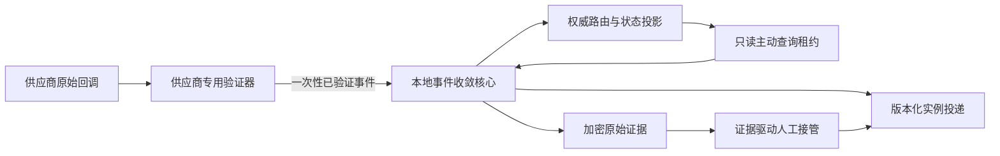

# 第十阶段回调对账与人工接管冻结设计

## 1. 范围与当前门禁

本文冻结 OpenSpec 任务`10.6.d`的安装环境内本地合规网关契约，覆盖供应商回调验证边界、实例路由、回调去重与乱序、主动查询、未知结果保护、版本化投递和证据驱动人工接管。

当前腾讯和诺诺生产商务门禁仍未完成，公开资料检索也未取得足以冻结两家精确回调签名字段与轮换规则的完整契约。因此本阶段不得开放生产回调 HTTP 路由，不得装配供应商客户端，也不得用自创的“通用签名”冒充腾讯或诺诺验签。供应商中立核心可以先完成，但只接受未来供应商专用验证器一次性产生的已验证事件。

## 2. 信任与数据流

- 验证器必须验证供应商应用身份、签名、供应商时间窗、事件类型和原始载荷完整性；普通调用方不能构造`VerifiedSupplierEvent`并跳过验证器。
- 验证器不得接受回调自报实例号、商家号或主体号作为路由决定。中立核心只从写尝试、业务请求、活动主体绑定和路由表派生实例归属。
- 验证器必须把原始载荷限制在 256 KiB 内，并只保留供应商契约明确参与验签的允许列表请求头；查询参数、表单重排或重新序列化后的 JSON 不能代替原始字节。
- 原始载荷、签名和允许列表头作为一个证据缓冲进入独立加密器，消费者返回后清零。数据库只保存密文、完整性摘要、密文版本和安全规范投影。

## 3. 路由与外部编号

- 每个供应商写尝试在取得首次写租约的同一事务创建一个唯一路由，路由永久绑定尝试号、业务请求号、安装实例、供应商和操作范围。
- 路由初始不要求外部对象号。同步写结果成功时绑定外部对象号；结果未知时保留当前安装的本地尝试号，等待主动查询或带有供应商签名覆盖的本地关联值回调。
- 外部对象号使用独立路由 HMAC 做精确唯一查询，并用独立 AES-GCM 密钥加密保存供供应商查询适配器在同步回调内使用。不得使用明文全表扫描或返回外部对象号给无关实例。
- 回调按两条路径之一定位：精确匹配既有“供应商 + 外部对象 HMAC”，或者以已被供应商签名覆盖的本地尝试关联值锁定唯一尝试并首次绑定外部对象。两条路径最终都必须核对供应商和操作范围。

## 4. 证据、去重和乱序

- 外部事件编号使用供应商隔离 HMAC，形成`provider + event_hmac`唯一围栏。事件编号原文只存在于加密证据，不进入普通投影。
- 相同外部事件编号、相同载荷摘要、相同路由和相同规范结果是精确恢复；改变任一字段返回冲突并保留原证据，不覆盖历史。
- 供应商时间只记录为证据，不作为数据库版本。本地路由版本在每次真实投影变化时单调递增；无变化的重复或陈旧事件仍可记录一次去重证据，但不生成新版本投递。
- `running`可以进入`succeeded`、`failed`或`result_unknown`；`result_unknown`可以由后续权威证据进入成功或失败；成功或失败不能被处理中事件倒退。成功与失败终态冲突时不采用最后到达结果，路由进入`reconciliation_required`并等待主动查询或人工接管。
- 回调证据、投影变化和版本化实例投递必须在同一 PostgreSQL 事务提交。实例投递不包含供应商原始字段，只包含路由号、业务请求号、规范状态、本地路由版本、证据摘要和数据库观察时间。

## 5. 主动查询

- 只有`running`、`result_unknown`和`reconciliation_required`路由可以进入只读查询队列。查询按 PostgreSQL 时间每批最多领取 50 条并使用`FOR UPDATE SKIP LOCKED`；单进程最多并发执行 4 条，启动时立即执行一批，此后空闲轮询间隔固定为 10 秒。
- 租约以路由号、当前状态、当前版本、256 位随机令牌和到期时间形成完整围栏，数据库只保存令牌摘要。租约固定 60 秒，单次供应商读取固定 50 秒超时，为本地证据事务保留 10 秒；租约过期可安全重领，因为执行器只能调用供应商精确查询，不能调用创建、签署、开票、红冲或其他写操作。
- 查询成功必须精确核对供应商、外部对象号或本地尝试关联值，并复用与回调相同的状态收敛事务。查询失败、超时、错对象或畸形响应只追加五类固定脱敏证据、释放租约并按 1、2、4、8、16、30 分钟退避，后续始终封顶 30 分钟，不能伪造成供应商终态。
- 没有足够外部查询键且供应商不支持按本地关联值查询时，路由保持`result_unknown`并进入人工复核候选，绝不自动重放原供应商写入。

## 6. 人工接管

- 人工接管只属于当前安装环境内、当前商家受权员工的独立权限，不是通用操作按钮。权威能力必须返回精确员工身份、最近五分钟完整登录、精确动作、数据范围和审计证据；软件提供方和平台操作者不能成为业务权威。
- 请求只接受路由号、最后读取版本、五类固定封闭原因码之一、一至十六条既有证据号和 256 位用途隔离操作键；权限固定为`idc:admin:compliance:route:manual-takeover`。不接受自由文本、供应商结果、外部对象覆盖、重试开关或成功/失败结论。
- 服务在同一事务锁定路由、集合验证证据归属与版本，追加不可变接管记录，把符合条件的路由和业务请求置为`manual_takeover`，使查询租约失效并追加版本化实例投递。
- 人工接管是封闭状态，只表示自动化停止并已交给受控处置，不表示合同或发票成功，也不能作为重新发送供应商写请求的依据。

## 7. 分步实施

1. `10.6.d.1`实现供应商专用验签/只读查询接口、缺客户端失败关闭、原始证据密封前置和当前商家员工接管策略骨架。
2. `10.6.d.2`实现 PostgreSQL 权威的限流、单一供应商写租约、持久熔断和未知结果禁止自动重发。
3. `10.6.d.3`实现一次性已验证事件边界、回调路由、去重、乱序和共用状态投影；具体供应商验证器未核实时保持生产入口关闭。
4. `10.6.d.4`实现有界只读查询领取、结果回报、封顶退避，以及当前商家受权员工的证据驱动人工接管。
