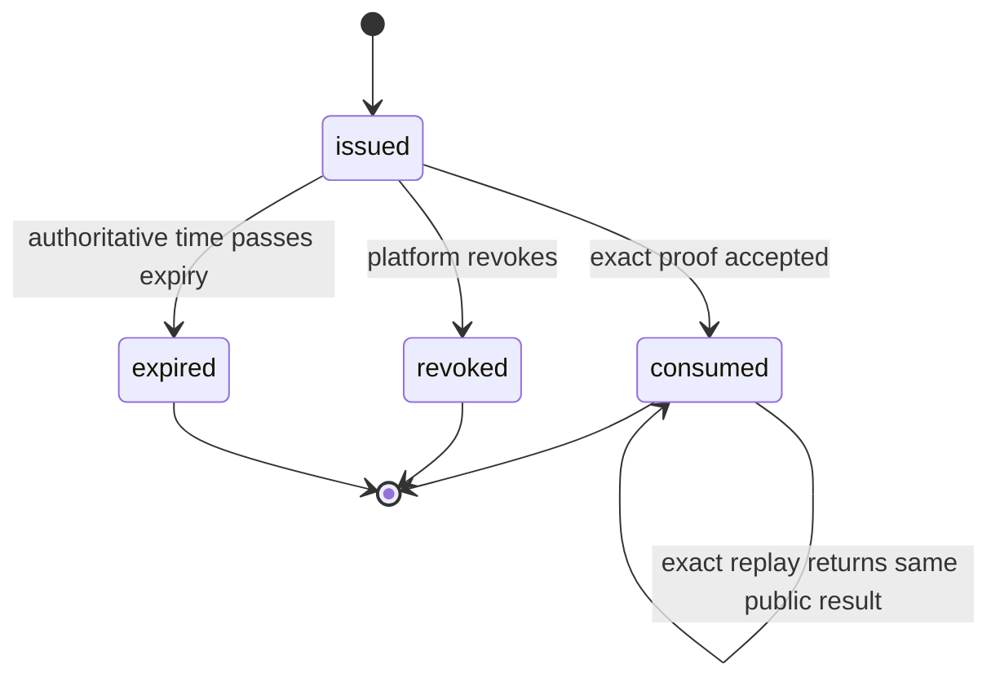

# 第十阶段中央合规网关身份协议

> 状态：本文件只保留历史技术验证证据。销售记录注册、远程实例身份和平台权威前提已被[完整独立交付边界纠偏记录](phase-10-independent-delivery-correction.md)废止；后续只能在安装期本地身份边界下复用通用密码学与幂等结论。

## 1. 范围

本文冻结任务`10.6`的注册、实例身份、密钥轮换、主体绑定和请求认证边界。回调路由、主动查询、熔断和人工接管继续使用同一身份模型，但分后续子任务实现。

当前协议不放行腾讯或诺诺调用，不依赖任务`10.4.b`的商务授权结果，也不把平台销售记录等同于尚未设计的商业授权码。

## 2. 信任边界

| 参与方 | 可以做什么 | 禁止做什么 |
|---|---|---|
| 平台销售系统 | 在已确认销售记录后请求签发一次性注册令牌 | 读取商家实例私钥、指定供应商主体或直接调用供应商 |
| 商家安装实例 | 本机生成`Ed25519`密钥，使用注册令牌提交公钥和持有证明，随后对请求签名 | 上传私钥、指定其他商家主体、绕过撤销或轮换状态 |
| 中央合规网关 | 校验销售绑定、令牌、签名和状态，保存公钥、摘要、主体密文和审计证据 | 把平台技术凭据、令牌原文或商家私钥返回给安装实例 |
| 供应商适配器 | 在能力门禁通过后接收中央服务注入的唯一主体编号 | 信任客户端提交的腾讯子企业或诺诺纳税主体编号 |

销售记录验证只通过平台侧受信能力注入注册服务，不开放任何令牌签发 HTTP 路由。中央服务只有在显式文件配置、数据库验证、迁移和 TLS 身份装配全部成功后才开放实例注册路由；供应商业务门禁仍未完成，因此整体就绪状态继续失败关闭。

## 3. 编号与密码学

- 平台销售系统为每次签发生成并持久化`256`位幂等操作键；中央服务使用独立 HMAC 域绑定销售记录和操作键，确定性派生`256`位注册令牌。首次和完全相同的签发重放返回同一令牌，操作键或请求内容变化则拒绝；令牌及操作键原文都不落库。
- 数据库只保存`HMAC-SHA-256`令牌摘要，摘要使用中央服务专用且可轮换的密钥；令牌原文不得进入数据库、日志、审计或错误消息。
- 安装实例使用`Ed25519`生成密钥。私钥只能存在于商家机器受保护的秘密存储中，中央服务只保存`32`字节公钥和`SHA-256`指纹。
- 商家插件必须为本机密钥和一次性注册令牌绑定两个不可互换的`secretcap`作用域；普通数据库只保存受保护句柄、服务端不可见恢复操作键、公开密钥/指纹和中央公开编号。公开`32`字节值以规范小写十六进制持久化，避免 ORM 二进制缓冲别名；秘密原文只允许在嵌套同步回调中短暂存在并在返回前清零。
- 注册持有证明使用版本化二进制长度前缀帧，固定域为`idc-compliance-gateway/enrollment/v1`，依次绑定令牌、公钥和至少`256`位客户端随机数，禁止依赖不稳定的`JSON`序列化。
- 注册请求摘要使用`SHA-256`计算完整规范帧。令牌已消费后，只有摘要、公钥和销售记录全部相同的请求可以返回原实例与密钥编号；任何不同请求都拒绝。
- 业务编号使用带领域前缀的随机不透明编号，不从数据库序号、销售记录、商家编号或供应商主体派生。

## 4. 注册状态机

注册事务必须锁定令牌行，并在同一事务中完成：

1. 核对令牌摘要、销售记录绑定、状态和数据库权威到期时间。
2. 验证`Ed25519`持有证明和请求摘要。
3. 创建唯一安装实例及第一代活动公钥。
4. 把令牌转为`consumed`并保存请求摘要。
5. 追加不含令牌、公钥原文或销售资料的身份事件。

任一步失败都整体回滚。超时或响应丢失后，客户端只能使用完全相同的令牌、密钥和随机数重放注册请求；不得生成新密钥盲目重试。

## 5. 轮换与撤销

- 每个活动实例最多有一把活动密钥，代次严格递增。
- 轮换操作使用`liop1_`前缀的`256`位随机幂等操作键。中央服务使用与注册令牌完全分离的 HMAC 密钥和固定域保存操作键摘要，不保存操作键原文；相同操作键改变任何请求内容必须拒绝。
- 轮换固定域为`idc-compliance-gateway/key-rotation/v1`，长度前缀帧依次绑定操作键、实例编号、当前密钥编号、当前代次、新公钥和`256`位随机数。当前活动密钥与新密钥必须分别对完全相同的帧签名，新旧公钥必须不同。
- 轮换服务先读取当前活动密钥验证双签名，再由 PostgreSQL 事务重新锁定并核对活动实例、当前密钥、代次和指纹。事务内先创建待激活新密钥，再退役旧密钥并激活新密钥，最后写入不可变操作和身份事件；任一步失败整体回滚。
- 轮换响应丢失后，只有相同操作键、帧和双签名可以恢复同一新密钥编号与代次；旧活动密钥、变更公钥或变更随机数不能发起第二次效果。
- 可配置短重叠窗口只能用于完成已经接受的精确请求或回调确认，不能授权新的业务写入。
- 实例撤销会同时撤销全部活动或待激活密钥、主体绑定和未完成注册令牌。撤销后查询不得泄露主体、额度或历史对象是否存在。
- 活动密钥不能被单独撤销而让活动实例失去身份；活动密钥泄露必须原子撤销整个实例。单独密钥撤销只允许待激活、已退役密钥，或在同一事务内随实例撤销执行。
- 泄露处置和管理员撤销必须通过注入的平台操作者权威能力核对精确动作、目标、近期完整登录和证据，只接受`credential_compromise`、`merchant_termination`、`sales_revocation`、`rotation_abandoned`、`provider_onboarding_approved`、`provider_revoked`、`subject_replaced`或`security_incident`中与动作匹配的封闭原因，不提供自由文本、强制成功或恢复已撤销身份。

## 6. 供应商主体强绑定

- 一个安装实例对每个供应商最多有一个活动主体绑定。
- 腾讯绑定使用不可变`ProxyOrganizationOpenId`；诺诺绑定使用经商务契约验证后的唯一纳税主体编号。
- 主体编号使用中央密钥加密保存，并使用用途隔离的`HMAC-SHA-256`摘要做精确唯一查询；普通日志、列表、用量清单和客户端令牌都不得包含主体原文。
- 主体加密密钥、主体查询 HMAC 密钥和身份操作 HMAC 密钥必须彼此独立。主体密文使用`AES-256-GCM`随机数和版本化 AAD，AAD 绑定实例、供应商、绑定编号和密文版本；查询摘要使用独立固定域绑定供应商和经权威来源确认的规范主体值。
- 客户端与普通管理请求都不能直接提交供应商主体原文。绑定服务只消费平台开通权威能力返回的供应商、规范主体缓冲、操作者、近期完整登录证明和证据摘要；原文只允许在同步加密回调中短暂存在并在返回前清零。
- 客户端业务请求不接受供应商主体字段。中央服务只根据已认证实例加载活动绑定并注入供应商适配器。
- 主体更换不能覆盖历史绑定。旧绑定进入撤销状态，新绑定必须通过独立重新开通和人工复核流程创建。

## 7. 耐久数据模型

中央服务独占以下 PostgreSQL 数据：

| 数据 | 关键不变量 |
|---|---|
| 注册令牌 | 销售记录和商家绑定、签发操作键 HMAC 与请求摘要唯一、短期有效、原文不落库、签发和注册分别精确重放 |
| 安装实例 | 一个销售记录只对应一个耐久实例身份，显式活动或撤销状态 |
| 实例密钥 | 每实例代次唯一、全局公钥指纹唯一、每实例最多一把活动密钥 |
| 主体绑定 | 每实例和供应商最多一个活动绑定，主体密文与用途隔离查询摘要分离 |
| 身份事件 | 只追加、不更新、不删除，只保存封闭事件码、操作者类型和证据摘要 |
| 身份操作 | 保存用途隔离操作键 HMAC、完整请求摘要、公开结果、封闭动作/原因、操作者和证据摘要；严格不可更新或删除 |

上述记录都使用显式生命周期状态，不使用软删除，也禁止普通物理删除。时间统一使用`timestamptz`和数据库权威时间。

## 8. 后续请求认证

注册完成后的业务请求使用协议版本`lrp1`和确定性长度前缀签名帧。签名帧依次绑定协议版本、实例编号、当前密钥编号、操作范围、标准大写 HTTP 方法、规范路径、规范查询、真实载荷`SHA-256`、签发毫秒时间、到期毫秒时间、256 位随机数和以`lbi1_`开头的 256 位业务幂等键；安装实例使用当前`Ed25519`私钥签名，中央服务只使用数据库中该实例的当前活动公钥验签。

签名时间窗必须为正且不超过两分钟。中央服务以同一事务读取的 PostgreSQL 权威时间校验到期时间和最多三十秒未来偏差，不信任应用进程或客户端时钟决定是否过期。业务请求体最多 1 MiB；载荷摘要必须由收到的原始字节计算，不能信任客户端单独声明。路径必须是无转义、无重复分隔符、无点段且位于`/v1/`的绝对路径；查询最多 32 个唯一键和 1 KiB，按 UTF-8、稳定键序及标准转义规范化。路由必须把服务端预期操作范围传给认证器核对，不能只信任请求头中的范围。

每个通过验签的传输随机数保存`SHA-256`、签名帧摘要、实例、密钥、业务请求号、到期时间和清理时间。同一实例重复使用随机数时，只有完全相同的签名帧和同一业务请求可以恢复；改变任一字段都按重放冲突拒绝。随机数原文不落库，过期至少 24 小时后才允许由有界清理作业删除。

业务幂等键使用与注册令牌、身份操作和主体查重都不同的 HMAC 密钥与用途域。业务内容摘要绑定协议、实例、操作范围、方法、路径、查询和载荷，但有意排除密钥代次、时间、随机数和签名，使合法客户端在响应丢失或密钥轮换后可用同一幂等键和新签名恢复原业务请求。一个实例内同一幂等键只能对应一个内容摘要；改变范围或内容必须返回冲突，不能创建第二个供应商效果。

数据库模型同时预留两层持久限流窗口和供应商写熔断状态：实例维度与操作维度必须在业务处理前同事务计数；具体窗口、上限和策略版本由部署权威配置注入，不在代码中猜测生产额度。供应商写熔断按供应商和操作范围维护`closed/open/half_open`、修订号、开放截止时间和唯一探测尝试；每个真实供应商写尝试必须先取得不可重放尝试号，再以`succeeded/definitive_failure/result_unknown`之一观察一次。本地认证、权限、额度或构造失败不能冒充供应商故障样本。

任务`10.6.d.1`只冻结并验证上述公开签名协议及数据库不变量，不开放注册之外的业务 HTTP 路由。请求认证、防重放与限流服务由`10.6.d.2`实现，供应商写熔断由`10.6.d.3`实现。当前实例注册仍固定为`POST /v1/instance-registrations`，请求体最大`2048`字节；中央运行时要求 TLS 1.3、文件化数据库 DSN、HMAC 密钥和 TLS 身份。销售令牌签发仍只存在于平台销售权威能力边界，不存在公共 HTTP 路由。

## 9. 回调、主动查询与人工接管

任务`10.6.e`采用供应商专用入口适配器与供应商中立状态核心两层边界。入口适配器必须用收到的原始字节、原始允许列表请求头和供应商固定算法完成签名、时间窗、事件类型及应用身份验证，再通过只能调用一次的同步生产者交付`VerifiedSupplierEvent`；中立核心不接受普通 JSON、自报实例号、自报主体号或“已验签”布尔值。腾讯与诺诺的精确公开验签字段、算法、证书或密钥轮换规则未取得可验证契约前，生产回调路由保持不存在，不得用通用 HMAC 猜测替代。

每个真实写尝试在租约事务内同时创建唯一供应商路由。路由先只绑定中央尝试号；同步响应或已验证回调提供外部对象号后，使用独立路由 HMAC 与加密密文绑定。回调只能通过已经存在的外部对象绑定，或通过被供应商签名覆盖的中央尝试关联值定位路由；实例号、业务请求号和商家归属始终从 PostgreSQL 权威关系派生，禁止从回调请求直接选择。

外部事件编号以供应商隔离 HMAC 去重。相同事件编号只有供应商、路由、原始载荷摘要和规范结果完全一致时才是精确恢复，改变任一内容均冲突。原始回调与主动查询证据使用独立`AES-256-GCM`密钥加密，AAD 绑定证据号、路由、供应商、来源和密文版本；普通表、日志、错误、实例投递和`AI`不得包含原始载荷、签名、主体或平台技术凭据。

所有已验证事实都先追加不可变证据，再由同一事务推进路由投影和实例投递。供应商时间只作为证据，不能覆盖中央版本：处理中事件不能让成功或失败终态倒退；结果未知可被后续权威成功或确定失败收敛；相互冲突的终态保留证据并进入主动查询，不选择“最后到达者获胜”。实例投递使用中央数据库生成的单调路由版本，相同版本和证据只能投递一次。

主动查询是可安全重领的只读租约，只允许处理`running`、`result_unknown`或终态冲突路由。领取和回报使用 PostgreSQL 时间、路线号、状态、随机令牌、版本及有效期完整围栏；查询错误只追加脱敏失败证据并延后，不调用供应商写接口、不生成成功或失败结论。查询结果必须精确匹配供应商、外部对象或被签名关联的中央尝试，否则按冲突证据处理。

人工接管只允许平台操作者权威能力授权，并要求近期完整认证、精确动作和数据范围、调用方最后读取的路由版本、封闭原因码及一至十六条属于该路由的不可变证据。接管事务只能把未终结、结果未知或冲突路由置为`manual_takeover`，关闭查询租约并追加版本化投递；不得接受自由文本、供应商状态、结果引用、重试参数或强制成功/失败结论，也不得调用供应商。
